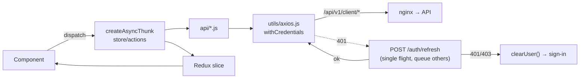

# Portal (`nextcybr-portal`)

The portal is the whole product for visitors, candidates, recruiters and mentors: marketing site, auth, onboarding and the signed-in app. It's built on **Next.js 16** (App Router, Turbopack) and **React 19**.

:::caution Next.js version
This Next.js version has breaking changes from older releases. Before changing framework-level code, read the guides in `node_modules/next/dist/docs/` (see `AGENTS.md` in the repo).
:::

## Directory layout

```text
nextcybr-portal/
├── app/
│   ├── (static)/          Public site: home, about, for-*, legal, blogs, auth, public-profile
│   ├── (protected)/       Signed-in app (layout.js wraps sidebar, sockets, guards)
│   ├── onboarding/[id]/   Role onboarding wizard
│   ├── layout.js · page.js · globals.css · fonts/ (Inter, Poppins, self-hosted)
├── middleware.js          Edge auth redirect (see below)
├── constants/             routeAccess.js (public paths), imagePaths, selectionOptions
├── components/            Feature UI: navigation/SideBar, onBoarding, aIResumeBuillder, chat,
│                          interview, mentor, recruiter, candidates, jobs, settings, ticketSupport, …
├── api/                   Axios call wrappers per domain (authApi, jobApi, mentorApi, …)
├── services/              Older call wrappers (being merged into api/)
├── store/                 Redux Toolkit: slices/ + actions/ (createAsyncThunk)
├── hooks/                 useAiCredits, useFeatureLimit, useNotifications, …
├── utils/                 axios.js, socket.js, bookingRules, sessionTime, generateInvoicePDF, …
├── wrapper/               ReduxWrapper, app Wrapper
└── tests/                 Vitest unit tests
```

## Routing & access control

- `(static)` and `(protected)` are **route groups** and don't appear in the URL. See the full list in [Frontend route maps](/reference/frontend-routes).
- **Edge middleware** (`middleware.js`) runs on every non-asset path:
  - A request with no auth cookie (`accessToken`, `refreshToken` or legacy `token`) to a non-public path is redirected to `/auth/sign-in?returnUrl=<path>`.
  - A signed-in user on an auth-only page is sent to `/dashboard`.
  - Public paths and prefixes are defined in `constants/routeAccess.js`.
- **In-app guards** in the protected layout handle what the edge can't know: onboarding not finished → `/onboarding/[id]`, unapproved recruiter or mentor → `VerificationPendingPage`.
- The **sidebar** (`components/navigation/SideBar.js`) builds a different menu per role. See [Personas](/getting-started/personas).

## Data layer



- `utils/axios.js` uses `baseURL = NEXT_PUBLIC_API_URL` (`/api/v1/client`). On a 401 it runs **one** refresh while queuing other failed requests, retries them, and clears the user only if the refresh itself returns 401/403. A 5xx on refresh keeps the session.
- Server components use `utils/serverApiUrl.js`, which prefers the absolute `BACKEND_API_URL`.

## Real time, video & payments

| Concern | Implementation |
| --- | --- |
| Chat, presence, live notifications | `utils/socket.js` (`socket.io-client`, cookie auth) → [Real-time](/backend/realtime) |
| Video (1:1 sessions, webinars, interviews) | `agora-rtc-sdk-ng`. Tokens come from the join/start endpoints. Pages: `/mentor/join-session/[id]`, `/mentor/start-webinar/[id]`, `/mentor/join-webinar/[id]`, `/interview/[id]` |
| Plan checkout | Redirect to Stripe Checkout, then return to `/payments/success/[id]` or `/payments/cancel` |
| Booking payments | Stripe Elements (`@stripe/react-stripe-js`) confirming the PaymentIntent `clientSecret` from the booking endpoint |
| Invoices | Client-side PDF (`utils/generateInvoicePDF.js`) |
| Rich text | Tiptap / Quill editors and viewers. HTML is sanitised with DOMPurify (`SanitizedHTML`). |

## Plan-aware UI

`hooks/useFeatureLimit.js` and `useAiCredits.js` read `GET /{role}/entitlements/me` and the AI token endpoints so the UI can show locked states, remaining quotas (`AITokensCard`, `RecruiterAiUsageCard`) and upgrade prompts. The server still enforces every limit. The UI only mirrors them.

## Scripts

| Script | Does |
| --- | --- |
| `npm run dev` | `next dev --turbopack` |
| `npm run build` / `start` | Production build and serve |
| `npm run check` | Prettier check + ESLint |
| `npm test` | Vitest |
