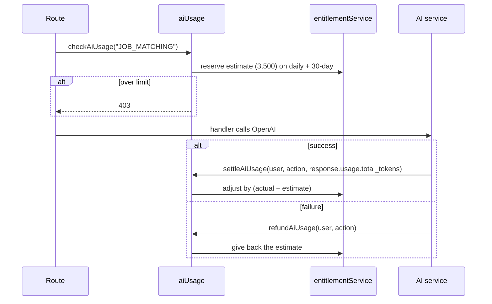

# AI services & usage

## Providers

All live AI features call **OpenAI** through the official SDK. The model is set by `OPENAI_MODEL` (default **`gpt-4o-mini`**) and output size by `OPENAI_MAX_TOKENS`. Responses are requested as JSON and parsed defensively (`utils/extractMatchingJSON.js`).

| Service | Used by |
| --- | --- |
| `aiCoachService.js` | [Cyber Coach](/features/cyber-coach): sessions, quizzes, exams, flashcards, scenarios, logs, labs, assessments, interview prep, grading, safety routing |
| `resumeBuilderByAIService.js` | [CV builder](/features/resume-builder): generate, upload-parse (PDF text extraction), enhance, assess |
| `aiCareerPathService.js` | [Roadmaps](/features/career-roadmaps): generation, persistence, comparison |
| `aiJobMatchingService.js` | AI job search |
| `aiMentorMatchingService.js` | AI mentor match |
| `aiCandidateSuggestionsService.js` | Recruiter AI match runs and candidate search, mentor mentee search |

:::note Other provider SDKs
`@google/genai` (Gemini), `@aws-sdk/client-bedrock-runtime` and `OPENROUTER_API_KEY` are installed and configured in env, but no current feature path depends on them.
:::

## The AI token ledger

Each audience has two token allowances, enforced together: a **daily** allowance and a **rolling 30-day** allowance (`AI_TOKENS_DAILY[_MENTOR|_COMPANY]`, `AI_TOKENS_MONTHLY[_…]`). Recruiter UIs show remaining searches and match runs rather than raw token counts.

### Estimated cost per action

| Action | Estimate | Action | Estimate |
| --- | --: | --- | --: |
| `RESUME_GENERATE` | 3,000 | `COACH_SESSION` | 3,000 |
| `RESUME_ENHANCE` | 2,000 | `COACH_QUIZ` | 2,500 |
| `CV_ASSESSMENT` | 2,500 | `COACH_MOCK_EXAM` | 4,000 |
| `CAREER_PATH` | 4,000 | `COACH_FLASHCARDS` | 2,000 |
| `JOB_MATCHING` | 3,500 | `COACH_SCENARIO` | 3,000 |
| `MENTOR_MATCHING` | 3,500 | `COACH_LOG_ANALYSIS` | 3,500 |
| `CANDIDATE_SUGGESTION` | 3,500 | `COACH_SAFE_LAB` | 3,000 |
| `COMPANY_CANDIDATE_SEARCH` | 3,500 | `COACH_ASSESSMENT` | 2,500 |
| `MENTOR_CANDIDATE_SEARCH` | 3,500 | `COACH_INTERVIEW` | 2,500 |
| `CUSTOM_PROMPT` | 2,000 (record only) | `COACH_GRADE` | 2,000 |

Reserving up front closes the race the older two-step check-then-deduct had. The estimates are content constants in `middlewares/aiUsage.js`, not plan policy.

## Business-action quotas on top of tokens

Most AI routes also use a per-action quota through `requireAndConsume` (e.g. `CV_GENERATION_MONTHLY`, `AI_JOB_SEARCH_MONTHLY`, `COMPANY_AI_MATCH_RUNS_DAILY`), and the Coach uses its own interaction allowance. A request has to pass **both** the action quota and the token reservation, and a failure refunds both.

## Reading usage

`GET /client/get-ai-tokens` and `GET /client/get-ai-credits` return the caller's remaining allowance for the usage cards. `GET /student/usage-summary` returns every quota.
