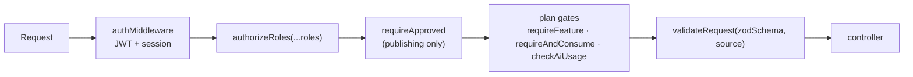

# Auth & security

The user-facing flows are in [Authentication & sessions](/features/authentication). This page covers how the server enforces them.

## Middleware chain

| Middleware | File | Fails with |
| --- | --- | --- |
| `authMiddleware` | `middlewares/auth.js` | 401: missing/invalid/expired token, blacklisted token, revoked/expired/foreign session |
| `authorizeRoles(...)` | `middlewares/auth.js` | 403: role not allowed (dev mode lists allowed and received roles) |
| `requireApproved` | `middlewares/auth.js` | 403: account pending admin approval |
| `requireFeature` / `requireAndConsume` | `services/entitlementService.js` | 403: feature not on plan / limit reached |
| `checkAiUsage` | `middlewares/aiUsage.js` | 403: AI token allowance exhausted |
| `validateRequest(schema, "body"\|"query"\|"params")` | `middlewares/validateRequest.js` | 400 with `errors[]` |

## Tokens

- **Access JWT**: HS256, `ACCESS_TOKEN_SECRET`, 15 minutes, payload `{ id, role, sessionId }`.
- **Refresh JWT**: `REFRESH_TOKEN_SECRET`, 7 days, stored on `LoginSession.refreshToken`, rotated on every refresh, with a 60-second reuse grace through `previousRefreshToken`.
- **Cookies** (`utils/cookieOptions.js`): httpOnly, `secure` in production. Portal: `refreshToken` cookie **6 hours** (re-issued on every refresh, so it slides) and `accessToken` cookie 15 minutes. Admin portal: refresh cookie 7 days.
- **Revocation**: logout puts the access token on a Redis blacklist (`bl_<token>`) and marks the `LoginSession` revoked. `sessionCache.js` caches sessions in Redis and invalidates on every session write, so revocation is immediate.
- Socket.io connections run the same session checks on the handshake cookie.

## Transport & headers

| Control | Setting |
| --- | --- |
| Helmet | Default headers. `x-powered-by` disabled. |
| CORS | Allow-list from `utils/allowedOrigins.js` (`CLIENT_URL`, `ADMIN_URL`, `PORTAL_URL`), `credentials: true` |
| Global rate limit | 200 requests / minute / IP (`express-rate-limit`). `trust proxy` is on in production so nginx's client IP is used. |
| Per-user limiters | `perUserLimiter` keyed by user id (falls back to IP): webinar register 10/min, cancel 10/min, join/attend/leave 30/min |
| Body limits | JSON and urlencoded 1 MB. File uploads 10 MB (`express-fileupload`, abort on limit). |
| Media | `/api/v1/media` sets `Cross-Origin-Resource-Policy: same-site` |

## Input & output safety

- **Strict bodies**: auth handlers reject unknown fields. Zod schemas live in `*.schema.js` and `src/validations/`.
- **HTML**: user-supplied HTML that goes into emails is escaped (`utils/escapeHtml.js`). Rich text is sanitised on render by the frontends (DOMPurify).
- **Errors**: production responses never include stack traces or Prisma query text (see [Errors & validation](./errors-validation)).
- **Privacy**: `utils/studentPrivacy.js` strips fields from candidate data shown to others according to visibility and anonymity.
- **Passwords**: bcrypt, cost 12.

