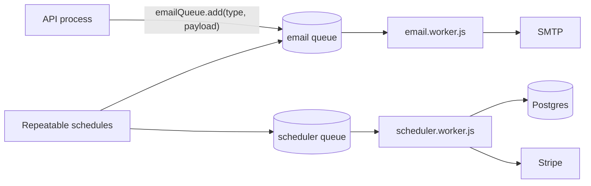

# Background jobs

Asynchronous work runs on **BullMQ** over Redis, processed by a separate **worker** process (`worker.js`, pm2 app `nextcybr-worker`).

:::warning Run the worker
`npm run dev` / `npm start` alone **do not** process jobs, so emails and sweeps pile up in Redis. Run `npm run worker` too, or set `ENABLE_INLINE_WORKERS=true` locally.
:::

## Scheduler jobs

Repeatable jobs are registered when the scheduler worker starts (cron patterns, server time).

| Job | Schedule | Does |
| --- | --- | --- |
| `mark-missed-interviews` | every 15 min | `SCHEDULED` interviews past their window → `NO_SHOW` and notify the candidate |
| `send-upcoming-reminders` | every 5 min | Session and webinar reminders inside the lead window (`SESSION_REMINDER`, `WEBINAR_REMINDER`) |
| `mark-no-show-sessions` | every 15 min | Settles elapsed 1:1 sessions from who joined: `COMPLETED` / `NO_SHOW` (mentor credited) / mentor absent (cancelled + refunded) |
| `expire-unpaid-bookings` | every 2 min | Unpaid `PENDING` sessions and registrations past `PENDING_HOLD_MINUTES` → `EXPIRED`, freeing slots and seats |
| `reconcile-webinars` | every 5 min | Completes stuck `LIVE` webinars (marks `ATTENDED`/`ABSENT`, credits the mentor), cancels and refunds never-started ones, retries failed refunds |
| `run-weekly-payout-batch` | Mondays 00:00 | [Mentor payout batch](/features/mentor-payouts#3-weekly-batch) |
| `reconcile-processing-payouts` | hourly at :15 | Resolves payouts stuck in `PROCESSING` against Stripe |

## Email jobs

Scheduled email jobs:

| Job | Schedule | Does |
| --- | --- | --- |
| `weekly-summary` | Sundays 00:00 | Weekly activity summary to candidates. Failures are logged per recipient, not retried, so nobody gets it twice. |
| `job-alert-digest` | daily 08:00 | Matching new jobs, sent on each candidate's `JOB_ALERT_FREQUENCY_DAYS` cadence when `jobAlerts` is on |

Event emails are queued by the API as `emailQueue.add("sendEmail", { type, payload })`:

| Area | Types |
| --- | --- |
| Account | `USER_SIGNUP`, `LOGIN_ALERT`, `ACCOUNT_APPROVED`, `ACCOUNT_REJECTED`, `ACCOUNT_DEACTIVATED`, `WAITLIST_WELCOME` |
| Jobs | `JOB_POSTED`, `CANDIDATE_SHORTLISTED`, `APPLICATION_STATUS_CHANGED`, `INTERVIEW_SCHEDULED`, `INTERVIEW_CANCELLED` |
| Mentorship | `SESSION_BOOKED`, `SESSION_CONFIRMED`, `SESSION_CANCELLED`, `SESSION_RESCHEDULED`, `SESSION_REMINDER`, `SESSION_REQUEST`, `SESSION_REVIEW_SUBMITTED`, `WAITLIST_SLOT_AVAILABLE`, `WEBINAR_REGISTERED`, `WEBINAR_CANCELLED`, `WEBINAR_REMINDER` |
| Money | `PAYMENT_EVENT`, `PAYOUT_RECEIPT`, `ADMIN_ALERT` |
| Digests | `WEEKLY_SUMMARY`, `JOB_ALERT_DIGEST` |

Templates live in `src/templates/templates.js`. Delivery is via Nodemailer with Titan SMTP (`USE_TITAN_EMAIL_SERVICE`, `TITAN_EMAIL_*`) or the generic `NODE_MAILER_*` account. Email links point at `nextcybr.ai` on purpose.

## Operating the queues

- Queue definitions: `src/queues/email.queue.js`, `src/queues/scheduler.queue.js`.
- Repeatable job names are stable, so registrations carry over across deploys.
- Each scheduled sweep handles items in their own `try/catch`, so one bad record can't block the rest.
- Production: `pm2 logs nextcybr-worker` (see [Deployment](/operations/deployment)).
