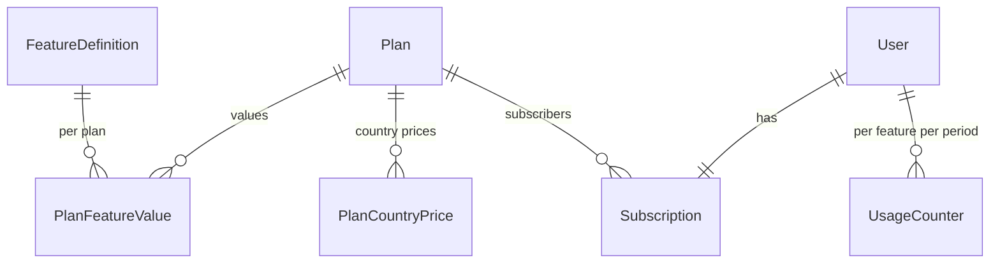
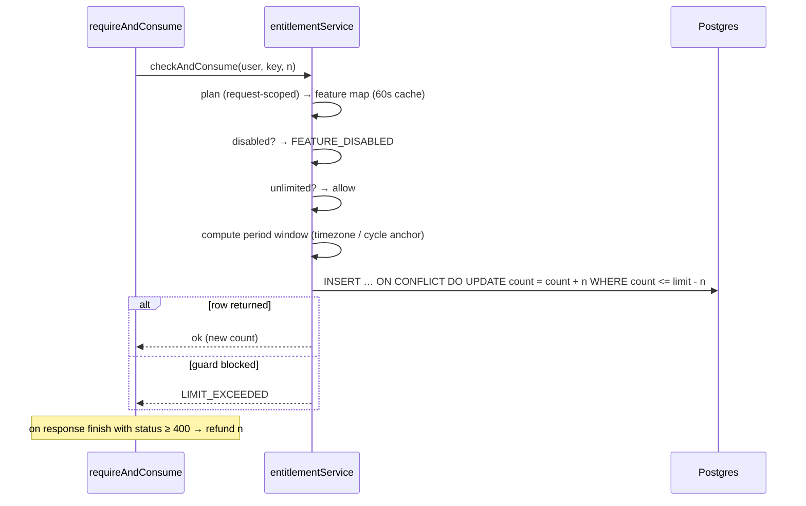

# Plans & entitlements engine

Every plan limit and feature toggle goes through **`services/entitlementService.js`**. Limits live in the database and admins edit them at runtime, so no limit is hardcoded.

## Data model

| Model | Holds |
| --- | --- |
| `Plan` | `key` + `userType` (unique), `tierRank`, prices, Stripe price env names, `scope` (`GLOBAL` or `ORG` custom plans) |
| `FeatureDefinition` | `key`, `type` (`BOOLEAN` / `NUMERIC`), `resetPeriod`, `appliesTo`, category, description |
| `PlanFeatureValue` | For one plan × feature: `enabled`, `limitValue`, `isUnlimited` |
| `UsageCounter` | `userId` × `featureKey` × period window → `count` |

Seeded by `prisma/seedEntitlementSystem.js` (idempotent upserts). Current defaults: [Plans & feature matrix](/reference/plans).

## Three kinds of feature

| Kind | `type` / `resetPeriod` | Enforced by | Example |
| --- | --- | --- | --- |
| **Toggle** | `BOOLEAN` | `requireFeature(key)` or `isFeatureEnabled()` | `COMPANY_JOB_TEMPLATES` |
| **Consumption** (quota) | `NUMERIC`, `DAILY` / `SEVEN_DAY_ROLLING` / `THIRTY_DAY_ROLLING` / `MONTHLY_CALENDAR` / `BILLING_CYCLE` | `requireAndConsume(key, amount)` or `checkAndConsume()` | `CV_GENERATION_MONTHLY` |
| **Capacity** | `NUMERIC`, `NONE` | Caller counts live rows and compares with `getEntitlement().limitValue` | `COMPANY_ACTIVE_JOB_POSTINGS` |

**A missing `PlanFeatureValue` means disabled, not unlimited.** If a user has no plan, the Free plan for their role is used.

## Resolving and consuming

- **Atomic.** The counter is created or incremented in a single SQL statement guarded by `count <= limit - amount`, so concurrent requests at the boundary can't both succeed.
- **Periods.** `DAILY` uses the user's IANA `timezone` (captured at sign-up). Rolling windows and `BILLING_CYCLE` are anchored to when the user's current window opened (or the subscription renewal date) rather than calendar boundaries. `MONTHLY_CALENDAR` follows calendar months.
- **Refunds.** `requireAndConsume` registers a refund that runs if the response finishes with status ≥ 400, so users pay only for actions that worked. Streaming handlers that fail after sending 200 call `refundConsumption(res)` themselves.
- **Errors.** `EntitlementError` codes are `FEATURE_DISABLED`, `LIMIT_EXCEEDED` and `NO_PLAN`. Middleware turns them into a **403** with an upgrade message, or a route-specific `limitMessage`.

## Caching

| Cache | Scope | TTL | Invalidation |
| --- | --- | --- | --- |
| Plan → feature map | per process, keyed by `planId` | 60 s | `invalidatePlanCache(planId)` after admin edits |
| Free-plan-by-role | per process | 60 s | `invalidatePlanCache()` |
| Request scope | one request (`AsyncLocalStorage`, `entitlementRequestScope`) | request | cleared when the plan cache is invalidated mid-request |

Admin edits apply immediately on the instance that handled them. Other cluster workers catch up within 60 seconds, a delay that's accepted for business limits.

## Read APIs for the UI

| Function | Exposed as |
| --- | --- |
| `getUsageSummary(userId)` | `GET /student/usage-summary`, part of `entitlements/me` |
| `getBooleanFeatureSummary(userId)` | part of `GET /{role}/entitlements/me` |
| `getUserIdsWithFeature(ids, key)` | Bulk checks (e.g. which mentors get a directory boost) |

## Adding a new gated feature

1. Add a `FeatureDefinition` entry (and default `VALUES`) in `seedEntitlementSystem.js` and run it, or create it in **Admin → Entitlements → Feature definitions**.
2. Gate the route: `requireFeature("KEY")` for a toggle, `requireAndConsume("KEY")` for a quota, or count rows and call `getEntitlement()` for a capacity limit.
3. Mirror it in the UI with `useFeatureLimit` so users see a locked state instead of an error.
4. Run `npm run sync` in this docs project so the plan matrix and API reference pick it up.
