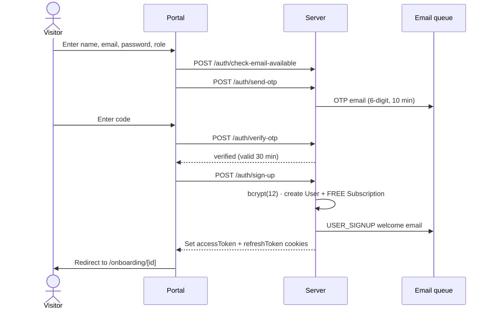
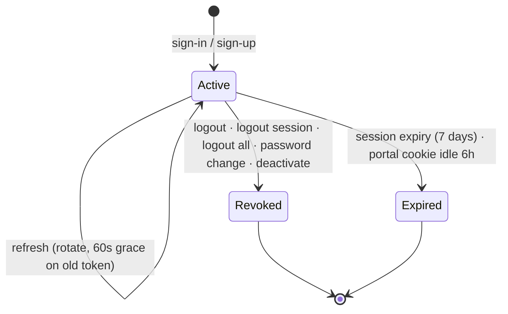

# Authentication & sessions

Portal users sign up with a verified email, then sign in with a password, Google or LinkedIn. Every sign-in creates a revocable **login session**. Access is a short-lived JWT, renewed with a rotating refresh token.

<FeatureMeta
  roles={["STUDENT", "COMPANY", "MENTOR", "ADMIN"]}
  portal={<><code>/auth/sign-up</code> · <code>/auth/sign-in</code> · <code>/auth/forgot-password</code> · <code>/auth/reset-password/[token]</code> · Settings → Security</>}
  admin={<><code>/signin</code></>}
  server={<><code>src/modules/auth</code> · <code>src/modules/adminAuth</code> · <code>src/middlewares/auth.js</code> · <code>src/utils/tokenGenerator.js</code></>}
  models={<><code>User</code> · <code>Admin</code> · <code>LoginSession</code> · <code>EmailOtp</code></>}
/>

## Sign-up

Rules enforced by the server:

- **OTP first.** `sign-up` fails unless the email completed `verify-otp` in the last **30 minutes**. The verification is used up on success.
- **OTP limits.** Codes last **10 minutes**. **5** wrong guesses lock the email for **15 minutes**, and resends have a wait period.
- **Strict body.** Only `firstName`, `lastName`, `email`, `password`, `role`, plus an optional browser `timezone` (used for daily quota resets). Unknown fields are rejected.
- **Role and approval.** `STUDENT` accounts are approved immediately. `COMPANY` and `MENTOR` accounts start unapproved (see [approvals](./onboarding-approvals)).
- **Plan.** Every new user gets a `Subscription` on the Free plan.

## Sign-in options

| Method | Endpoint | Notes |
| --- | --- | --- |
| Email + password | `POST /api/v1/client/auth/sign-in` | Body `{ email, password, role }`. A role mismatch returns a "registered as …" error. Deactivated or deleted accounts are refused. |
| Google | `POST /api/v1/client/auth/google` | Verifies the Google ID token (`google-auth-library`, `GOOGLE_CLIENT_ID`). |
| LinkedIn | `POST /api/v1/client/auth/linkedin/callback` | Exchanges the OAuth code using `LINKEDIN_*` env vars. Portal callback page: `LinkedInCallback`. |
| Admin | `POST /api/v1/admin/auth/sign-in` | Separate `Admin` table. Admin accounts are provisioned by the team. |

A new-device sign-in queues a `LOGIN_ALERT` email.

## Tokens & cookies

| Token | Lifetime | Where |
| --- | --- | --- |
| Access token (JWT, HS256) | **15 min** | `accessToken` httpOnly cookie, or `Authorization: Bearer` |
| Refresh token (JWT) | JWT and session valid **7 days**. The portal cookie lasts **6 hours** and is re-issued on each refresh, so a portal session ends after about 6 idle hours. | `refreshToken` httpOnly cookie, stored on `LoginSession.refreshToken` |

Each access token carries `{ id, role, sessionId }`. On every request, [`authMiddleware`](/backend/auth-security):

1. verifies the JWT,
2. checks the Redis blacklist (`bl_<token>`) and the cached session together in one round trip,
3. rejects the request if the session is missing, revoked, expired, or belongs to someone else,
4. refreshes `lastActive` at most every 5 minutes, without blocking the request.

### Refresh rotation

`POST /auth/refresh` rotates the refresh token every time. The previous token stays valid for a **60-second grace window** (`previousRefreshToken`), so parallel tabs refreshing at the same moment don't log each other out. An unknown token, or one outside the grace window, clears both cookies.

## Device sessions

Settings shows every active `LoginSession` (device, IP, last active).

| Action | Endpoint |
| --- | --- |
| List sessions | `GET /api/v1/client/auth/sessions` |
| Sign out one device | `DELETE /api/v1/client/auth/sessions/logout` |
| Sign out everywhere | `POST /api/v1/client/auth/sessions/logout-all` |
| Change password | `POST /api/v1/client/auth/change-password` |

Revocation takes effect immediately: the session cache is invalidated on every `LoginSession` write, so a revoked access token stops working before its 15 minutes are up.

## Password reset

`POST /auth/forgot-password` emails a reset link (`/auth/reset-password/[token]`). `POST /auth/reset-password/:token` sets the new password.

## Portal behaviour

- `middleware.js` treats a request as signed in if any auth cookie is present. Signed-out visitors to protected routes go to `/auth/sign-in?returnUrl=…`, and signed-in users visiting auth pages go to `/dashboard`.
- The Axios layer retries once after `POST /auth/refresh` on a 401, then logs out.

**API:** [Client auth](/reference/api/client-auth) · [Admin auth](/reference/api/admin-auth)
