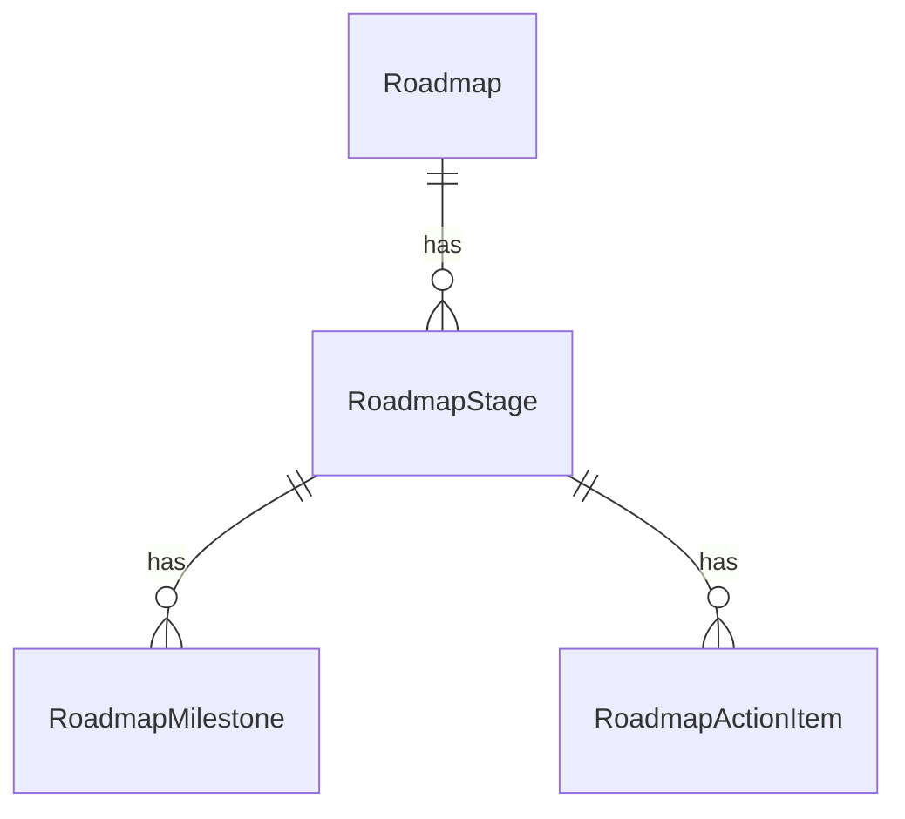

# Career roadmaps

The **Personalized Roadmap** turns a candidate's profile and target role into a staged plan of milestones and action items. The candidate ticks items off and progress rolls up to the dashboard.

<FeatureMeta
  roles={["STUDENT"]}
  tags={["AI"]}
  portal={<><code>/roadmap</code> · dashboard progress widgets</>}
  server={<><code>modules/job/job.controller.js</code> (<code>getCareerPath</code>) · <code>modules/student/roadmap.controller.js</code> · <code>services/aiCareerPathService.js</code></>}
  models={<><code>Roadmap</code> · <code>RoadmapStage</code> · <code>RoadmapMilestone</code> · <code>RoadmapActionItem</code> · enum <code>RoadmapItemStatus</code></>}
  plan={<><code>ROADMAP_GENERATIONS_MONTHLY</code> · <code>ROADMAP_ACTIVE_SCENARIOS</code> · <code>ROADMAP_HISTORY_MAX</code> · <code>ROADMAP_CAREER_PATH_COMPARISON</code></>}
/>

## Structure

## Behaviour

| Action | Endpoint | Rules |
| --- | --- | --- |
| Generate | `POST /student/get-career-path` | `ROADMAP_GENERATIONS_MONTHLY` (Free 1/month) + AI tokens `CAREER_PATH`. Saved as the active roadmap; the previous one moves to history. |
| Active roadmap(s) | `GET /student/roadmap/active` | Always returned. Pro Plus can keep several active **scenarios** (`ROADMAP_ACTIVE_SCENARIOS`). |
| History | `GET /student/roadmap/history` | `ROADMAP_HISTORY_MAX`: none on Free, limited on Pro, extended on Pro Plus. Nothing is deleted. Older roadmaps reappear after an upgrade, and `hiddenCount` lets the UI say how many are hidden. |
| Mark progress | `PATCH /student/roadmap/:type/:id/status` | Milestones and action items only, on **active** roadmaps (history is read-only). Ownership-checked. Completion is self-reported. |
| Compare paths | `POST /student/roadmap/compare` | Pro Plus (`ROADMAP_CAREER_PATH_COMPARISON`). A side-by-side what-if that isn't saved. |

**API:** [Student](/reference/api/student) (roadmap routes)
