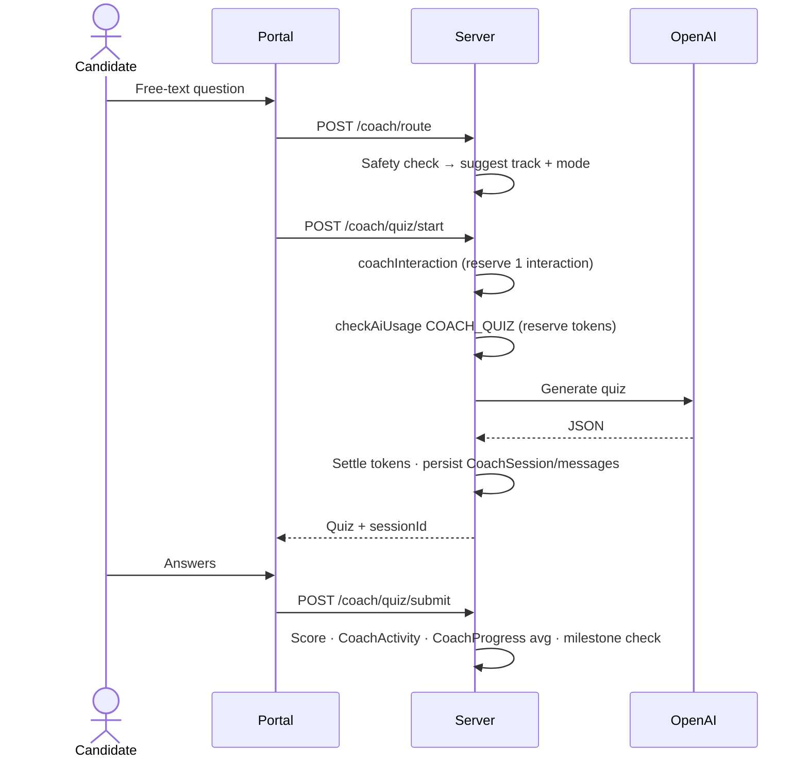

# AI Cyber Coach

Cyber Coach is an AI tutor for cybersecurity. A candidate picks a **track**, a **mode** and a **level**, optionally a target certification, and the coach generates training content, questions or scenarios and grades the answers.

<FeatureMeta
  roles={["STUDENT"]}
  tags={["AI"]}
  portal={<><code>/cyber-coach</code></>}
  server={<><code>modules/coach/coach.controller.js</code> · <code>modules/coach/coachInteraction.js</code> · <code>services/aiCoachService.js</code></>}
  models={<><code>CoachSession</code> · <code>CoachMessage</code> · <code>CoachActivity</code> · <code>CoachProgress</code> · <code>CoachMilestone</code> · <code>CoachWeakArea</code></>}
  plan={<><code>COACH_INTERACTIONS_MONTHLY</code> · <code>COACH_INTERACTIONS_WEEKLY</code> · AI tokens (<code>COACH_*</code> actions)</>}
/>

## Tracks, modes and levels

<Tabs>
<TabItem value="tracks" label="8 tracks" default>

| Track | Focus |
| --- | --- |
| Foundations | Networking, Linux, Windows, web, cloud and security fundamentals |
| Blue Team | SOC analysis, logs, incident response, detection, threat hunting |
| Red Team Labs (Authorized Only) | Lab-only offensive learning in fictional, CTF-style or authorized environments |
| Purple Team | Attacker techniques paired with detection, mitigation and control validation |
| Cloud Security | Cloud IAM, logging, encryption, storage security, detection, IR |
| Application Security | OWASP, secure coding, authN/authZ, API security |
| GRC | Governance, risk, compliance, audits, policies, privacy, third-party risk |
| Certification Prep | Lessons, quizzes, flashcards and mock exams for a chosen certification |

</TabItem>
<TabItem value="modes" label="9 modes">

| Mode | Start | Finish |
| --- | --- | --- |
| Learn a Topic | `POST /coach/session` | Complete on generation (markdown lesson) |
| Take a Quiz | `POST /coach/quiz/start` | `POST /coach/quiz/submit` (scored locally) |
| Mock Exam Practice | `POST /coach/mock-exam/start` | `POST /coach/mock-exam/submit` |
| Flashcards | `POST /coach/flashcards/start` | `POST /coach/flashcards/review` |
| Practice Scenario | `POST /coach/scenario/start` | `POST /coach/scenario/grade` (AI-graded) |
| Analyze Synthetic Logs | `POST /coach/log-analysis/start` | `POST /coach/log-analysis/grade` (AI-graded) |
| Safe Lab Coach | `POST /coach/safe-lab/start` | `POST /coach/safe-lab/grade-step` (AI-graded, per step) |
| Skill Assessment | `POST /coach/skill-assessment/start` | `POST /coach/skill-assessment/submit` |
| Interview Prep | `POST /coach/interview-prep/start` | `POST /coach/interview-prep/grade` (AI-graded) |

</TabItem>
<TabItem value="certs" label="Certifications">

CompTIA (Security+ SY0-701, Network+, CySA+, PenTest+, SecurityX) · ISC2 (CC, SSCP, CISSP, CCSP) · ISACA (CISA, CISM, CRISC) · GIAC (GSEC, GCIH, GCIA, GPEN) · AWS Security Specialty · Microsoft (SC-900, SC-200, SC-100) · Cisco CyberOps Associate · OffSec OSCP · Other.

The full list and descriptions come from `GET /coach/config`, so the UI never hardcodes them.

</TabItem>
</Tabs>

Levels: **Beginner**, **Intermediate**, **Advanced**.

## Request flow

- **Safety.** `POST /coach/route` screens the prompt and suggests a track and mode. A request the safety check redirects (`{ blocked: true }`) doesn't use an interaction.
- **Interactions.** On Candidate Free, each AI-generating action uses one interaction: **4 per 30 days, at most 1 per 7 days**. Paid plans have no interaction limit and are governed by AI tokens. The interaction is reserved up front and refunded if no AI response is produced.
- **AI tokens.** Every start action and the four AI grading routes reserve an estimated cost (2,000–4,000 tokens, see [AI services](/backend/ai-services)), then settle to actual usage.
- **Progress.** Scores update `CoachProgress` (per-track averages). Scores of **70+** earn milestones (`CoachMilestone`). Weak topics flagged during grading are counted in `CoachWeakArea` (per topic, with last-seen time) and drive `GET /coach/recommendations`.
- **Transcripts.** Exchanges are stored as `CoachSession` + `CoachMessage`, so finished sessions can be reviewed (`GET /coach/sessions`, `GET /coach/sessions/:id`). Submit and grade calls link to a session only when a `sessionId` is sent, so older clients still work.
- **Push to profile.** `POST /coach/push-to-profile` copies skills from passed tracks and earned certifications onto the candidate's profile.

**API:** [AI Cyber Coach](/reference/api/coach)
