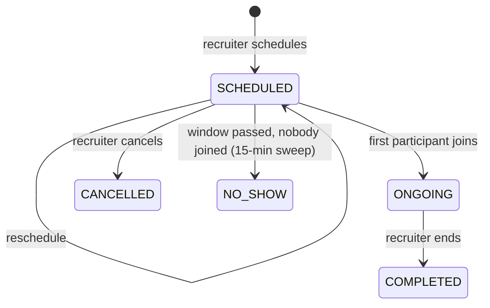

# Live interviews

Recruiters schedule a video interview against an application. Both sides join an in-app Agora room from the interview page.

<FeatureMeta
  roles={["COMPANY", "STUDENT"]}
  portal={<><code>/interview/[id]</code> · interview actions on applicant lists · candidate dashboard</>}
  server={<><code>modules/interview/interview.controller.js</code> · <code>utils/agora.js</code> · scheduler job <code>mark-missed-interviews</code></>}
  models={<><code>Interview</code> · <code>JobApplication</code></>}
/>

## Lifecycle

| Step | Endpoint | Rules |
| --- | --- | --- |
| Schedule | `POST /client/interviews/schedule` | The application must belong to the recruiter's company and be `APPLIED`, `UNDER_REVIEW`, `SHORTLISTED` or `INTERVIEW_SCHEDULED`. Duration **15–120 min**. Time is given in the recruiter's timezone and stored in UTC. Must be at least **1 hour** ahead. No overlapping interview on the same application. Sets the application to `INTERVIEW_SCHEDULED`, notifies the candidate and queues `INTERVIEW_SCHEDULED`. |
| Reschedule | `PATCH /client/interviews/:id/reschedule` | Notifies the candidate |
| Cancel | `PATCH /client/interviews/:id/cancel` | Sets the application back to `APPLIED` and queues `INTERVIEW_CANCELLED` |
| Join | `POST /client/interviews/:id/join` | Recruiter or candidate only. Opens **10 min before** start and closes **15 min after** the scheduled end. First join sets `ONGOING`. Returns an Agora RTC token. |
| End | `PATCH /client/interviews/:id/end` | Recruiter only. Sets `COMPLETED` and moves the application to `INTERVIEWED`. |
| Details / mine | `GET /client/interviews/:id`, `GET /client/interviews` | Times are formatted in both parties' timezones |

The scheduler's `mark-missed-interviews` job runs every 15 minutes. It marks `SCHEDULED` interviews whose window has passed as `NO_SHOW` and notifies the candidates. See [Background jobs](/backend/background-jobs).

**API:** [Interviews](/reference/api/interviews)
