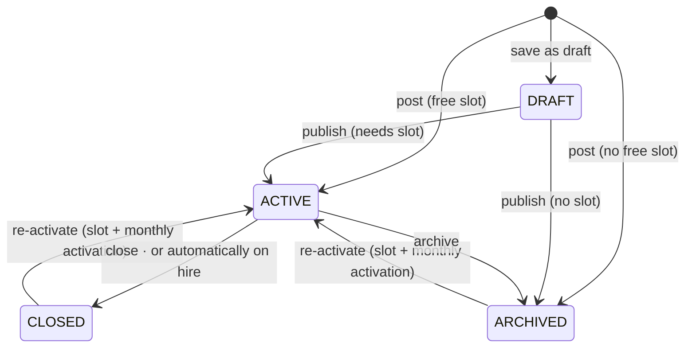
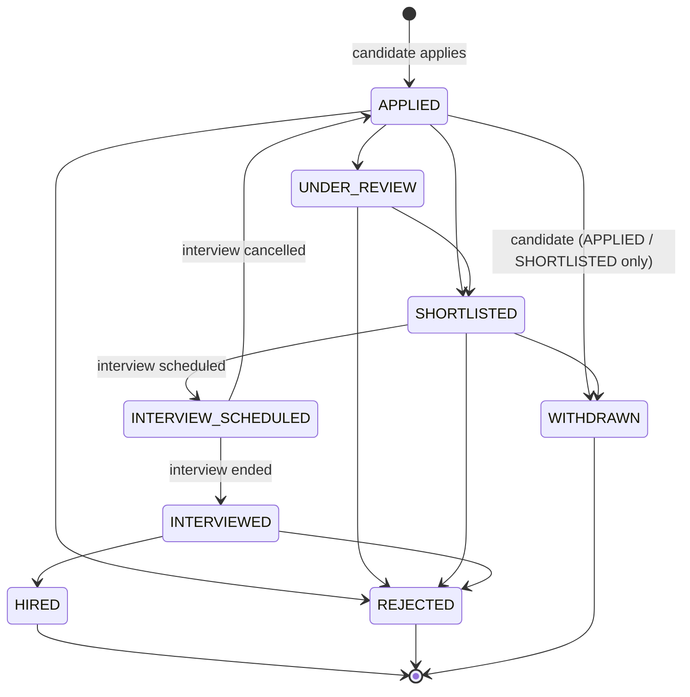

# Jobs & applications

Recruiters post jobs. Candidates find, save and apply to them. Recruiters then move each application through a forward-only pipeline that ends in a hire or a rejection.

<FeatureMeta
  roles={["COMPANY", "STUDENT", "ADMIN"]}
  tags={["Recruiter must be approved to post"]}
  portal={<>Recruiter: <code>/add-new-job</code> (<code>AddJobStepper</code>) · <code>/myjobs</code> · <code>/hired-candidates</code>. Candidate: <code>/jobs</code> · <code>/jobs/[id]</code> · <code>/jobs/ai-suggested-jobs</code> · <code>/companies/[id]</code></>}
  admin={<>No screen yet. Admin job and applicant endpoints exist (see the Admin portal page, Known gaps).</>}
  server={<><code>modules/company/company.controller.js</code> · <code>modules/job</code> · <code>modules/jobApplication</code> · <code>modules/student/savedJob.controller.js</code> · <code>modules/public</code></>}
  models={<><code>Job</code> · <code>JobApplication</code> · <code>SavedJob</code> · <code>ActivityLog</code></>}
  plan={<><code>COMPANY_ACTIVE_JOB_POSTINGS</code> · <code>COMPANY_JOB_ACTIVATIONS_MONTHLY</code> · <code>SAVED_JOBS_MAX</code> · <code>AI_JOB_SEARCH_*</code></>}
/>

## Posting a job

Recruiters create jobs with the multi-step **AddJobStepper**: title, description, contract type (`ContractType`), remote policy (`ONSITE` / `REMOTE` / `HYBRID`), location, experience range, skills, salary and currency. They can start from a saved [job template](./recruiter-tools#job-templates).

- **Active-job limit (capacity).** Only `ACTIVE` jobs count against `COMPANY_ACTIVE_JOB_POSTINGS` (Free: 2, Pro/Enterprise: unlimited). A recruiter can post any number of jobs, but a new job beyond the limit is created as `ARCHIVED` and isn't visible to candidates.
- **Re-activation** of an archived or closed job needs a free slot *and* uses one of `COMPANY_JOB_ACTIVATIONS_MONTHLY`. Editing an already-active job uses neither.
- Posting queues a `JOB_POSTED` email. Job creation requires an [approved](./onboarding-approvals) recruiter.

## Finding jobs

| Surface | Endpoint | Notes |
| --- | --- | --- |
| Public job board `/jobs` | `GET /client/public/jobs` | No sign-in needed |
| Candidate search | `GET /student/find-jobs` | Filters: contract types, remote policy, location, experience range, keyword. Only `ACTIVE` jobs. |
| AI job search | `GET /student/find-jobs-by-ai` | See [AI matching](./ai-matching). Counts against `AI_JOB_SEARCH_MONTHLY` and AI tokens. |
| Company page | `GET /student/find-company/jobs` | Open jobs for one company |

**Experience filter semantics:** ranges match on *overlap*, not containment. A 2–4 year job matches a 2–3 year search, and a missing bound is open-ended.

**Saved jobs:** `POST /student/save-job`, `DELETE /student/save-job/:jobId`, `GET /student/saved-jobs`. Capped by `SAVED_JOBS_MAX` (Free: 5).

## The application pipeline

Rules from `jobApplication.controller.js`:

- **No duplicates.** A candidate can apply to a job only once.
- **Forward only.** Once an interview is scheduled or done, the application can't go back to an earlier stage.
- **Final states.** `REJECTED`, `HIRED` and `WITHDRAWN` can't change.
- **Withdraw.** Only the candidate can withdraw, and only from `APPLIED` or `SHORTLISTED`. The company is notified.
- **Ownership.** Only the company that owns the job can change its applications.
- **Notifications.** Each status change notifies the candidate in-app and queues an `APPLICATION_STATUS_CHANGED` email, unless they turned off "Application updates" (the `productUpdates` preference). Shortlisting also sends `CANDIDATE_SHORTLISTED`.

### Hiring

Marking an application `HIRED`:

1. closes the job, so no new applications come in,
2. rejects every other applicant still in the pipeline and notifies them, in one bulk statement each,
3. adds the candidate to **Hired Candidates** (`GET /company/hired-candidates`, and the admin endpoint `GET /admin/hired-candidates`).

## Candidate views

`/myjobs` (candidate) lists applications with status filters (`GET /student/job-applications`). Recruiters see applicants per job (`GET /company/created-job/job-applications`) and across all jobs (`GET /company/job-applications`).

**API:** [Company](/reference/api/company) · [Student](/reference/api/student) · [Public](/reference/api/public)
