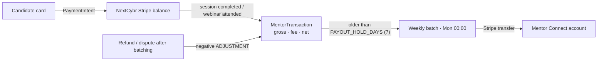
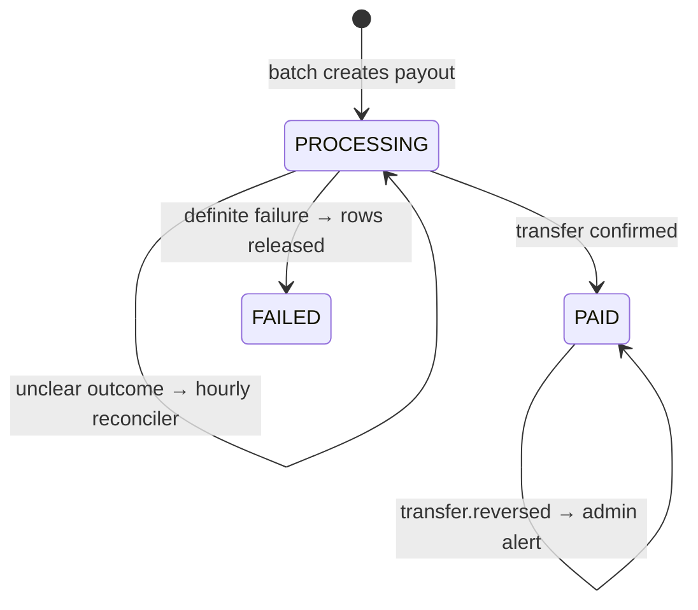

# Mentor payouts

Candidates pay NextCybr through Stripe. NextCybr pays mentors their share each week through **Stripe Connect** (Express accounts). A ledger of `MentorTransaction`s is the source of truth for what each mentor is owed.

<FeatureMeta
  roles={["MENTOR", "ADMIN"]}
  tags={["Money movement"]}
  portal={<><code>/payments</code> (mentor "Earnings &amp; Plan")</>}
  admin={<>Payouts (<code>/payouts</code>, <code>/payouts/:payoutId</code>) · Payout accounts (<code>/payout-accounts</code>) · Payments</>}
  server={<><code>modules/mentor/payoutAccount.js</code> · <code>payoutLedger.js</code> · <code>mentorPayout.controller.js</code> · <code>mentorScheduledJobs.js</code> · <code>modules/webhook/webhook.js</code> (<code>/webhook/connect</code>)</>}
  models={<><code>MentorPayoutMethod</code> · <code>MentorTransaction</code> · <code>MentorPayout</code> · enums <code>PayoutStatus</code>, <code>TransactionSourceType</code></>}
  plan={<><code>MENTOR_PLATFORM_FEE_BPS</code> · <code>MENTOR_ADVANCED_ANALYTICS</code> (earnings breakdown)</>}
/>

## Money flow

## 1. Connect onboarding

| Action | Endpoint |
| --- | --- |
| Start or resume onboarding (Stripe-hosted) | `POST /mentor/payout-method/onboard` |
| Status | `GET /mentor/payout-method` |
| Stripe Express dashboard link | `GET /mentor/payout-method/dashboard-link` |

Onboarding requests only the `transfers` capability. `MentorPayoutMethod.status` follows the Stripe account through the Connect webhook (`account.updated`). If a mentor revokes access (`account.application.deauthorized`), the account is marked disconnected and skipped by batches until they reconnect.

## 2. The ledger

A `MentorTransaction` is written when a sale completes: a 1:1 session ends or settles as `COMPLETED`/`NO_SHOW`, or a webinar registration is `ATTENDED`. Each row stores the gross amount, the **platform fee rate and amount at that moment** (15% Free / 10% Pro, from the mentor's plan), and the net amount.

- `sourceType` is `SESSION`, `WEBINAR` or `ADJUSTMENT`.
- **Adjustments.** A refund (`charge.refunded`) or dispute (`charge.dispute.created`) on a sale already paid out creates a **negative** `ADJUSTMENT` row, deducted from the next payout. Adjustments are never held, because they only reduce what's owed.

## 3. Weekly batch

`run-weekly-payout-batch` runs **every Monday at 00:00**. For each mentor with a connected account:

1. Collect unbatched transactions past the hold period (`PAYOUT_HOLD_DAYS`, default 7), plus any adjustments.
2. Skip the mentor if the net is ≤ 0 or there's no usable account. Their rows roll into next week.
3. Create one `MentorPayout` in `PROCESSING` and link the rows to it.
4. Send a Stripe transfer with an idempotency key derived from the exact set of transactions, so a retry can't pay twice.
5. On success → `PAID`, store `stripeTransferId`, queue a `PAYOUT_RECEIPT` email. A definite failure → `FAILED`, and the rows are released for the next batch.

## 4. Reconciliation & alerts

- **Unclear outcomes** (network error, Stripe 5xx) leave the payout in `PROCESSING`. Releasing the rows could double-pay. `reconcile-processing-payouts` runs **hourly at :15** and checks Stripe to settle these.
- Admins can trigger the same check with `POST /admin/payouts/:payoutId/reconcile`.
- Anything that needs a human (reversed transfers, refunds that failed, reconciliation that can't resolve) is logged with an `[ALERT]` tag and emailed to `ADMIN_ALERT_EMAIL` (`ADMIN_ALERT` email type).

## Mentor views

| View | Endpoint |
| --- | --- |
| Earnings list | `GET /mentor/earnings` |
| Summary (available, pending, paid, fees, hold days) | `GET /mentor/earnings/summary` |
| CSV export | `GET /mentor/earnings/export` |
| Breakdown by period/service | `GET /mentor/earnings/breakdown` (Pro, `MENTOR_ADVANCED_ANALYTICS`) |
| Payout history | `GET /mentor/payouts` |

**API:** [Mentor](/reference/api/mentor) · [Admin](/reference/api/admin) · [Stripe webhooks](/reference/api/webhooks)
