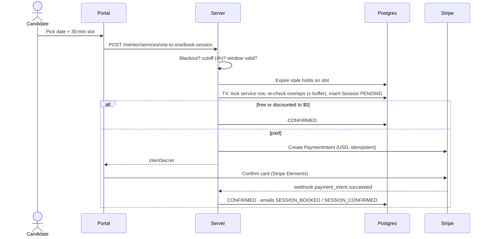
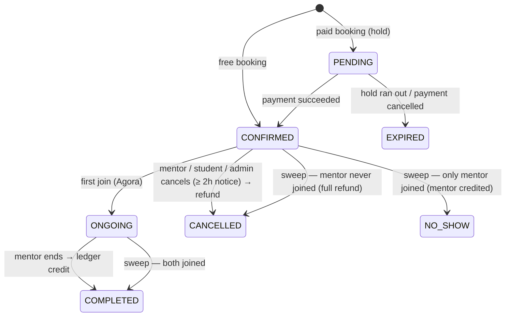
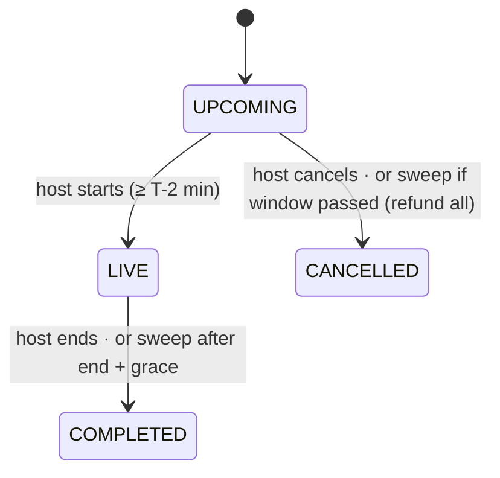

# Mentorship

Mentors sell two kinds of service: **1:1 sessions** booked into their availability, and **webinars** with limited seats. Candidates pay with Stripe and meet in an in-app Agora video room. After the session the earnings go to the mentor's [payout ledger](./mentor-payouts).

<FeatureMeta
  roles={["MENTOR", "STUDENT", "ADMIN"]}
  tags={["Mentor must be approved to publish"]}
  portal={<>Mentor: <code>/mentor/services</code> · <code>/mentor/sessions</code> · <code>/mentor/availability</code> · <code>/mentor/start-webinar/[id]</code> · <code>/mentor/join-session/[id]</code>. Candidate: <code>/mentorship</code> · <code>/mentorship/services/[id]</code> · <code>/mentorship/my-bookings</code> · <code>/mentor/join-webinar/[id]</code></>}
  admin={<>Mentorship activity (<code>/mentorship-activity</code>) · Payments</>}
  server={<><code>modules/mentor/</code>: <code>mentorServiceCatalog</code>, <code>mentorAvailability</code>, <code>mentorSession</code>, <code>mentorWebinar</code>, <code>webinarLifecycle</code>, <code>mentorDiscounts</code>, <code>mentorScheduledJobs</code>, <code>mentor.shared</code></>}
  models={<><code>MentorService</code> · <code>OneToOneMentorService</code> · <code>WebinarMentorService</code> · <code>MentorAvailability</code> · <code>MentorAvailabilityException</code> · <code>Session</code> · <code>SessionReview</code> · <code>SessionWaitlist</code> · <code>WebinarRegistration</code> · <code>DiscountCode</code> · <code>Badge</code></>}
  plan={<><code>MENTOR_ACTIVE_1TO1_SERVICES</code> · <code>MENTOR_ACTIVE_WEBINARS</code> · <code>MENTOR_SERVICE_ARCHIVE</code> · <code>MENTOR_DISCOUNT_CODES</code> · <code>MENTOR_PLATFORM_FEE_BPS</code> · <code>MENTOR_MESSAGING_UNRESTRICTED</code> (candidate)</>}
/>

## Key timings

| Constant | Value | Applies to |
| --- | --- | --- |
| `BOOKING_CUTOFF_MINUTES` | **240** (4 h) | New bookings close this long before the start |
| `MIN_SESSION_NOTICE_MINUTES` | **120** (2 h) | Cancelling or rescheduling an existing session |
| `PENDING_HOLD_MINUTES` | **15** (env) | How long an unpaid booking or seat is held |
| Slot size | 30 min | Bookable start times inside an availability window |
| `bufferTime` | per service (default 5 min) | Padding on both sides when checking overlaps |
| Student join window | 30 min before start | 1:1 rooms |
| Webinar start | 2 min before start | Host "Start webinar" unlocks |

All times are stored in UTC and computed in the mentor's timezone.

## Services

A `MentorService` is either `ONE_TO_ONE` (+ `OneToOneMentorService`: duration, price, discounted price, buffer) or `WEBINAR` (+ `WebinarMentorService`: date and time, capacity, price, status).

- **Create.** `POST /mentor/services/one-to-one` and `POST /mentor/services/webinar` need an [approved](./onboarding-approvals) mentor and a free slot in `MENTOR_ACTIVE_1TO1_SERVICES` (Free 3) / `MENTOR_ACTIVE_WEBINARS` (Free 2). Pro is unlimited.
- **Activate/deactivate.** `PATCH /mentor/service/toggle-service-status`.
- **Archive.** `PATCH /mentor/service/toggle-archive` (Pro, `MENTOR_SERVICE_ARCHIVE`).
- **Prices** are USD. The price is copied onto each booking, so later price edits never change history or payouts.
- **Discover.** Candidates browse with `GET /mentor/browse` and see stats with `GET /mentor/student-mentor-services-stats`.

## Availability

| What | Endpoints |
| --- | --- |
| Weekly windows (`MentorAvailability`) | `POST /mentor/availability-slot(s)`, `GET/PATCH /mentor/availability-slots`, `DELETE /mentor/availability-slot` |
| Blackout dates (`MentorAvailabilityException`) | `POST/GET/DELETE /mentor/availability-exception(s)` |
| Bookable slots for a day | `GET /mentor/services/one-to-one/service-slots` |
| Bookable dates in a month | `GET /mentor/services/one-to-one/month-availability?month=YYYY-MM` |

The slot picker returns bookable slots *and* taken slots (shown disabled). Both apply the same buffer and notice rules as booking, so nothing shown as bookable fails at checkout.

## 1:1 booking

Correctness comes from the transaction: it locks the service row and re-checks every active session that overlaps `[start, start + duration)` plus the buffer. A unique index is the backstop. If Stripe fails, the hold is released straight away. Abandoned holds expire through `expire-unpaid-bookings` (every 2 minutes) and become `EXPIRED`, which frees the slot.

### Session lifecycle

- **Join.** `POST /mentor/services/one-to-one/join-session` checks the caller is a participant and inside the join window, records who joined (`mentorJoinedAt` / `studentJoinedAt`), and returns an Agora token. Both sides publish in a 1:1.
- **End.** `POST /mentor/services/one-to-one/end-session` (mentor). Marking it `COMPLETED` and writing the ledger entry happen together, and only from `ONGOING`, so the settlement sweep can never credit a session twice.
- **Settlement sweep** (`mark-no-show-sessions`, every 15 min) handles sessions nobody ended, from who joined: both → `COMPLETED`, mentor only → `NO_SHOW` (mentor still paid), mentor absent → cancelled and refunded.
- **Cancel.** Mentor (`…/sessions/:id/cancel`), student (`…/student-cancel`) or admin (`POST /admin/sessions/:id/cancel`). Needs 2 h notice for users. `cancelledByRole` is recorded, paid sessions are refunded, and the waitlist is notified.
- **Reschedule.** `…/sessions/:id/reschedule` (either side) runs the same locked overlap check on the new time, emails `SESSION_RESCHEDULED`, and notifies the waitlist about the freed slot.
- **Review.** `POST …/sessions/:id/review` (student, validated rating and comment). Updates mentor ratings and emails the mentor.
- **Reminders.** `send-upcoming-reminders` (every 5 min) emails both sides before the start.

## Waitlist & session requests

- **Waitlist.** When a day is fully booked, a candidate can `POST /mentor/services/one-to-one/waitlist`. When a slot frees up (cancel or reschedule), waitlisted candidates get `WAITLIST_SLOT_AVAILABLE`. Joining again resets the notified flag.
- **Request a session.** `POST /mentor/request-session` (from a mentor's profile, outside slot booking) notifies the mentor in-app and by email (`SESSION_REQUEST`) and opens a chat thread. On Candidate Free, the [messaging rule](./messaging#who-can-message-whom) applies: a new thread with a mentor needs an existing booking.

## Webinars

| Registration | |
| --- | --- |
| `PENDING` | Paid seat on hold, waiting for payment |
| `REGISTERED` | Seat confirmed (free immediately, paid after the webhook) |
| `ATTENDED` / `ABSENT` | Set when the webinar completes, from who joined |
| `CANCELLED` / `REFUNDED` / `EXPIRED` | Seat released |

- **Register** (`POST /mentor/services/webinar/register`, rate-limited) locks the webinar row and recounts seat-holding registrations, so concurrent sign-ups can't oversell capacity. A candidate who abandoned checkout resumes the same PaymentIntent instead of being blocked.
- **Host** gets a publisher token (`start-webinar`). It can be called again while `LIVE` to get a fresh token after a dropped connection. **Viewers** get subscriber tokens (`join-webinar`), and only for a live seat. A refunded student can't join and be marked `ATTENDED`.
- `join-webinar` returns **409** before the host starts, so the viewer page keeps polling.
- **Cancel.** The student cancels their registration (refunded if paid), or the mentor cancels the whole webinar (everyone refunded, `WEBINAR_CANCELLED` emails).
- `reconcile-webinars` (every 5 min) completes webinars left `LIVE`, cancels and refunds webinars the host never started, and retries failed refunds.

## Discount codes & badges

- **Discount codes.** Mentor Pro can create, list, edit and delete `DiscountCode`s (`MENTOR_DISCOUNT_CODES`). Students apply one at 1:1 or webinar checkout (`discountCode` on `book-session` / `webinar/register`). The checkout modals check it first with `POST /mentor/discount-codes/preview` (STUDENT, 10/min).
  - **Price.** The code comes off the list price (`discountedPrice ?? price`): a percentage, or a flat amount capped at the price, rounded to cents. The result is stored as `Session.price` / `WebinarRegistration.price` with `discountCodeId` and `discountAmount`, so the Stripe charge, the platform fee, payouts and refunds all use the discounted amount.
  - **Valid when** the code belongs to the service's mentor, is active, hasn't passed the end of its `expiresAt` day, is under `maxRedemptions`, and the mentor still has `MENTOR_DISCOUNT_CODES`. Rejected if the total would land between $0 and Stripe's $0.50 minimum. A 100% code confirms the booking with no payment.
  - **Usage** (`redemptionCount`) is counted only when the checkout is confirmed (`payment_intent.succeeded`, or immediately when free), so abandoned checkouts don't use up a code. Two checkouts racing for the last use can take a code one past its limit.
  - **Webinar resume.** An unpaid webinar checkout is resumed only at the same price. Coming back with a different code (or none) cancels the old PaymentIntent and re-prices.
- **Badges.** `VERIFIED_MENTOR` (awarded on admin approval) and `PRO_MENTOR` (while on Mentor Pro). See `GET /mentor/badges`.

## Platform fee

NextCybr keeps a share of every completed paid booking. The rate comes from the mentor's plan: `MENTOR_PLATFORM_FEE_BPS` is **1500 (15%) on Free** and **1000 (10%) on Pro**. If a plan has no rate, `PLATFORM_FEE_RATE` (env) is used. The rate is stored on each ledger row. See [Mentor payouts](./mentor-payouts).

**API:** [Mentor & mentorship](/reference/api/mentor) · [Admin](/reference/api/admin)
