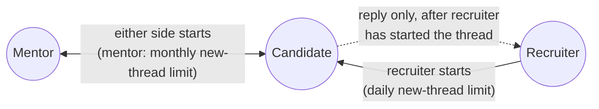

# Messaging & notifications

<FeatureMeta
  roles={["STUDENT", "COMPANY", "MENTOR"]}
  portal={<><code>/messages</code> (<code>components/chat</code>) · <code>/notifications</code> · <code>NotificationsPanel</code></>}
  server={<><code>modules/conversation</code> · <code>utils/socket.js</code> · notification endpoints in each role router · <code>workers/email.worker.js</code></>}
  models={<><code>Conversation</code> · <code>ConversationParticipant</code> · <code>Message</code> · <code>Notification</code> · <code>NotificationPreference</code></>}
  plan={<><code>MENTOR_MESSAGING_UNRESTRICTED</code> · <code>MENTOR_NEW_CONVERSATIONS_MONTHLY</code> · <code>COMPANY_NEW_SOURCED_CONVERSATIONS_DAILY</code></>}
/>

## Who can message whom

| Initiator → target | Allowed? | Extra rule |
| --- | --- | --- |
| Mentor → candidate | ✓ | New threads count against `MENTOR_NEW_CONVERSATIONS_MONTHLY` (Free 10, Pro 50) |
| Candidate → mentor | ✓ | Candidate Free without `MENTOR_MESSAGING_UNRESTRICTED` may open a new thread only with a mentor they've booked (any 1:1 or webinar) |
| Recruiter → candidate | ✓ | New threads count against `COMPANY_NEW_SOURCED_CONVERSATIONS_DAILY` |
| Candidate → recruiter | Only as a reply | "You can only reply after a recruiter contacts you first." |
| Mentor ↔ recruiter, anyone ↔ admin | ✕ | |

Limits only apply to a **new** conversation. Replying to or reopening an existing thread uses nothing.

## REST + Socket.io

REST endpoints load data: `GET /conversation/list`, `/unread-count`, `/:id`, `/:id/messages`, `/search-contacts`, `/bootstrap`, `POST /conversation/start`. Sending messages and live updates go over Socket.io. The socket authenticates with the `accessToken` cookie on the handshake and applies the same session checks as `authMiddleware`.

| Client emits | Server emits | Purpose |
| --- | --- | --- |
| `join_conversation` / `leave_conversation` | `chat_error` | Join the `conv:<id>` room (participants only) |
| `send_message` | `receive_message` | Zod-validated, persisted, delivered to the room and the recipient's `user:<id>` room |
| `mark_read` | `messages_read` | Read receipts (`MessageStatus` `SENT` → `READ`) |
| `typing_start` / `typing_stop` | `user_typing` / `user_stop_typing` | Typing indicators |
| `get_online_status` (ack) | `user_online` / `user_offline` / `user_last_seen_updated` | Presence, pushed to chat partners |
| — | `notification` | Live notification push to `user:<id>`, `admins` or `users` |

See [Real-time](/backend/realtime) for the room model and scaling.

## Notifications

In-app `Notification` rows (type `SYSTEM`, `JOB_APPLICATION`, `JOB_STATUS_CHANGE`, `MESSAGE`, `ACCOUNT`, `JOBS`, `ACHIEVEMENT`, `PAYMENTS`, `CUSTOM`, with a priority) are created by domain events (applications, approvals, bookings, interviews, payouts) and pushed live over the socket.

| Action | Endpoint (per role prefix) |
| --- | --- |
| List | `GET /<role>/notifications` (`student`, `company` or `mentor`) |
| Unread count | `GET /client/unread-notification-count` |
| Mark one / all read | `PATCH …/mark-notification-as-read`, `PATCH …/mark-all-notification-as-read` |
| Delete | `DELETE …/delete-notification` |

## Emails

Transactional emails go through the BullMQ `email` queue (welcome, OTP, login alert, approvals, job, interview, session and webinar events, payouts, support). Two scheduled digests run in the worker:

- **Weekly summary**: Sundays 00:00.
- **Job alert digest**: daily at 08:00. Each candidate gets it on their plan's cadence (`JOB_ALERT_FREQUENCY_DAYS`, Free every 7 days) if `jobAlerts` is on.

Users control categories in [Settings](./settings#notification-preferences). The `security` category is always on.

**API:** [Conversations](/reference/api/conversations) · [Common](/reference/api/common)
