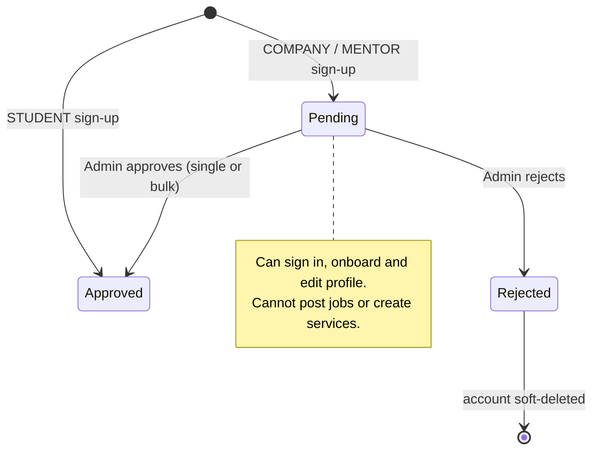

# Onboarding & approvals

After sign-up, each role completes an onboarding flow that creates its profile. Candidates go straight in. Recruiters and mentors wait for an admin to approve the account before they can publish anything.

<FeatureMeta
  roles={["STUDENT", "COMPANY", "MENTOR", "ADMIN"]}
  tags={["Admin approval"]}
  portal={<><code>/onboarding/[id]</code> (<code>StudentOnboarding</code>, <code>RecruiterOnBoarding</code>, <code>MentorOnboarding</code>) · <code>VerificationPendingPage</code></>}
  admin={<>Approvals (<code>/approvals</code>) · Students / Company / Mentors lists</>}
  server={<><code>POST /client/&#123;student|company|mentor&#125;/onboarding</code> · <code>src/modules/approvals</code> · <code>requireApproved</code></>}
  models={<><code>User.approvedByAdmin</code> · <code>StudentProfile</code> · <code>CompanyProfile</code> · <code>MentorProfile</code></>}
/>

## Onboarding by role

| Role | Flow | Captures |
| --- | --- | --- |
| Candidate | Seven-step wizard (`Step1`–`Step7`) | Personal details, location, education, experience, skills and certifications, preferred contract types and roles, languages |
| Recruiter | Company onboarding form | Company name, role within the company (`FOUNDER`, `CEO`, `HR_MANAGER`), size, industry, headquarters and locations, website, logo |
| Mentor | Mentor onboarding form | Headline, expertise and domains, experience, bio, languages, rates and currency |

All three post to the role's `onboarding` endpoint, which shares its handler with `update-profile`. Until onboarding is complete, the portal sends protected pages back to `/onboarding/[id]`.

## The approval gate

- The portal shows `VerificationPendingPage` to unapproved recruiters and mentors.
- The **server** enforces the gate on publishing endpoints with `requireApproved`: `POST /company/create-job`, `POST /mentor/services/one-to-one` and `POST /mentor/services/webinar`. This stops anyone from bypassing the frontend overlay. Onboarding and profile edits stay open on purpose, because otherwise the admin would have nothing to review.
- **Approve** sets `approvedByAdmin = true`, creates an in-app notification (pushed live over Socket.io) and queues an `ACCOUNT_APPROVED` email. Approving a mentor also awards the `VERIFIED_MENTOR` badge.
- **Reject** notifies the user, queues `ACCOUNT_REJECTED` and soft-deletes the account.
- **Bulk approve** handles up to 50 users per call and notifies only users whose status actually changed.

## Admin queue

The admin **Approvals** screen lists pending users, filterable by role and paginated. It has a detail modal, approve, reject (with a reason), and bulk approve. Counts per role come from `GET /admin/approvals/stats`.

**API:** [Approvals](/reference/api/approvals) · [Student](/reference/api/student) · [Company](/reference/api/company) · [Mentor](/reference/api/mentor)
