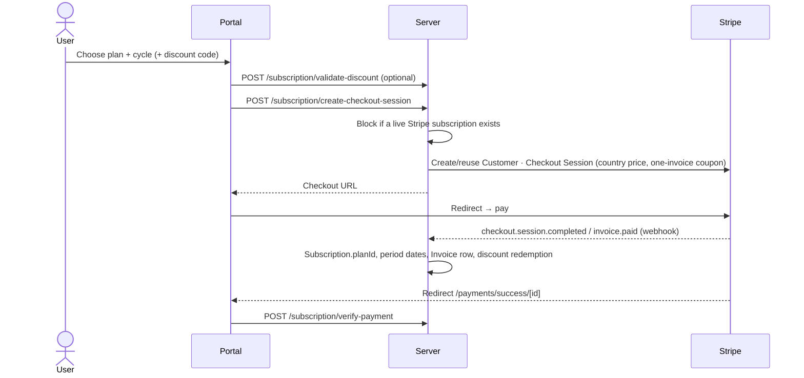

# Plans & billing

Each audience has its own plan ladder. Paid plans are Stripe subscriptions, billed monthly or yearly. What a plan unlocks is data in the database, not code. See the [entitlements engine](/backend/entitlements) and the [plan matrix](/reference/plans).

<FeatureMeta
  roles={["STUDENT", "COMPANY", "MENTOR", "ADMIN"]}
  portal={<><code>/plans</code> · <code>/payments</code> · <code>/payments/success/[id]</code> · <code>/payments/cancel</code> · AI usage cards</>}
  admin={<>Entitlements (<code>/entitlements</code>) · Subscription discounts · Payments</>}
  server={<><code>modules/subscription</code> · <code>modules/webhook/webhook.js</code> · <code>services/planListingService.js</code> · <code>services/entitlementService.js</code></>}
  models={<><code>Plan</code> · <code>PlanCountryPrice</code> · <code>Subscription</code> · <code>Invoice</code> · <code>SubscriptionDiscount</code> · <code>SubscriptionDiscountRedemption</code></>}
/>

## Tiers

| Audience | Tiers (`Plan.key`) | List price |
| --- | --- | --- |
| Candidate | `FREE` · `PRO` · `PRO_PLUS` | Free · $19 · $29 /mo |
| Recruiter | `FREE` · `PRO` · `ENTERPRISE` ("Recruiter Custom") | Free · $99 /mo · custom quote |
| Mentor | `FREE` · `PRO` | Free · $19 /mo |

These are seeded list prices. Stripe price IDs and per-country prices decide what is actually charged.

There is one `Plan` row per tier per audience, not one per billing cycle. The row holds both Stripe price IDs (monthly and yearly env vars). `tierRank` decides whether a change is an upgrade or a downgrade, so adding a tier needs no code change. Admins can also create **custom/org plans** (`PlanScope.ORG`) and assign them to individual users.

Plan listings (`GET /{student|company|mentor}/subscription-plans`) return marketing copy plus the price for the user's country.

## Checkout

- **No duplicates.** Checkout is refused while the user has a live Stripe subscription. The check uses Stripe's own status, because the local `isActive` is false during `past_due` retries.
- **Discounts.** Admin-created `SubscriptionDiscount`s apply to one invoice. A capped percentage is converted to an exact amount for the chosen price. Redemptions are recorded only from the successful-checkout webhook, so an abandoned checkout uses nothing.

## Changing plans

| Change | Endpoint | Effect |
| --- | --- | --- |
| Upgrade (higher `tierRank`) | `POST /subscription/update-subscription` | Immediate, prorated |
| Same plan, monthly → yearly | same | Immediate (treated as an upgrade) |
| Downgrade, or yearly → monthly | same | Scheduled for renewal (Stripe subscription schedule) |
| Re-select current plan while a downgrade is scheduled | same | Cancels the scheduled downgrade |
| Cancel | `POST /subscription/cancel-subscription` | `cancel_at_period_end`. Access continues until the period ends, and any scheduled downgrade is dropped. |
| Undo cancel | `POST /subscription/reactivate` | Clears `cancel_at_period_end` |

Plan changes are blocked while a cancellation is scheduled.

## Webhooks that drive billing

`POST /api/v1/payment/webhook` handles `checkout.session.completed`, `invoice.paid`, `invoice.payment_failed`, `customer.subscription.updated` and `customer.subscription.deleted` (back to Free). It also handles the booking events (`payment_intent.*`, `charge.refunded`, `charge.dispute.created`, `transfer.reversed`) described in [Mentorship](./mentorship) and [Payouts](./mentor-payouts). Mentor Pro subscribers get the `PRO_MENTOR` badge, which is revoked when the subscription ends.

## Country pricing

Admins set per-country prices on any plan (`/admin/plans/:planId/country-prices`). Checkout and plan listings use the user's profile country and fall back to the base price.

## Invoices & usage

- `GET /subscription/get-all-invoices`: invoice history from the `Invoice` mirror.
- `GET /subscription/get-subscription-details`: current plan, cycle, renewal and cancel state.
- `GET /{role}/entitlements/me`, `GET /student/usage-summary` and `GET /client/get-ai-tokens` drive the in-app usage meters (`AITokensCard`, `RecruiterAiUsageCard`).

**API:** [Subscriptions](/reference/api/subscriptions) · [Stripe webhooks](/reference/api/webhooks) · [Admin](/reference/api/admin)
