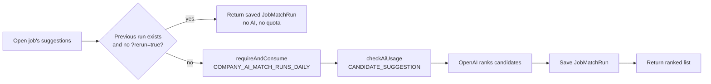

# Recruiter tools

The sourcing and productivity tools on top of job posting. Most of them are plan-gated.

<FeatureMeta
  roles={["COMPANY", "MENTOR"]}
  portal={<><code>/candidates</code> · <code>/myjobs/get-suggested-candidates/[id]</code> · <code>/shortlistings</code> · <code>/saved-searches</code></>}
  server={<><code>modules/company/company.controller.js</code> · <code>modules/company/recruiterTools.controller.js</code> · <code>modules/company/companyExport.controller.js</code> · <code>services/aiCandidateSuggestionsService.js</code></>}
  models={<><code>JobMatchRun</code> · <code>FavoriteCandidate</code> · <code>RecruiterNote</code> · <code>JobTemplate</code> · <code>SavedSearch</code></>}
  plan={<><code>COMPANY_AI_MATCH_RUNS_DAILY</code> · <code>COMPANY_AI_CANDIDATE_SEARCH_MONTHLY</code> · <code>COMPANY_ACTIVE_SHORTLISTS</code> · <code>COMPANY_SHORTLIST_ADDS_MONTHLY</code> · <code>COMPANY_JOB_TEMPLATES</code> · <code>COMPANY_SAVED_SEARCHES</code> · <code>COMPANY_CANDIDATE_EXPORT</code></>}
/>

## AI Match Run: "find candidates for this job"

`GET /company/suggested-students-for-job?jobId=…`

There are two independent limits: a **daily match-run count** and the recruiter's shared **AI token** budget. When the daily count runs out, the message says the Free allowance renews tomorrow and that saved results are still available.

## AI candidate search

`GET /company/candidates/search?q=…` is free-text AI search over candidate profiles. It counts against `COMPANY_AI_CANDIDATE_SEARCH_MONTHLY` and AI tokens. Standard, non-AI search (`GET /company/find-students`) is always available. Mentors get the same tool as **AI mentee search** (`GET /mentor/candidates/search`, `MENTOR_AI_CANDIDATE_SEARCH_MONTHLY`).

## Shortlists

| Action | Endpoint | Rule |
| --- | --- | --- |
| Add | `POST /company/shortlisted` | Capacity `COMPANY_ACTIVE_SHORTLISTS` (Free 12) **and** monthly adds `COMPANY_SHORTLIST_ADDS_MONTHLY` (Free 6) |
| List / remove | `GET` / `DELETE /company/shortlisted` | Filters for experience, skills, search |
| Export CSV | `GET /company/shortlisted/export` | Plan feature `COMPANY_CANDIDATE_EXPORT` |

These endpoints dispatch by role (`byRole`). Mentors calling them get the **mentor shortlist** (`MENTOR_SHORTLIST_MAX`, Free 10), because the shared candidate pages call the `/company/shortlisted` paths for every role.

## Recruiter notes

Private notes on a candidate, optionally tied to one application: `POST / GET / PATCH / DELETE /company/recruiter-notes`. Bodies are validated with Zod (`recruiterNoteSchema`).

## Job templates

Save a job spec and reuse it in the stepper: `POST / GET / PATCH / DELETE /company/job-templates`. Creating and editing need `COMPANY_JOB_TEMPLATES`. Listing and deleting stay open, so a downgraded recruiter can still clean up.

## Saved searches

Save a candidate search, AI search or match run and reopen it later: `POST / GET / DELETE /company/saved-searches`. Reopening returns the stored snapshot with **no AI call and no quota used**. The list view leaves out the results snapshot to keep the payload small. Creating needs `COMPANY_SAVED_SEARCHES`.

**API:** [Company](/reference/api/company) · [Mentor](/reference/api/mentor)
