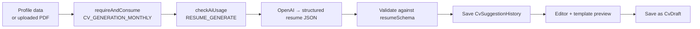

# NextGen CV builder

"My NextGen CV" is the candidate's AI resume builder. It builds a structured CV from the profile or an uploaded PDF, improves single sections, scores the CV, and saves editable drafts in a choice of templates.

<FeatureMeta
  roles={["STUDENT"]}
  tags={["AI"]}
  portal={<><code>/resume-builder</code> (<code>components/aIResumeBuillder</code>)</>}
  server={<><code>modules/resume/resume.controller.js</code> · <code>services/resumeBuilderByAIService.js</code> · <code>services/cvDraftService.js</code> · <code>constants/cvTemplates.js</code></>}
  models={<><code>CvDraft</code> · <code>CvSuggestionHistory</code></>}
  plan={<><code>CV_GENERATION_MONTHLY</code> · <code>CV_AI_ASSESSMENT_MONTHLY</code> · <code>CV_BUILDER_AI_GENERATOR</code> · <code>CV_TEMPLATE_ALL_ACCESS</code> · <code>CV_ASSESSMENT_ADVANCED</code></>}
/>

## Capabilities

| Capability | Endpoint | Gate |
| --- | --- | --- |
| Generate CV from profile | `POST /student/resume/generate` | `CV_GENERATION_MONTHLY` (Free 1, Pro unlimited) + AI tokens `RESUME_GENERATE` |
| Upload PDF → generate | `POST /student/resume/upload` | Same as generate. PDF only, up to **10 MB**. DOC/DOCX is planned. |
| Enhance one section | `POST /student/resume/enhance-section` | Feature `CV_BUILDER_AI_GENERATOR` (Pro+) + AI tokens `RESUME_ENHANCE` |
| Assess CV | `POST /student/resume/assess` | `CV_AI_ASSESSMENT_MONTHLY` (Free 1, Pro unlimited) + AI tokens. `CV_ASSESSMENT_ADVANCED` unlocks the deeper report. |
| Suggestion history | `GET /student/resume/history` | — |
| Templates | `GET /student/resume/templates` | Free: **Minimal**. `CV_TEMPLATE_ALL_ACCESS` unlocks the rest (Classic, Modern Sidebar, …). |
| Drafts | `GET/POST/PUT/DELETE /student/resume/drafts[/:draftId]` | Creating a draft counts as a CV generation |

## How generation works

- **Failure refunds.** If generation fails after the response has started, the handler refunds the CV generation itself, because the route-level refund only runs on error statuses.
- **Template enforcement at write time.** `cvDraftService` checks the content against the resume schema, and checks that a paid template is unlocked by the user's plan. A Free user can't save a locked template by calling the API directly.
- **Export.** The portal renders the chosen template and exports to PDF in the browser (`html2canvas-pro`).

**API:** [Student](/reference/api/student) (resume routes)
