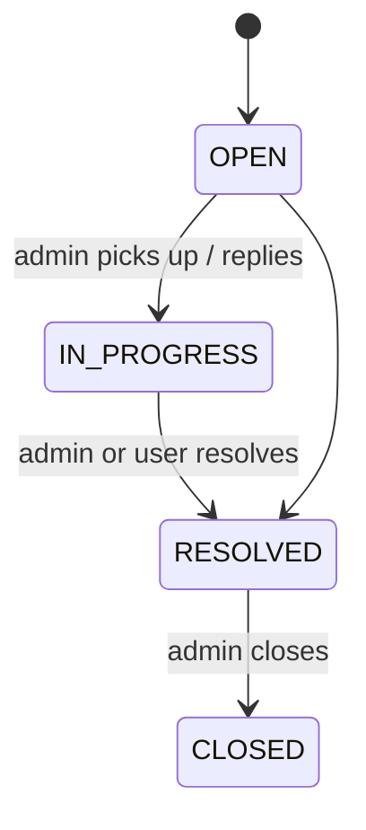

# Support desk

Any portal user can raise a ticket. Admins work the queue from the admin portal.

<FeatureMeta
  roles={["STUDENT", "COMPANY", "MENTOR", "ADMIN"]}
  portal={<><code>/support-help</code> (<code>components/ticketSupport</code>)</>}
  admin={<>Support (<code>/support</code>, <code>/support/ticket</code>)</>}
  server={<><code>modules/ticketingSystem</code></>}
  models={<><code>Category</code> · <code>Reason</code> · <code>Ticket</code> · <code>TicketMessage</code></>}
  plan={<><code>SUPPORT_PRIORITY_LEVEL</code></>}
/>

## Raising a ticket

1. Pick a **category** (`GET /support/tickets/categories`), then a **reason** in it (`…/categories/reasons`). If the reason is a "custom" one, free text is required (min 3 characters).
2. Describe the issue and attach up to **3 screenshots** (images, **2 MB** each), uploaded to S3.
3. `POST /support/tickets` creates the ticket and its first message in one transaction.

**Priority by plan.** `SUPPORT_PRIORITY_LEVEL` is 0 = Standard, 1 = Priority, 2 = Highest. Paid support tiers start one priority level higher, and `supportLevel` orders tickets within the same priority. Types: `SUPPORT` or `BUG`.

## Lifecycle

| Who | Action | Endpoint |
| --- | --- | --- |
| User | List / view own tickets | `GET /support/tickets`, `GET /support/ticket?id=` |
| User | Reply | `POST /support/tickets/messages` |
| User | Mark resolved | `PATCH /support/tickets/resolve` |
| Admin | Queue with filters | `GET /admin/support/tickets` |
| Admin | Reply (`TicketSenderType.ADMIN`) | `POST /admin/support/tickets/messages` |
| Admin | Change status | `PATCH /admin/support/tickets/status` |

Admin routes are also mounted under `/client/support/admin/*` for backwards compatibility.

:::warning Known gap
The admin ticket screen has a priority control that calls `PATCH /admin/support/tickets/priority`, which the server doesn't define. Priority is set automatically at creation and can't currently be changed. See [Admin portal → Known gaps](/apps/admin-portal#known-gaps-as-of-this-sync).
:::

**API:** [Support (client)](/reference/api/support) · [Support (admin)](/reference/api/support-admin)
