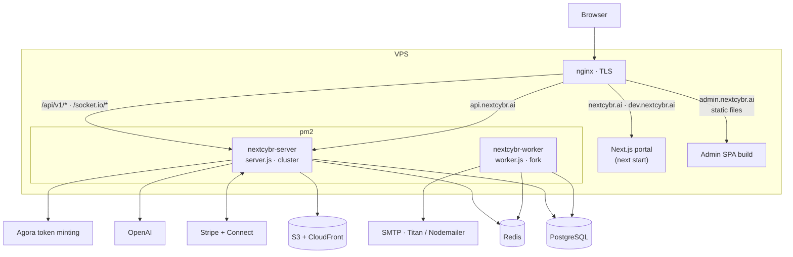
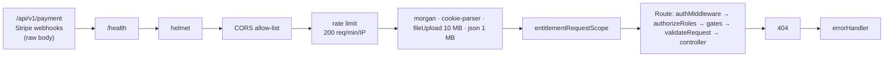

# System architecture

NextCybr runs as two frontends and one backend, deployed together on a single VPS behind nginx, with managed PostgreSQL and Redis.

## Runtime topology



- **nginx** (config in `nextcybr-server/nginx/`) terminates TLS. On the portal hosts it sends `/api/v1/` and `/socket.io/` to the API, so the browser talks to one origin and cookies stay first-party.
- **pm2** (`ecosystem.config.cjs`) runs two apps: `nextcybr-server`, the HTTP and Socket.io process in cluster mode, and `nextcybr-worker`, the BullMQ consumer in fork mode. The web process never drains queues itself unless `ENABLE_INLINE_WORKERS=true`. That setting is for local dev only.
- **Socket.io** runs inside the API process. The API currently runs as a single pm2 instance, and the Redis adapter is installed but not wired, so scaling out needs it first (see [Real-time](/backend/realtime)).

## Request lifecycle (server)

`app.js` builds the Express app in this order:



1. **Webhooks first.** Stripe routes mount before the JSON parser so signature verification sees the raw body.
2. **Health** (`/health`, `/api/v1/health`) answers before CORS, so load balancers and deploy scripts work without an `Origin` header.
3. **CORS** allows only origins from `allowedOrigins.js`, built from `CLIENT_URL`, `ADMIN_URL` and `PORTAL_URL`, with `credentials: true`.
4. **`entitlementRequestScope`** gives each request one shared plan lookup, so several gates on one route don't re-query the plan.
5. **Per route:** [`authMiddleware`](/backend/auth-security) → `authorizeRoles(...)` → [plan gates](/backend/entitlements) (`requireFeature`, `requireAndConsume`, `checkAiUsage`) → Zod `validateRequest` → controller wrapped in `tryCatchBlockHandler`.
6. **Errors** go through `CustomError` and the global [`errorHandler`](/backend/errors-validation).

## Server layering

```text
nextcybr-server/
├── server.js            HTTP + Socket.io bootstrap, graceful shutdown
├── worker.js            BullMQ workers (email, scheduler)
├── app.js               Express app factory and route mounting
├── prisma/              schema.prisma, migrations, seeds, smoke tests
└── src/
    ├── modules/<domain>/   *.routes.js → *.controller.js (+ *.schema.js Zod)
    ├── services/           Cross-module business logic (AI, entitlements, profiles)
    ├── middlewares/        auth, aiUsage, rateLimiters, validateRequest, errorHandler
    ├── queues/ workers/    BullMQ queue definitions and processors
    ├── lib/                S3 client, media URL helpers
    ├── utils/              socket.js, tokens, cookies, email, timezone, CSV, …
    ├── constants/          status codes, CV templates, education levels
    └── templates/          Email HTML templates
```

Routers declare middleware chains. Controllers hold request logic. Code shared by more than one module goes in `services/`. Mentor code is split into one controller per area (`mentorSession`, `mentorWebinar`, `mentorPayout`, …) plus `mentor.shared.js` for constants and helpers.

## Frontend architecture

| | Portal | Admin portal |
| --- | --- | --- |
| Routing | Next.js App Router. `(static)` public pages, `(protected)` signed-in app, `onboarding/[id]` | React Router 7 in `src/App.jsx`. Everything behind `PrivateRoute` except `/signin` |
| Access control | Edge `middleware.js` + `constants/routeAccess.js` | `PrivateRoute` + admin session check |
| State | Redux Toolkit (`store/`) | Redux Toolkit (`src/store/slices`) |
| HTTP | Axios (`utils/axios.js`, `withCredentials`) with a queued refresh-on-401 interceptor. Base `NEXT_PUBLIC_API_URL=/api/v1/client`, same origin via nginx. Server-side fetches use `BACKEND_API_URL`. | Axios instance (`src/utils/axiosInstance.js`) with admin refresh flow, base `VITE_API_BASE_URL` |
| Real time | `socket.io-client` (chat, presence, notifications) | — |
| Video | `agora-rtc-sdk-ng` (sessions, webinars, interviews) | — |
| Payments | `@stripe/react-stripe-js` (bookings), Stripe Checkout redirect (plans) | — |

See [Candidate portal](/apps/portal) and [Admin portal](/apps/admin-portal).

## Cross-cutting mechanisms

| Mechanism | Where | Guide |
| --- | --- | --- |
| JWT access/refresh with rotating refresh tokens and revocable `LoginSession`s | `middlewares/auth.js`, `modules/auth` | [Auth & security](/backend/auth-security) |
| Plan features, quotas and capacity limits | `services/entitlementService.js` | [Entitlements engine](/backend/entitlements) |
| AI token reservation and settlement | `middlewares/aiUsage.js` | [AI services & usage](/backend/ai-services) |
| Real-time chat, presence and notification push | `utils/socket.js` | [Real-time](/backend/realtime) |
| Emails, reminders, sweeps, payout batches | `queues/`, `workers/` | [Background jobs](/backend/background-jobs) |
| Stripe billing, bookings, Connect payouts | `modules/subscription`, `modules/webhook`, `modules/mentor/payout*` | [Integrations](/backend/integrations) |
