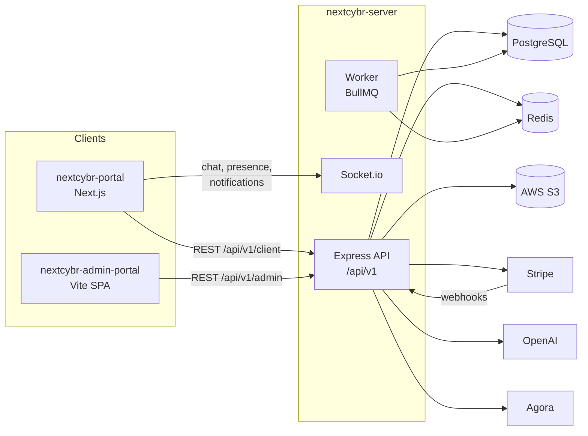

# Platform overview

NextCybr is a cybersecurity careers platform. Candidates build a profile and CV, learn with an AI coach, follow an AI career roadmap, find mentors and apply to jobs. Recruiters post jobs and source candidates with AI. Mentors sell 1:1 sessions and webinars and get paid out through Stripe Connect. Platform admins approve accounts, run plans and billing, and handle support.

This site documents **what the platform does today**, as built on the `master` branch of the three repositories.

## The three codebases

| Repo | What it is | Stack | Who uses it |
| --- | --- | --- | --- |
| `nextcybr-portal` | The product: public site, auth, onboarding and the signed-in app for every role | Next.js 16 (App Router, Turbopack), React 19, Redux Toolkit, Tailwind v4, Socket.io client, Agora RTC, Stripe Elements | Candidates, recruiters, mentors, visitors |
| `nextcybr-admin-portal` | Internal back-office | Vite 8, React 19, React Router 7, Redux Toolkit, Tailwind v4, Recharts, Tiptap | NextCybr staff |
| `nextcybr-server` | The one API behind both frontends, plus real-time and background work | Node 22, Express 5, Prisma 7 / PostgreSQL, Redis, BullMQ, Socket.io, Stripe, OpenAI, Agora, AWS S3 | Both frontends, Stripe webhooks |

## Feature map

| Area | Candidate | Recruiter | Mentor | Admin |
| --- | :-: | :-: | :-: | :-: |
| [Authentication & sessions](/features/authentication) | ✓ | ✓ | ✓ | ✓ |
| [Onboarding & approvals](/features/onboarding-approvals) | ✓ | ✓ (approval) | ✓ (approval) | approves |
| [Profiles & public profile](/features/profiles) | ✓ | ✓ | ✓ | views |
| [Jobs & applications](/features/jobs-applications) | applies | posts | | views |
| [Recruiter tools](/features/recruiter-tools) | | ✓ | shortlists, search | |
| [Live interviews](/features/interviews) | joins | schedules | | |
| [AI Cyber Coach](/features/cyber-coach) | ✓ | | | |
| [NextGen CV builder](/features/resume-builder) | ✓ | | | |
| [Career roadmaps](/features/career-roadmaps) | ✓ | | | |
| [AI matching](/features/ai-matching) | jobs, mentors | candidates | mentees | |
| [Mentorship](/features/mentorship) | books | | sells | cancels |
| [Mentor payouts](/features/mentor-payouts) | | | ✓ | reconciles |
| [Plans & billing](/features/plans-billing) | ✓ | ✓ | ✓ | manages |
| [Messaging & notifications](/features/messaging) | ✓ | ✓ | ✓ | broadcasts |
| [Support desk](/features/support) | raises | raises | raises | answers |
| [Blog & launch waitlist](/features/content) | reads | reads | reads | authors |
| [Account settings](/features/settings) | ✓ | ✓ | ✓ | |

## Where to go next

- New to the codebase? Read [Architecture](/getting-started/architecture), then [Local setup](/getting-started/local-setup).
- Working on a feature? Each [feature guide](/features) lists the screens, endpoints, models and plan gates involved.
- Need a specific endpoint, table or limit? Use the [API reference](/reference/api), [Data model](/reference/data-model) or [Plans & feature matrix](/reference/plans). These are generated from `master` and kept current by `npm run sync`.
