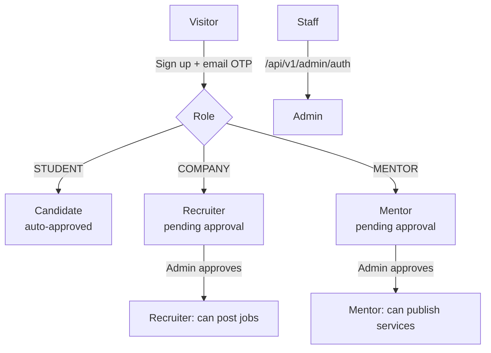

# Personas & roles

Every portal account is a `User` with exactly one `role`: `STUDENT`, `COMPANY` or `MENTOR` (the `UserRole` enum). Platform staff are a separate `Admin` table with their own sign-in, and their tokens carry the role `ADMIN`. A user's role is fixed at sign-up; sign-in requires choosing the matching account type.

## Visitor (public)

No account needed for the marketing site (`/`, `/about-us`, `/for-job-seeker`, `/for-recruiter`, `/for-mentor`), legal pages, the blog (`/blogs`), the public job board (`/jobs`) and public profiles (`/public-profile/[id]`, only when the owner set their profile to `PUBLIC`). When the portal runs in coming-soon mode, visitors can join the [launch waitlist](/features/content#launch-waitlist--coming-soon-gate).

## Candidate (`STUDENT`)

Approved automatically at sign-up (`approvedByAdmin = true`). Completes a multi-step onboarding, then gets:

| Menu | What it does |
| --- | --- |
| Dashboard | Profile score, usage summary, roadmap progress, recommendations |
| My NextGen CV | [AI CV builder](/features/resume-builder): generate, upload, enhance, assess, drafts, templates |
| Cyber Coach | [Nine AI learning modes](/features/cyber-coach) across eight tracks |
| Personalized Roadmap | [AI career path](/features/career-roadmaps) with progress tracking |
| Mentorship | Browse and [book mentors](/features/mentorship), AI-suggested mentors, my bookings |
| Challenges | Placeholder screen (`InDev`) — not built yet |
| Jobs | Search, AI-suggested jobs, saved jobs, [applications](/features/jobs-applications) |
| Companies | Browse companies and their open jobs |
| Chats | [Messaging](/features/messaging) with mentors and recruiters |
| Payment & Finances | [Plan, invoices, purchases](/features/plans-billing) |
| Support & Help · Settings · Notifications | [Support](/features/support), [settings](/features/settings) |

Plans: **Free**, **Pro**, **Pro Plus**.

## Recruiter (`COMPANY`)

Signs up, completes company onboarding, then waits for an admin. Until approved the portal shows a verification-pending overlay, and the server blocks publishing with `requireApproved` (job creation). Profile edits stay open so the admin has something to review.

| Menu | What it does |
| --- | --- |
| Job Postings | Create/edit jobs, templates, view applicants per job ([jobs](/features/jobs-applications)) |
| Candidate Search | Standard search plus AI candidate search ([recruiter tools](/features/recruiter-tools)) |
| Short Listings | Shortlisted candidates, notes, CSV export |
| Saved Searches | Re-open saved searches and AI match runs without spending AI allowance |
| Hired Candidates | Everyone hired across all jobs |
| Messaging, Notifications, Payment & Finances, Support, Settings | Shared features |

Plans: **Free**, **Pro**, **Enterprise**.

## Mentor

Same approval gate as recruiters; service creation (`POST /services/one-to-one`, `POST /services/webinar`) requires approval. Mentors also see the shared candidate search and shortlist pages.

| Menu | What it does |
| --- | --- |
| Candidate Search · Short Listings | Find and shortlist mentees (AI mentee search on Pro) |
| Services | Create 1:1 and webinar services, archive, discount codes |
| Sessions | Bookings and registrations, join/start calls |
| Availability | Weekly slots and blackout dates |
| Earnings & Plan | Plan, earnings, payouts, Stripe Connect onboarding ([payouts](/features/mentor-payouts)) |

Plans: **Free**, **Pro**.

## Platform admin

Signs in to the admin portal (`/signin`) against the `Admin` table. Every admin endpoint is guarded by `authorizeRoles("ADMIN")`. See [Admin portal](/apps/admin-portal) for the screens.

