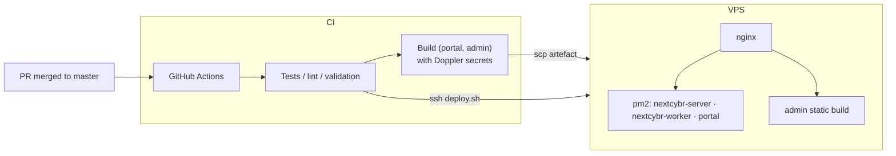

# Deployment

All three apps deploy to **one VPS** on every push to `master` (or a manual `workflow_dispatch`) through each repo's `.github/workflows/deploy.yml`. Work goes in through pull requests to `master`. Each workflow allows one deploy at a time.



## Server

1. **Pre-deploy validation** (CI): `npm ci`, `prisma generate`, `npm test`, `node --check server.js worker.js`, `prisma validate`.
2. **Deploy** (CI over SSH runs `deploy.sh` on the VPS):
   ```bash
   git pull origin master
   npm install
   doppler secrets download --no-file --format env > .env
   npx prisma migrate deploy
   npx prisma generate
   npx prisma db seed
   pm2 startOrReload ecosystem.config.cjs --env production   # new process up before old stops
   pm2 save
   ```
   The first deploy after the server switched from fork to cluster mode needs a one-off delete and restart, which `deploy.sh` detects.

:::danger Migrations run on deploy
`prisma migrate deploy` runs against production on every server deploy. Test new migrations on a **copy** of the database first, never on your only local DB, and never by hand on production.
:::

## Portal

CI runs unit tests, then builds with production secrets from Doppler (`next build`), packs the build as `portal-build.tgz`, and copies it to the VPS (`scp`). Over SSH it resets the portal checkout to the deployed commit and runs `scripts/deploy-vps.sh <tarball>`, which unpacks the build and restarts the portal. Vercel preview checks on pull requests are known to fail and can be ignored. Production doesn't use Vercel.

## Admin portal

CI runs `format:check`, `lint` and tests, builds with production secrets from Doppler, and copies the static `dist/` to the VPS, where nginx serves it at `admin.nextcybr.ai` (`vercel.json` holds SPA rewrites for previews).

## nginx

`nextcybr-server/nginx/` holds the site config:

| Host | Routes |
| --- | --- |
| `nextcybr.ai`, `www.nextcybr.ai`, `dev.nextcybr.ai` | `/` → portal. `/api/v1/` and `/socket.io/` → API. |
| `admin.nextcybr.ai` | Static admin SPA (cached `/assets/`) |
| `api.nextcybr.ai` | API |

## Operating production

```bash
# on the VPS, as the app user
pm2 ls
pm2 logs nextcybr-server --lines 200
pm2 logs nextcybr-worker --lines 200
curl -s localhost:<PORT>/health
```

- **Health checks**: `GET /health` and `GET /api/v1/health` return `{ status: "UP", uptime }`.
- **Graceful shutdown**: `server.js` closes HTTP, Socket.io, Prisma and Redis on SIGTERM so pm2 reloads drop no requests.
- **Alerts**: payout and refund problems are emailed to `ADMIN_ALERT_EMAIL` and tagged `[ALERT]` in the logs.
