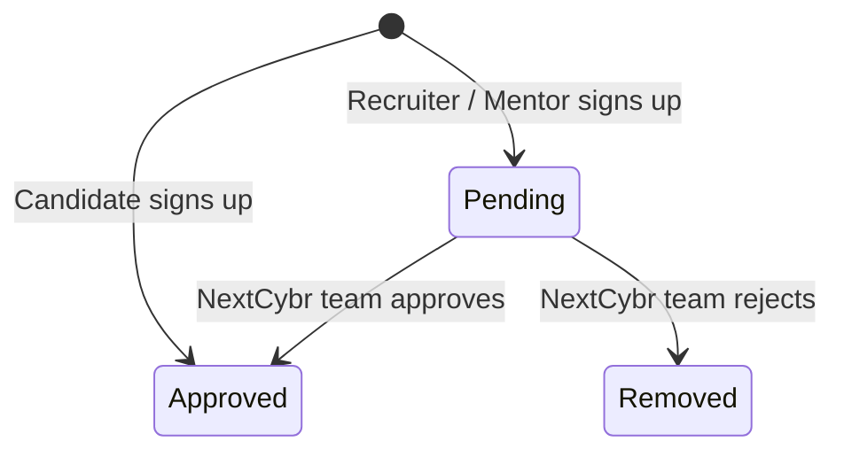

# Roles, sign-up & approval

## The four roles

| Role | In the product | Can't do |
| --- | --- | --- |
| **Candidate** | Job seeker and learner | Message a recruiter first. Message an unbooked mentor on the Free plan. |
| **Recruiter** | A hiring company (one account per recruiter today) | Post jobs before approval |
| **Mentor** | An industry professional selling time | Publish services before approval |
| **Admin** | NextCybr staff, in a separate admin portal | Use the main portal. Admin accounts are separate. |

An account has **exactly one role, chosen at sign-up, and it can't be changed**. Signing in asks for the account type, and choosing the wrong one gives a "this account is registered as …" message.

## Sign-up and verification

- Sign-up needs a verified email. The user gets a **6-digit code valid for 10 minutes**.
- **5 wrong codes lock that email for 15 minutes.** Resending has a short wait.
- After verifying, the user has **30 minutes** to finish creating the account.
- An email can only be registered once.
- Google and LinkedIn sign-in are also available.
- Every new account starts on the **Free plan** and gets a welcome email.

## Approval

| | Before approval | After approval |
| --- | --- | --- |
| Sign in, onboarding, edit profile | ✓ | ✓ |
| Recruiter: post a job | ✗ | ✓ |
| Mentor: create a 1:1 service or webinar | ✗ | ✓ |
| What they see | A "verification pending" screen over the restricted areas | Full access per plan |

- **Approval** sends an in-app notification and an email. Mentors also get a **Verified Mentor** badge.
- **Rejection** notifies the user, emails them and removes the account.
- The team can approve up to 50 accounts at once.

## Onboarding

Each role fills in its profile right after sign-up. Until that's done, the app keeps sending them back to onboarding.

| Role | Captures |
| --- | --- |
| Candidate | Personal details, location, education, experience, skills, certifications, preferred contract types and roles, languages |
| Recruiter | Company details, size, industry, headquarters and locations, website, logo, their role in the company (founder, CEO, HR manager) |
| Mentor | Headline, expertise, experience, bio, languages, rates |

## Sessions and devices

- Signing in on a **new device or browser** sends a login alert email.
- Users can see every signed-in device and sign out one device or all of them.
- Changing the password signs out other devices.
- An idle session in the portal ends after about **6 hours**.

## Edge cases worth testing

- Sign up as a recruiter, then try to post a job before approval. It must be refused, even if the button is reachable.
- Sign in with the right password but the wrong account type.
- Enter a wrong code 5 times, then the right one: still locked for 15 minutes.
- Verify the email, wait more than 30 minutes, then submit sign-up: refused.
- Sign out of one device from another device. The first must be signed out on its next action.
- A rejected mentor tries to sign in again.

[Engineering detail →](/features/authentication) · [Onboarding & approvals →](/features/onboarding-approvals)
