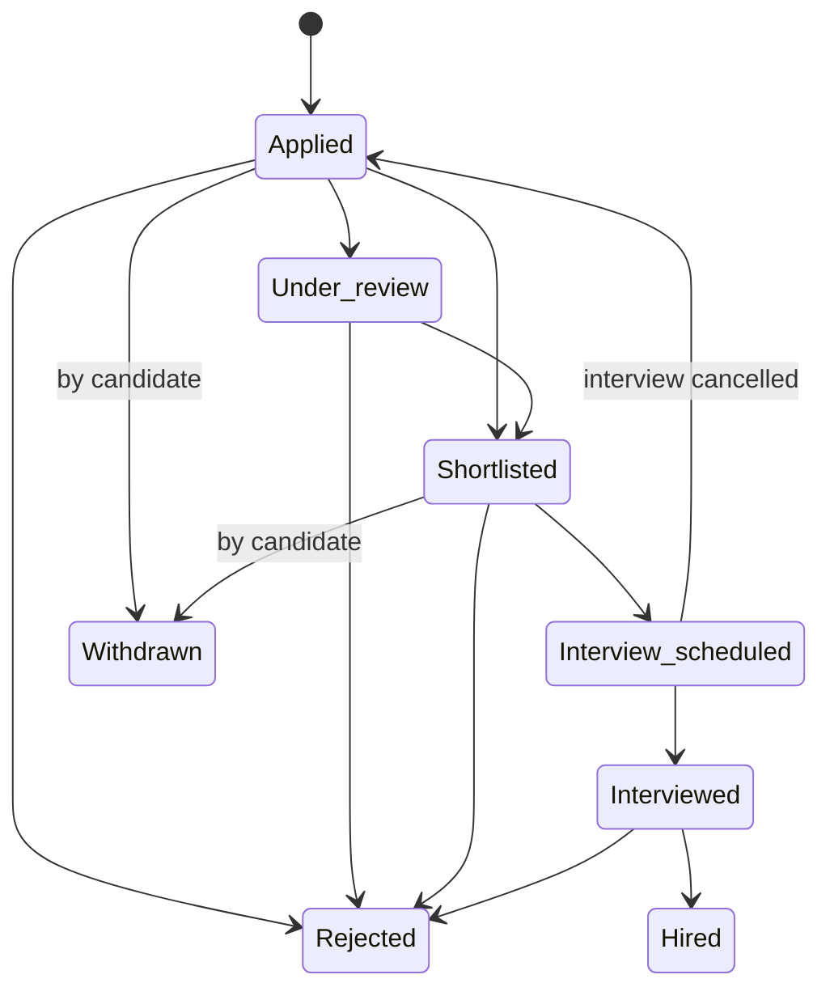

# Jobs & applications (candidate side)

## Finding jobs

| Way in | Behaviour |
| --- | --- |
| **Public job board** | Anyone can browse open jobs without an account |
| **Job search** | Filter by contract type, remote/hybrid/onsite, location, experience and keyword. Only live jobs appear (no drafts, closed or archived jobs). |
| **AI job search** | Ranks jobs against the candidate's profile and shows only matches scoring 60+. Free 1 · Pro 30 · Pro Plus unlimited per 30 days. Free sees 5 results, paid plans up to 10. |
| **Company pages** | All open jobs from one company |

- **Experience filter:** a job matches if its experience range **overlaps** the filter. A "2–4 years" job appears in a "2–3 years" search.
- **Fit explanation:** every AI match shows the overall fit, top strengths and top gaps. **Pro Plus** adds a detailed breakdown: per-criterion scores, alignment with career goals, and what to do before applying.
- **Saved jobs:** Free 5 · Pro 40 · Pro Plus unlimited at once. Removing one frees a slot.
- **Job alerts:** an email digest of new matching jobs every 7 days (Free), 3 days (Pro) or daily (Pro Plus). Paid plans also get them in the app. It can be turned off in settings.

## Applying and tracking

| Rule | Detail |
| --- | --- |
| One application per job | Applying twice is refused |
| Candidates can withdraw | Only while **Applied** or **Shortlisted** |
| Only recruiters move applications forward | And never backwards once an interview is scheduled or done |
| Final states | Hired, Rejected and Withdrawn can't change |
| Someone else is hired | The job closes and **every other open application is rejected automatically**, with a notification |
| Updates | In-app notification on every status change, plus email unless "Application updates" is turned off |

## Edge cases worth testing

- Apply, withdraw, apply again → refused (one application per job).
- Withdraw when Under review or Interview scheduled → not allowed.
- Two candidates apply and one is hired → the other is rejected automatically and notified, and the job disappears from search.
- Save 5 jobs on Free and try a 6th → blocked. Remove one → allowed.
- A job with no experience range appears in every experience filter.

[Engineering detail →](/features/jobs-applications)
