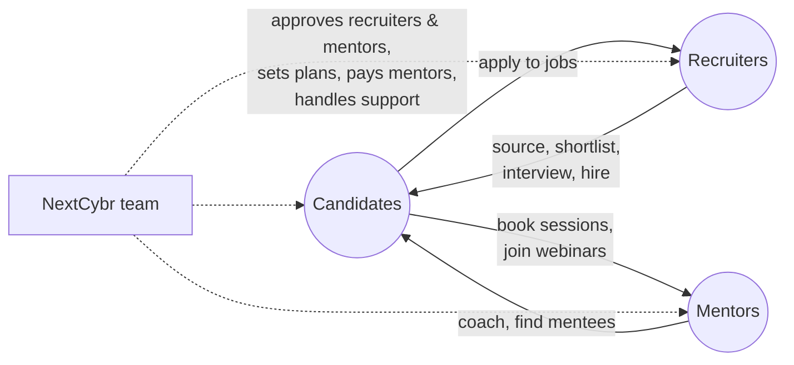

# Product guide

This section explains **how NextCybr behaves from a product and business point of view**: who can do what, the rules the platform enforces, what changes by plan, and where the edge cases are. It's written for product managers, QA and anyone who needs to know what the product does without reading code.

For how things are built (endpoints, tables, services), each page links to its engineering counterpart.

## NextCybr in one picture

NextCybr is a **three-sided cybersecurity careers marketplace** with a platform team running it.

| Audience | What they come for | Plans |
| --- | --- | --- |
| **Candidates** | Build a strong CV, learn with the AI Cyber Coach, follow a career roadmap, find jobs, get mentored | Free · Pro · Pro Plus |
| **Recruiters** | Post cybersecurity jobs, find and assess candidates with AI, interview and hire | Free · Pro · Enterprise |
| **Mentors** | Sell 1:1 sessions and webinars, find mentees, get paid | Free · Pro |
| **NextCybr team** | Vet recruiters and mentors, run plans and pricing, pay mentors, support users | Admin portal |

## How NextCybr makes money

1. **Subscriptions.** Candidates, recruiters and mentors can upgrade to paid plans, billed monthly or yearly through Stripe. See [Plans & pricing](./plans-and-pricing.md).
2. **Mentorship commission.** NextCybr keeps **15%** of every paid booking and webinar seat from mentors on the Free plan, and **10%** from mentors on Pro. The rest is paid out to the mentor weekly. See [Earnings & payouts](./mentors/earnings-and-payouts.md).

## Platform-wide principles

These hold across every feature. Bear them in mind when you write requirements or test cases.

| Principle | What it means in practice |
| --- | --- |
| **Plans are configuration, not code** | Every limit and paid feature lives in an admin-editable plan matrix. Numbers in this guide are the **launch defaults**. The team can change them in the admin portal without a release. |
| **You only pay for what worked** | If an AI action or a counted action fails, the allowance it used is given back. |
| **AI has two budgets** | Each AI action uses one unit of its own allowance (e.g. "1 CV creation") **and** some of a shared daily and 30-day AI token budget. Either one running out blocks the action. |
| **Limits come in two kinds** | *Counters* reset on a schedule (daily, every 30 days, or each calendar month). *Caps* limit how many of something you have at once (active jobs, shortlisted candidates) and free up when you remove one. |
| **Time zones** | Users see times in their own time zone. "Daily" allowances reset at the user's local midnight. Mentor availability uses the mentor's time zone. |
| **The server is the referee** | Everything this guide calls a "rule" is enforced by the platform, not just hidden in the UI. Calling the API directly can't get around it. |
| **Recruiters and mentors are vetted** | They can sign up and fill in a profile immediately, but can't publish jobs or services until the NextCybr team approves them. |

## How to use this section

- **Product managers:** start with [Roles & access](./accounts/roles-and-access.md) and [Plans & pricing](./plans-and-pricing.md), then the experience you own.
- **QA:** every feature page ends with **edge cases worth testing**. [Known limitations](./known-limitations.md) lists behaviour that is incomplete on purpose or known to be broken, so you don't log it twice.
