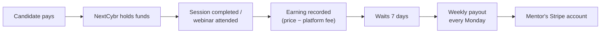

# Earnings & payouts

## The money flow

## Business rules

| Rule | Detail |
| --- | --- |
| **Platform fee** | **15%** for Free mentors, **10%** for Pro. The rate in force when the sale completes is locked on that earning. Upgrading later doesn't change past earnings. |
| When an earning is recorded | When a 1:1 session completes (or the candidate no-shows) or a webinar attendee is marked attended. Not at booking time. |
| **Hold period** | Earnings wait **7 days** before they can be paid, to leave room for refunds and disputes |
| **Payout schedule** | Weekly, **every Monday**. Each payout covers every earning past its hold that hasn't been paid yet. |
| Payout account | Mentors connect a **Stripe** payout account, set up on Stripe's own pages. No account means no payout. The earnings wait. |
| Disconnected account | Payouts pause until the mentor reconnects |
| **Refund after payout** | If a candidate is refunded or disputes a charge after the mentor was paid, the amount is **deducted from the next payout** |
| Receipt | The mentor gets an email for every payout |
| Problems | Failed or unclear transfers are retried and checked automatically. Anything that needs a human alerts the NextCybr team. |

## What mentors see

| View | Free | Pro |
| --- | :-: | :-: |
| Earnings list, available / pending / paid totals, fees paid, hold days | ✓ | ✓ |
| Payout history | ✓ | ✓ |
| CSV export | ✓ | ✓ |
| Breakdown by period and service | — | ✓ |

## Edge cases worth testing

- A Free mentor's $100 session → $85 earning. The mentor upgrades to Pro, then the next $100 session → $90, and the first stays $85.
- A session completed 6 days before Monday's run isn't in that payout. It's in the next one.
- A mentor with no Stripe account connected → earnings build up, no payout, nothing lost.
- A refund on an already-paid session → the next payout is reduced by that amount.

[Engineering detail →](/features/mentor-payouts)
