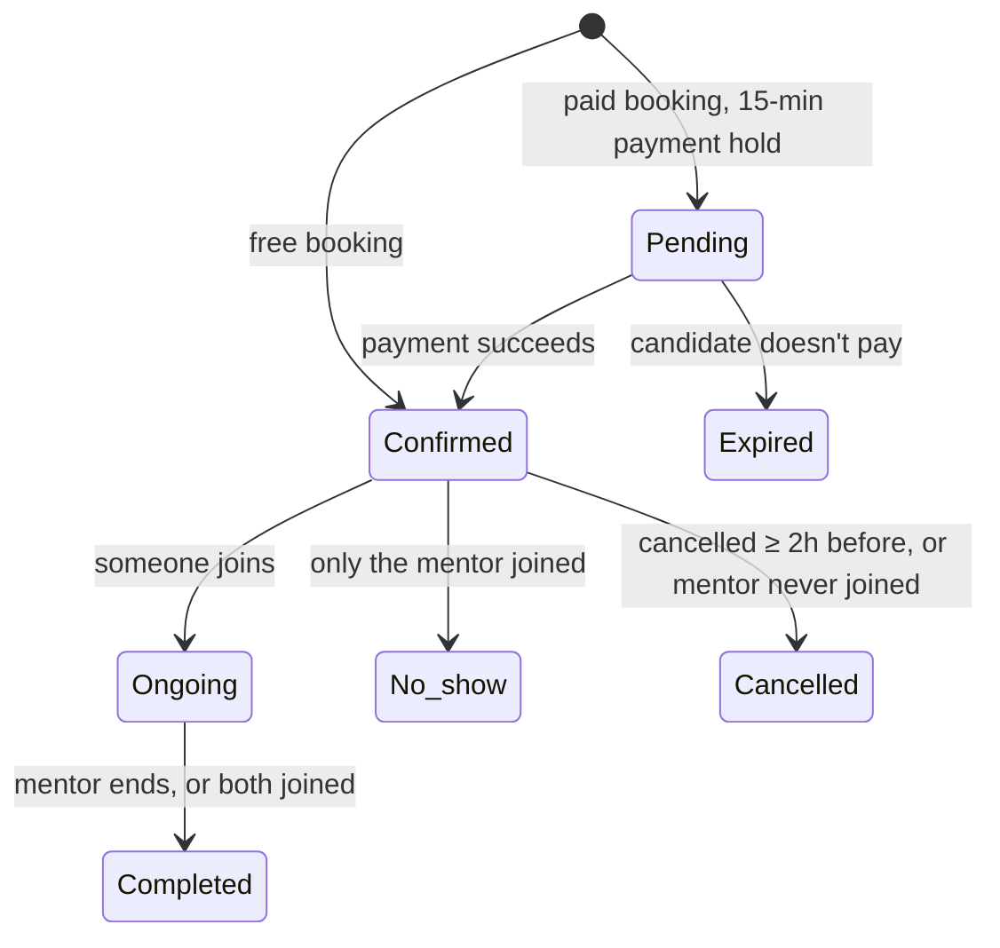
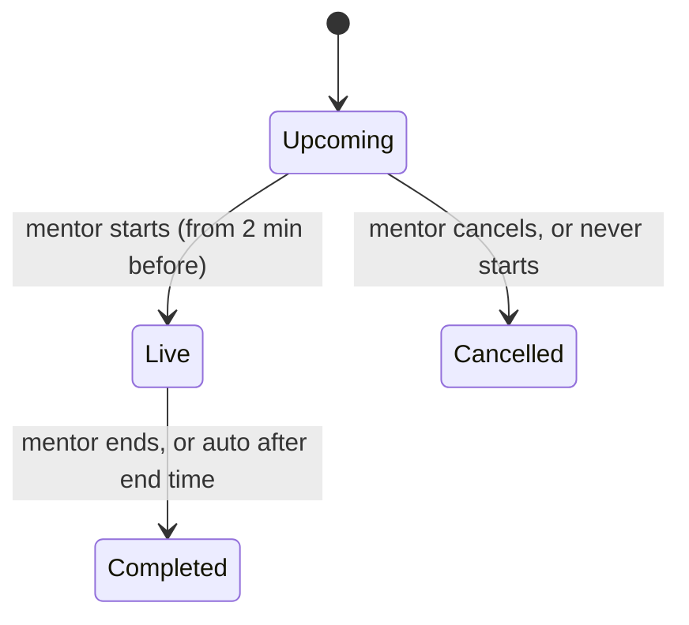

# Sessions & webinars

## 1:1 session lifecycle

## Who gets what

| Outcome | Candidate | Mentor |
| --- | --- | --- |
| Completed | — | Paid (minus platform fee) |
| Candidate no-show (mentor joined) | No refund | Paid |
| **Mentor no-show** | **Full refund** | Not paid |
| Cancelled by candidate or mentor (≥ 2h before) | Full refund | Not paid |
| Cancelled by the NextCybr team | Full refund | Not paid |
| Payment not completed in 15 min | Not charged, slot released | — |

## Session rules

| Rule | Detail |
| --- | --- |
| Joining | The room opens 30 minutes before the start |
| Ending | The mentor ends the session. If nobody does, the platform settles it automatically after the scheduled end. |
| Cancel / reschedule | Either side, up to **2 hours before** the start |
| Waitlist | When a slot frees up (cancel or reschedule), waitlisted candidates get an email |
| Reviews | Candidates rate and review after the session, and the mentor is notified |
| Reminders | Both sides get an email shortly before the start |

## Webinars

| Rule | Detail |
| --- | --- |
| Capacity | Seats are never oversold, even with simultaneous sign-ups. An unpaid seat is held for 15 minutes. |
| Abandoned checkout | If the candidate returns within the hold, they resume the same payment |
| Joining | Attendees can only join once the mentor has started. Until then the page waits. |
| Attendance | When the webinar ends, each registrant is marked **Attended** or **Absent**. The mentor is paid for attendees. |
| Candidate cancels registration | Refunded if paid |
| Mentor cancels the webinar | Every paid registrant is refunded and emailed |
| Mentor never starts | Cancelled automatically after its scheduled time, and everyone refunded |
| Refunded seats | Can't be used to join |

## Edge cases worth testing

- Book and pay, mentor doesn't join → auto-cancelled and refunded after the session window.
- Both join, nobody presses End → completed automatically, and the mentor sees the earning.
- Webinar with 1 seat left, two candidates register at the same moment → one succeeds, the other sees "full".
- Candidate cancels a paid webinar seat → refunded, and the seat becomes available again.
- Candidate opens the webinar link before the mentor starts → waiting state, not an error.

[Engineering detail →](/features/mentorship)
