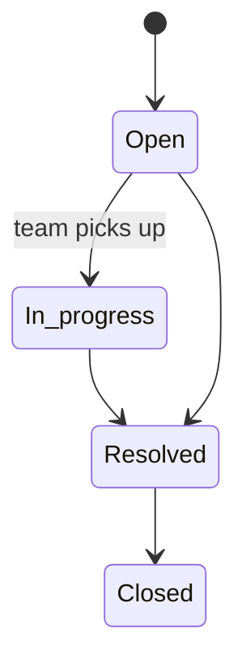

# Support desk

## Raising a ticket

- Users pick a **category** and then a **reason**. Some reasons ("Other") need a short description.
- They describe the issue and can attach up to **3 screenshots** (images, 2 MB each).
- Tickets are either **Support** or **Bug**.

## Priority by plan

| Plan level | Support tier | Starting priority |
| --- | --- | --- |
| Free (all audiences) | Standard | Normal |
| Candidate Pro, Recruiter Pro, Mentor Pro | Priority | One level higher |
| Candidate Pro Plus, Recruiter Enterprise | Highest / Dedicated | One level higher, sorted first within that level |

## Lifecycle

- Users and the team reply in a threaded conversation on the ticket.
- Users can mark their own ticket resolved.
- The team works the queue in the admin portal (filters, replies, status changes).

## Edge cases worth testing

- Attach 4 screenshots, or one of 3 MB → rejected.
- Choose "Other" with no description → rejected.
- A Pro user's new ticket starts at a higher priority than a Free user's.

:::warning Known issue
The admin portal shows a control for changing a ticket's priority, but it doesn't work. Priority is set automatically when the ticket is created. See [Known limitations](../known-limitations.md).
:::

[Engineering detail →](/features/support)
