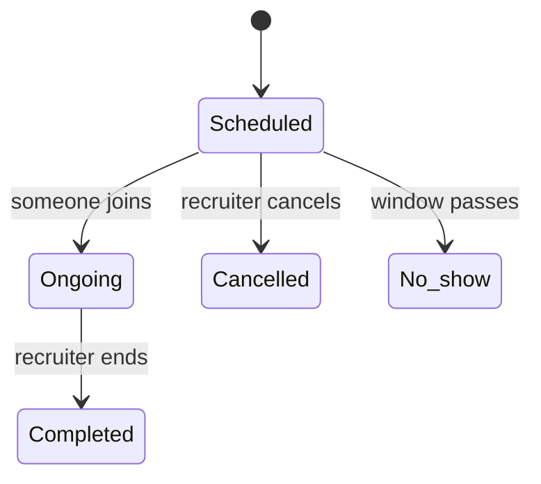

# Live interviews

Recruiters schedule video interviews with an applicant and both sides join from inside NextCybr. No external meeting link is needed.

## Business rules

| Rule | Detail |
| --- | --- |
| Who schedules | Only the recruiter who owns the job |
| Which applications | Applied, Under review, Shortlisted, or already Interview scheduled |
| Duration | 15 to 120 minutes |
| Notice | Must be at least **1 hour** from now |
| Time zones | The recruiter picks a time in their own time zone. Each side sees it in theirs. |
| No clashes | Two overlapping interviews can't be scheduled for the same application |
| Joining | Opens **10 minutes before** the start and closes **15 minutes after** the scheduled end |
| Ending | The recruiter ends the interview, and the application moves to **Interviewed** |
| Rescheduling | Allowed. The candidate is notified. |
| Cancelling | The application goes back to **Applied**, and the candidate gets an email |
| Nobody joins | After the window passes, the interview is marked a **no-show** automatically and the candidate is notified |

## Edge cases worth testing

- Schedule 59 minutes from now → refused. 14-minute or 121-minute duration → refused.
- Join 11 minutes early → refused. 10 minutes early → allowed.
- Cancel → the application status goes back to Applied.
- Nobody joins → it shows as no-show within about 15 minutes of the window closing.
- A recruiter in another time zone schedules 10:00 → the candidate sees their local time.

[Engineering detail →](/features/interviews)
