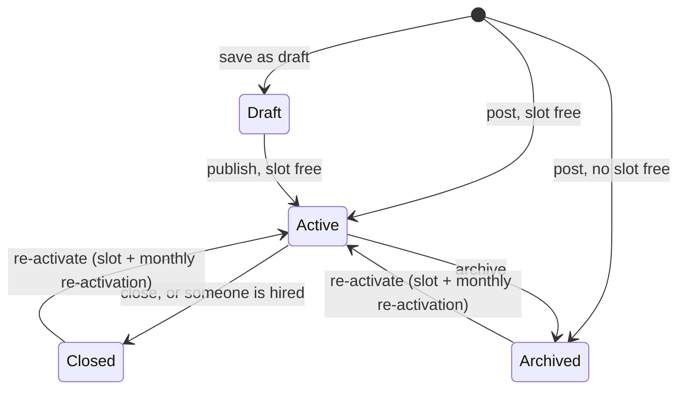

# Job postings & hiring

## Job statuses

| Status | Visible to candidates? | Counts toward the active-job limit? |
| --- | :-: | :-: |
| **Active** | ✓ | ✓ |
| **Draft** | — | — |
| **Archived** | — | — |
| **Closed** | — | — |

## Business rules

| Rule | Detail |
| --- | --- |
| Approval needed | Only approved recruiters can post |
| **Active-job limit** | Free: **2 active jobs** at once. Pro/Enterprise: unlimited. |
| Posting past the limit | Allowed, but the job is saved as **Archived**, not live. The recruiter can activate it when a slot frees up. |
| **Re-activations** | Bringing back an archived or closed job needs a free slot **and** one of **2 re-activations per calendar month** (Free) |
| Editing a live job | Doesn't use a slot or a re-activation |
| Job templates | Pro/Enterprise can save a job as a template and start new jobs from it |
| Posting confirmation | The recruiter gets an email when a job is posted |

## Managing applicants

- Applicants are listed **per job** and **across all jobs**.
- The recruiter moves each application forward: Applied → Under review → Shortlisted → Interview scheduled → Interviewed → Hired. They can reject at any stage before hiring.
- **No going back** once an interview is scheduled or done. **Hired, Rejected and Withdrawn are final.**
- Each move notifies the candidate in-app and, unless they opted out, by email.

### On hire

1. The job **closes** automatically (no new applications).
2. **Every other open applicant is rejected** and notified.
3. The person appears under **Hired candidates**.

## Edge cases worth testing

- Free recruiter with 2 active jobs posts a third → it's created as Archived, not live.
- Close one job, then activate the archived one → works. Do it a third time in the same month → blocked by the re-activation limit.
- Edit the title of a live job → no slot or re-activation used.
- Hire someone on a job with 5 applicants → 4 auto-rejected, the job is closed and gone from candidate search.
- Try to move an Interviewed application back to Shortlisted → refused.

[Engineering detail →](/features/jobs-applications)
