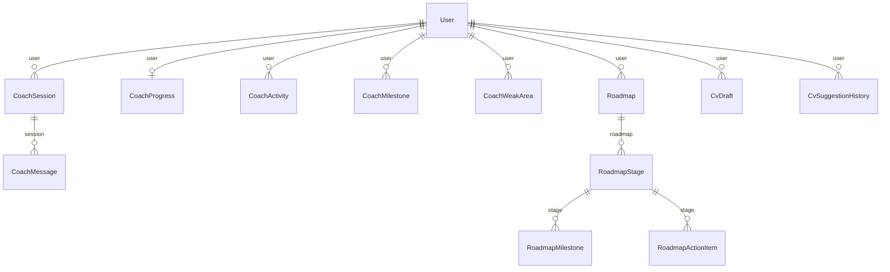

# AI: coach, roadmaps & CV

Cyber Coach progress, AI roadmaps and CV drafts/history.

:::info[Generated page]

This page is generated by `npm run sync` from `master` of **nextcybr-server**. Do not edit it by hand — changes are overwritten on the next sync.
:::

## CoachSession

The raw conversational transcript that CoachActivity/CoachProgress/ CoachMilestone/CoachWeakArea never captured — those record outcomes (score, passed, weak topics), not the turn-by-turn exchange, so "resume a training session" or "completed trial content remains viewable" (verbatim chat) had nothing to read back from.

| Field | Type | Attributes | Notes |
| --- | --- | --- | --- |
| `id` | `String` | @id @default(uuid()) |  |
| `userId` | `String` |  |  |
| `user` | [User](./identity#user) | relation (FK) |  |
| `mode` | `String` |  | "session" \| "quiz" \| "mock-exam" \| "flashcards" \| "scenario" \| "log-analysis" \| "safe-lab" \| "assessment" \| "interview-prep" |
| `track` | `String?` |  |  |
| `level` | `String?` |  |  |
| `certification` | `String?` |  |  |
| `goal` | `String?` |  |  |
| `status` | [CoachSessionStatus](./enums#coachsessionstatus) | @default(ACTIVE) |  |
| `metadata` | `Json?` |  | Generated content for this session (quiz questions, scenario details, etc.) — keeps the session resumable without re-calling the AI. |
| `createdAt` | `DateTime` | @default(now()) |  |
| `updatedAt` | `DateTime` | @updatedAt |  |
| `messages` | [CoachMessage[]](#coachmessage) |  |  |

**Indexes & constraints:** `@@index([userId])` · `@@index([userId, status])`

## CoachMessage

| Field | Type | Attributes | Notes |
| --- | --- | --- | --- |
| `id` | `String` | @id @default(uuid()) |  |
| `sessionId` | `String` |  |  |
| `session` | [CoachSession](#coachsession) | relation (FK) |  |
| `role` | [CoachMessageRole](./enums#coachmessagerole) |  |  |
| `content` | `String` |  |  |
| `createdAt` | `DateTime` | @default(now()) |  |

**Indexes & constraints:** `@@index([sessionId])`

## CoachProgress

| Field | Type | Attributes | Notes |
| --- | --- | --- | --- |
| `id` | `String` | @id @default(uuid()) |  |
| `userId` | `String` | @unique |  |
| `sessionsCompleted` | `Int` | @default(0) |  |
| `quizzesCompleted` | `Int` | @default(0) |  |
| `mockExamsCompleted` | `Int` | @default(0) |  |
| `scenariosCompleted` | `Int` | @default(0) |  |
| `logLabsCompleted` | `Int` | @default(0) |  |
| `flashcardsCompleted` | `Int` | @default(0) |  |
| `safeLabsCompleted` | `Int` | @default(0) |  |
| `assessmentsCompleted` | `Int` | @default(0) |  |
| `interviewsCompleted` | `Int` | @default(0) |  |
| `averageScore` | `Float` | @default(0) |  |
| `totalScore` | `Float` | @default(0) |  |
| `totalGraded` | `Int` | @default(0) |  |
| `createdAt` | `DateTime` | @default(now()) |  |
| `updatedAt` | `DateTime` | @updatedAt |  |
| `user` | [User](./identity#user) | relation (FK) |  |

## CoachActivity

| Field | Type | Attributes | Notes |
| --- | --- | --- | --- |
| `id` | `String` | @id @default(uuid()) |  |
| `userId` | `String` |  |  |
| `type` | `String` |  |  |
| `track` | `String` |  |  |
| `mode` | `String` |  |  |
| `level` | `String` | @default("Beginner") |  |
| `certification` | `String?` |  |  |
| `title` | `String` |  |  |
| `goal` | `String?` |  |  |
| `score` | `Float?` |  |  |
| `passed` | `Boolean` | @default(false) |  |
| `weakAreas` | `String[]` | @default([]) |  |
| `metadata` | `Json` | @default("&#123;&#125;") |  |
| `createdAt` | `DateTime` | @default(now()) |  |
| `user` | [User](./identity#user) | relation (FK) |  |

**Indexes & constraints:** `@@index([userId])` · `@@index([userId, createdAt(sort: Desc)])`

## CoachMilestone

| Field | Type | Attributes | Notes |
| --- | --- | --- | --- |
| `id` | `String` | @id @default(uuid()) |  |
| `userId` | `String` |  |  |
| `title` | `String` |  |  |
| `description` | `String` |  |  |
| `category` | `String` |  |  |
| `icon` | `String` | @default("🏆") |  |
| `earnedAt` | `DateTime` | @default(now()) |  |
| `user` | [User](./identity#user) | relation (FK) |  |

**Indexes & constraints:** `@@unique([userId, title])` · `@@index([userId])`

## CoachWeakArea

| Field | Type | Attributes | Notes |
| --- | --- | --- | --- |
| `id` | `String` | @id @default(uuid()) |  |
| `userId` | `String` |  |  |
| `topic` | `String` |  |  |
| `count` | `Int` | @default(1) |  |
| `lastSeenAt` | `DateTime` | @default(now()) |  |
| `user` | [User](./identity#user) | relation (FK) |  |

**Indexes & constraints:** `@@unique([userId, topic])` · `@@index([userId])`

## Roadmap

| Field | Type | Attributes | Notes |
| --- | --- | --- | --- |
| `id` | `String` | @id @default(uuid()) |  |
| `userId` | `String` |  |  |
| `user` | [User](./identity#user) | relation (FK) |  |
| `isPrimary` | `Boolean` | @default(true) | Free: exactly one (isPrimary). Pro: one primary + this flag distinguishes it if multi-scenario ever lands for Pro. Pro Plus: multiple, each its own row — isPrimary marks which one is "the" roadmap shown by default. |
| `isActive` | `Boolean` | @default(true) | Soft-archive when superseded by a new generation or deleted by the user — never hard-deleted, so roadmap history survives a downgrade per the client's data-retention requirement. |
| `goalPrompt` | `String` |  |  |
| `title` | `String` |  |  |
| `summary` | `String` |  |  |
| `targetRole` | `String` |  |  |
| `currentLevel` | `String?` |  |  |
| `estimatedJourney` | `String?` |  |  |
| `readinessScore` | `Int?` |  |  |
| `currentStrengths` | `String[]` |  |  |
| `skillGaps` | `String[]` |  |  |
| `salaryProgression` | `Json?` |  |  |
| `alternativePaths` | `String[]` |  |  |
| `relatedJobs` | `Json?` |  |  |
| `overallAdvice` | `String?` |  |  |
| `nextBestAction` | `String?` |  | Single highest-leverage next step, distinct from the more general overallAdvice — see the AI Roadmap doc's "next best action" callout. |
| `weeklyRecommendedActions` | `String[]` |  | Pro/Pro Plus only — omitted (empty array) on Free, per the tier-depth rules in aiCareerPathService.js's buildCareerPathSystemPrompt. |
| `createdAt` | `DateTime` | @default(now()) |  |
| `updatedAt` | `DateTime` | @updatedAt |  |
| `stages` | [RoadmapStage[]](#roadmapstage) |  |  |

**Indexes & constraints:** `@@index([userId])` · `@@index([userId, isActive])`

## RoadmapStage

| Field | Type | Attributes | Notes |
| --- | --- | --- | --- |
| `id` | `String` | @id @default(uuid()) |  |
| `roadmapId` | `String` |  |  |
| `roadmap` | [Roadmap](#roadmap) | relation (FK) |  |
| `stepNumber` | `Int` |  |  |
| `title` | `String` |  |  |
| `description` | `String` |  |  |
| `duration` | `String?` |  |  |
| `skillsToAcquire` | `String[]` |  |  |
| `createdAt` | `DateTime` | @default(now()) |  |
| `milestones` | [RoadmapMilestone[]](#roadmapmilestone) |  |  |
| `actionItems` | [RoadmapActionItem[]](#roadmapactionitem) |  |  |

**Indexes & constraints:** `@@index([roadmapId])`

## RoadmapMilestone

Candidate-toggleable completion tracking — matches the manager's own worked example exactly: candidate clicks "Mark as complete", status flips, dashboard rolls it up as "7/12 actions completed". Self-reported; no automatic verification of real-world completion is required.

| Field | Type | Attributes | Notes |
| --- | --- | --- | --- |
| `id` | `String` | @id @default(uuid()) |  |
| `stageId` | `String` |  |  |
| `stage` | [RoadmapStage](#roadmapstage) | relation (FK) |  |
| `title` | `String` |  |  |
| `status` | [RoadmapItemStatus](./enums#roadmapitemstatus) | @default(NOT_STARTED) |  |
| `completedAt` | `DateTime?` |  |  |
| `createdAt` | `DateTime` | @default(now()) |  |

**Indexes & constraints:** `@@index([stageId])`

## RoadmapActionItem

| Field | Type | Attributes | Notes |
| --- | --- | --- | --- |
| `id` | `String` | @id @default(uuid()) |  |
| `stageId` | `String` |  |  |
| `stage` | [RoadmapStage](#roadmapstage) | relation (FK) |  |
| `title` | `String` |  |  |
| `status` | [RoadmapItemStatus](./enums#roadmapitemstatus) | @default(NOT_STARTED) |  |
| `completedAt` | `DateTime?` |  |  |
| `createdAt` | `DateTime` | @default(now()) |  |

**Indexes & constraints:** `@@index([stageId])`

## CvDraft

"Start from Scratch" manual CV builder — previously nothing persisted a draft/finalized CV document or its chosen template server-side (only AI actions were logged, via CvSuggestionHistory above).

| Field | Type | Attributes | Notes |
| --- | --- | --- | --- |
| `id` | `String` | @id @default(uuid()) |  |
| `userId` | `String` |  |  |
| `user` | [User](./identity#user) | relation (FK) |  |
| `title` | `String` | @default("Untitled CV") |  |
| `content` | `Json` |  | resumeSchema-shaped JSON, includes content.template |
| `templateId` | `String?` |  | denormalized copy of content.template for fast filtering |
| `createdAt` | `DateTime` | @default(now()) |  |
| `updatedAt` | `DateTime` | @updatedAt |  |

**Indexes & constraints:** `@@index([userId])` · `@@index([userId, updatedAt(sort: Desc)])`

## CvSuggestionHistory

Extended AI-suggestion history for NextGen CV — Pro Plus's "extended AI suggestion history" requirement; nothing was persisted before this.

| Field | Type | Attributes | Notes |
| --- | --- | --- | --- |
| `id` | `String` | @id @default(uuid()) |  |
| `userId` | `String` |  |  |
| `user` | [User](./identity#user) | relation (FK) |  |
| `actionType` | `String` |  | "RESUME_GENERATE" \| "RESUME_ENHANCE" \| a section key |
| `sectionKey` | `String?` |  |  |
| `input` | `Json?` |  |  |
| `output` | `Json` |  |  |
| `createdAt` | `DateTime` | @default(now()) |  |

**Indexes & constraints:** `@@index([userId])` · `@@index([userId, createdAt(sort: Desc)])`
