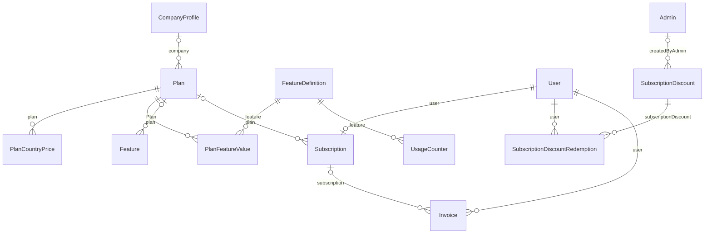

# Billing & entitlements

Plans, Stripe subscriptions, invoices and the dynamic feature/limit engine.

:::info[Generated page]

This page is generated by `npm run sync` from `master` of **nextcybr-server**. Do not edit it by hand — changes are overwritten on the next sync.
:::

## Plan

| Field | Type | Attributes | Notes |
| --- | --- | --- | --- |
| `id` | `String` | @id @default(uuid()) |  |
| `name` | `String` |  |  |
| `description` | `String` |  |  |
| `price` | `Float` |  |  |
| `currency` | `String` | @default("USD") |  |
| `billingCycle` | [BillingCycle](./enums#billingcycle) | @default(MONTHLY) |  |
| `userType` | [PlanUserType](./enums#planusertype) |  |  |
| `tag` | `String?` |  |  |
| `ctaText` | `String` |  |  |
| `createdAt` | `DateTime` | @default(now()) |  |
| `updatedAt` | `DateTime` | @updatedAt |  |
| `features` | [Feature[]](#feature) |  |  |
| `key` | `String` |  | ── Dynamic entitlement system ────────────────────────────────────────── Stable slug the rest of the system references (Subscription.planId, entitlementService, Stripe metadata) instead of the fixed SubscriptionType enum. Unique per userType so e.g. "PRO" can exist for STUDENT, MENTOR and COMPANY as three separate rows. |
| `scope` | [PlanScope](./enums#planscope) | @default(GLOBAL) | GLOBAL = selectable by any user of this userType (the seeded Free/Pro/... tiers). ORG = a one-off custom plan created for exactly one company and only assignable to that company (see companyId below). |
| `companyId` | `String?` |  |  |
| `company` | [CompanyProfile?](./profiles#companyprofile) | relation (FK) |  |
| `isActive` | `Boolean` | @default(true) |  |
| `isPubliclyVisible` | `Boolean` | @default(true) | ORG-scoped plans (and any internal/unlaunched GLOBAL plan) default to hidden from the public pricing page. |
| `tierRank` | `Int` | @default(0) | Ordering for upgrade/downgrade proration logic, replaces the old hardcoded PLAN_ORDER map in subscription.controller.js. |
| `legacyType` | [SubscriptionType?](./enums#subscriptiontype) |  | Populated only for the seeded GLOBAL plans, so existing code paths that still read Subscription.type (webhooks, analytics) keep working during the migration window. Null for ORG-scoped custom plans. |
| `stripePriceIdMonthly` | `String?` |  |  |
| `stripePriceIdYearly` | `String?` |  |  |
| `countryCode` | `String?` |  | ── Country scoping (separate from `scope`/`companyId` above) ─────────── ISO 3166-1 alpha-2 (e.g. "US", "IN", "GB"). Null = available to users in any country. Non-null = this plan is ONLY visible/assignable to users whose profile country matches — a distinct, rarer case from the per-country PRICING below, which applies to country-unrestricted plans. |
| `planFeatureValues` | [PlanFeatureValue[]](#planfeaturevalue) |  |  |
| `subscriptions` | [Subscription[]](#subscription) |  |  |
| `countryPrices` | [PlanCountryPrice[]](#plancountryprice) |  | Per-country price overrides for this plan. Only meaningful when countryCode above is null (a country-restricted plan has one obvious price already); enforced at the application layer, not by the DB. |

**Indexes & constraints:** `@@unique([key, userType])` · `@@index([userType])` · `@@index([scope])` · `@@index([companyId])` · `@@index([countryCode])`

## PlanCountryPrice

Per-country price override for a country-unrestricted (countryCode=null) Plan. Resolution: given (plan, user's country), look up a row here for that country; if none exists, fall back to the Plan's own base price/currency/stripePriceId* fields — i.e. this table only needs a row for the countries an admin actually wants to price differently, not every country the plan is sold in.

| Field | Type | Attributes | Notes |
| --- | --- | --- | --- |
| `id` | `String` | @id @default(uuid()) |  |
| `planId` | `String` |  |  |
| `plan` | [Plan](#plan) | relation (FK) |  |
| `countryCode` | `String` |  |  |
| `price` | `Float` |  |  |
| `currency` | `String` | @default("USD") |  |
| `stripePriceIdMonthly` | `String?` |  |  |
| `stripePriceIdYearly` | `String?` |  |  |
| `createdAt` | `DateTime` | @default(now()) |  |
| `updatedAt` | `DateTime` | @updatedAt |  |

**Indexes & constraints:** `@@unique([planId, countryCode])` · `@@index([countryCode])`

## FeatureDefinition

── Dynamic entitlement system ────────────────────────────────────────────── Canonical registry of gated capabilities. Referenced everywhere in application code by the stable `key` string (e.g. "AI_TOKENS_DAILY", "MENTOR_ACTIVE_1TO1_SERVICES") — never by id, and `key` is treated as immutable once created (create a new key + deprecate the old one via isActive/deprecatedAt rather than renaming).

| Field | Type | Attributes | Notes |
| --- | --- | --- | --- |
| `id` | `String` | @id @default(uuid()) |  |
| `key` | `String` | @unique |  |
| `name` | `String` |  |  |
| `description` | `String?` |  |  |
| `category` | `String?` |  |  |
| `appliesTo` | [PlanUserType](./enums#planusertype) |  |  |
| `type` | [FeatureValueType](./enums#featurevaluetype) |  |  |
| `resetPeriod` | [FeatureResetPeriod](./enums#featureresetperiod) | @default(NONE) |  |
| `isActive` | `Boolean` | @default(true) |  |
| `deprecatedAt` | `DateTime?` |  |  |
| `createdAt` | `DateTime` | @default(now()) |  |
| `updatedAt` | `DateTime` | @updatedAt |  |
| `planFeatureValues` | [PlanFeatureValue[]](#planfeaturevalue) |  |  |
| `usageCounters` | [UsageCounter[]](#usagecounter) |  |  |

**Indexes & constraints:** `@@index([appliesTo])` · `@@index([isActive])`

## PlanFeatureValue

The row an admin edits: what a given Plan's value is for a given Feature. Absence of a row for (plan, feature) is treated as "disabled" by entitlementService — plans don't need an explicit row for every feature.

| Field | Type | Attributes | Notes |
| --- | --- | --- | --- |
| `id` | `String` | @id @default(uuid()) |  |
| `planId` | `String` |  |  |
| `plan` | [Plan](#plan) | relation (FK) |  |
| `featureId` | `String` |  |  |
| `feature` | [FeatureDefinition](#featuredefinition) | relation (FK) |  |
| `enabled` | `Boolean` | @default(false) |  |
| `limitValue` | `Int?` |  | Ignored for BOOLEAN features. Null + isUnlimited=false on a NUMERIC feature means "enabled but zero allowance" (rarely useful, mostly a data hygiene footgun to validate against in the admin API). |
| `isUnlimited` | `Boolean` | @default(false) | Explicit flag rather than a magic-number sentinel like -1. |
| `createdAt` | `DateTime` | @default(now()) |  |
| `updatedAt` | `DateTime` | @updatedAt |  |

**Indexes & constraints:** `@@unique([planId, featureId])` · `@@index([featureId])`

## UsageCounter

Actual consumption tracking. One row per (user, feature, period) — a fresh row is created each time the period rolls over, which also gives usage history for free (nothing here is ever overwritten across periods).

| Field | Type | Attributes | Notes |
| --- | --- | --- | --- |
| `id` | `String` | @id @default(uuid()) |  |
| `userId` | `String` |  |  |
| `featureDefinitionId` | `String` |  |  |
| `feature` | [FeatureDefinition](#featuredefinition) | relation (FK) |  |
| `periodStart` | `DateTime` |  |  |
| `periodEnd` | `DateTime` |  |  |
| `count` | `Int` | @default(0) |  |
| `createdAt` | `DateTime` | @default(now()) |  |
| `updatedAt` | `DateTime` | @updatedAt |  |

**Indexes & constraints:** `@@unique([userId, featureDefinitionId, periodStart])` · `@@index([userId])` · `@@index([featureDefinitionId])`

## Feature

| Field | Type | Attributes | Notes |
| --- | --- | --- | --- |
| `id` | `String` | @id @default(uuid()) |  |
| `text` | `String` |  |  |
| `position` | `Int` | @default(0) | Display order of the pricing-page bullet within its plan. |
| `planId` | `String?` |  |  |
| `Plan` | [Plan?](#plan) | relation (FK) |  |

## Subscription

| Field | Type | Attributes | Notes |
| --- | --- | --- | --- |
| `id` | `String` | @id @default(uuid()) |  |
| `type` | [SubscriptionType](./enums#subscriptiontype) | @default(FREE) |  |
| `startDate` | `DateTime` | @default(now()) |  |
| `endDate` | `DateTime?` |  |  |
| `isActive` | `Boolean` | @default(true) |  |
| `autoRenew` | `Boolean` | @default(true) |  |
| `paymentMethod` | `String?` |  |  |
| `transactionId` | `String?` |  |  |
| `amount` | `Float?` |  |  |
| `currency` | `String` | @default("USD") |  |
| `metadata` | `Json?` |  |  |
| `userId` | `String` | @unique |  |
| `createdAt` | `DateTime` | @default(now()) |  |
| `updatedAt` | `DateTime` | @updatedAt |  |
| `billingCycle` | [BillingCycleType](./enums#billingcycletype) | @default(MONTHLY) |  |
| `invoiceUrl` | `String?` |  |  |
| `latestInvoiceId` | `String?` |  |  |
| `nextBillingAt` | `DateTime?` |  |  |
| `stripeCustomerId` | `String?` |  |  |
| `stripeSubscriptionId` | `String?` |  |  |
| `lastPaymentState` | `Json?` |  |  |
| `planId` | `String?` |  | New source of truth (dynamic entitlement system). `type` above is kept as a best-effort mirror for backward compatibility during migration — see entitlementService.js. New application code should read `plan`, not `type`. |
| `plan` | [Plan?](#plan) | relation (FK) |  |
| `pendingPlanKey` | `String?` |  | A downgrade waits for the next renewal (client spec: "Downgrade — take effect on the next renewal date"). It's carried out by a Stripe Subscription Schedule; these mirror it so the UI can say what changes and when. Cleared by the webhook once the new price is live, or when an upgrade/cancellation discards the pending change. |
| `pendingBillingCycle` | [BillingCycleType?](./enums#billingcycletype) |  |  |
| `pendingChangeAt` | `DateTime?` |  |  |
| `stripeScheduleId` | `String?` |  |  |
| `invoices` | [Invoice[]](#invoice) |  |  |
| `user` | [User](./identity#user) | relation (FK) |  |

**Indexes & constraints:** `@@index([type])` · `@@index([isActive])` · `@@index([planId])`

## SubscriptionDiscount

Platform-wide codes used only when purchasing a subscription. This is intentionally separate from DiscountCode, which is owned by a mentor and applies to mentor services.

| Field | Type | Attributes | Notes |
| --- | --- | --- | --- |
| `id` | `String` | @id @default(uuid()) |  |
| `code` | `String` | @unique |  |
| `percentage` | `Float` |  |  |
| `maxDiscountAmount` | `Float?` |  |  |
| `startsAt` | `DateTime?` |  |  |
| `expiresAt` | `DateTime?` |  |  |
| `isActive` | `Boolean` | @default(true) |  |
| `totalUsageLimit` | `Int?` |  |  |
| `redemptionCount` | `Int` | @default(0) |  |
| `perUserUsageLimit` | `Int?` | @default(1) | null means unlimited. New promotional codes default to one successful purchase per user, so repeated checkout attempts cannot consume a code. |
| `countries` | `String[]` | @default([]) |  |
| `createdByAdminId` | `String?` |  |  |
| `createdByAdmin` | [Admin?](./identity#admin) | relation (FK) |  |
| `createdAt` | `DateTime` | @default(now()) |  |
| `updatedAt` | `DateTime` | @updatedAt |  |
| `redemptions` | [SubscriptionDiscountRedemption[]](#subscriptiondiscountredemption) |  |  |

**Indexes & constraints:** `@@index([isActive])` · `@@index([expiresAt])`

## SubscriptionDiscountRedemption

| Field | Type | Attributes | Notes |
| --- | --- | --- | --- |
| `id` | `String` | @id @default(uuid()) |  |
| `subscriptionDiscountId` | `String` |  |  |
| `subscriptionDiscount` | [SubscriptionDiscount](#subscriptiondiscount) | relation (FK) |  |
| `userId` | `String` |  |  |
| `user` | [User](./identity#user) | relation (FK) |  |
| `checkoutSessionId` | `String?` | @unique |  |
| `redemptionCount` | `Int` | @default(1) |  |
| `redeemedAt` | `DateTime` | @default(now()) |  |

**Indexes & constraints:** `@@unique([subscriptionDiscountId, userId])` · `@@index([userId])`

## Invoice

| Field | Type | Attributes | Notes |
| --- | --- | --- | --- |
| `id` | `String` | @id @default(uuid()) |  |
| `stripeInvoiceId` | `String` | @unique |  |
| `subscriptionId` | `String?` |  |  |
| `userId` | `String` |  |  |
| `invoiceNumber` | `String?` |  |  |
| `hostedInvoiceUrl` | `String?` |  |  |
| `pdfUrl` | `String?` |  |  |
| `billingReason` | `String?` |  |  |
| `status` | [InvoiceStatus](./enums#invoicestatus) | @default(DRAFT) |  |
| `amountDue` | `Int?` |  |  |
| `amountPaid` | `Int?` |  |  |
| `amountRemaining` | `Int?` |  |  |
| `currency` | `String` | @default("USD") |  |
| `periodStart` | `DateTime?` |  |  |
| `periodEnd` | `DateTime?` |  |  |
| `nextPaymentAttempt` | `DateTime?` |  |  |
| `attempted` | `Boolean?` | @default(false) |  |
| `attemptCount` | `Int?` | @default(0) |  |
| `paymentIntentId` | `String?` |  |  |
| `metadata` | `Json?` |  |  |
| `raw` | `Json?` |  |  |
| `createdAt` | `DateTime` | @default(now()) |  |
| `updatedAt` | `DateTime` | @updatedAt |  |
| `subscription` | [Subscription?](#subscription) | relation (FK) |  |
| `user` | [User](./identity#user) | relation (FK) |  |

**Indexes & constraints:** `@@index([userId])` · `@@index([subscriptionId])`
