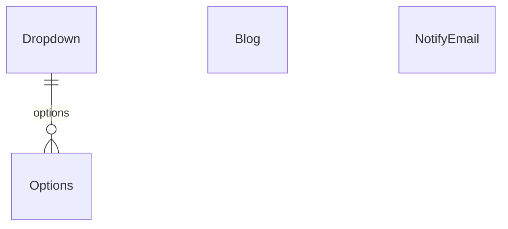

# Content & system

Blog, launch waitlist and dropdown lookups.

:::info[Generated page]

This page is generated by `npm run sync` from `master` of **nextcybr-server**. Do not edit it by hand — changes are overwritten on the next sync.
:::

## Blog

| Field | Type | Attributes | Notes |
| --- | --- | --- | --- |
| `id` | `String` | @id @default(uuid()) |  |
| `title` | `String` |  |  |
| `body` | `String` |  |  |
| `tags` | `String[]` |  |  |
| `blogImage` | `Json?` |  |  |
| `status` | [Status](./enums#status) | @default(ACTIVE) |  |
| `createdAt` | `DateTime` | @default(now()) |  |
| `updatedAt` | `DateTime` | @updatedAt |  |

## NotifyEmail

| Field | Type | Attributes | Notes |
| --- | --- | --- | --- |
| `id` | `String` | @id @default(uuid()) |  |
| `email` | `String` | @unique |  |
| `role` | [UserRole?](./enums#userrole) |  |  |
| `country` | `String?` |  | ISO 3166-1 alpha-2 code, required for new signups going forward |
| `createdAt` | `DateTime` | @default(now()) |  |

## Dropdown

| Field | Type | Attributes | Notes |
| --- | --- | --- | --- |
| `id` | `String` | @id @default(uuid()) |  |
| `name` | `String` | @unique |  |
| `options` | [Options[]](#options) |  |  |

## Options

| Field | Type | Attributes | Notes |
| --- | --- | --- | --- |
| `id` | `String` | @id @default(uuid()) |  |
| `label` | `String` |  |  |
| `value` | `String` |  |  |
| `dropdownId` | `String` |  |  |
| `options` | [Dropdown](#dropdown) | relation (FK) |  |

**Indexes & constraints:** `@@index([dropdownId])`
