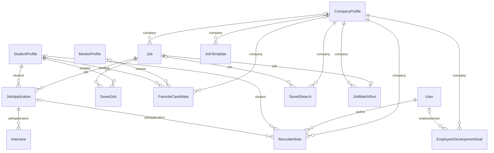

# Jobs & hiring

Job postings, applications and recruiter tooling.

:::info[Generated page]

This page is generated by `npm run sync` from `master` of **nextcybr-server**. Do not edit it by hand — changes are overwritten on the next sync.
:::

## Job

| Field | Type | Attributes | Notes |
| --- | --- | --- | --- |
| `id` | `String` | @id @default(uuid()) |  |
| `title` | `String` |  |  |
| `location` | `String` |  |  |
| `additionalBenefits` | `String[]` |  |  |
| `skills` | `String[]` |  |  |
| `certifications` | `String[]` |  |  |
| `qualifications` | [EducationLevel?](./enums#educationlevel) |  |  |
| `genderPreference` | [Gender?](./enums#gender) |  |  |
| `showSalary` | `Boolean` | @default(false) |  |
| `currency` | `String` | @default("USD") |  |
| `minSalary` | `Float?` |  |  |
| `maxSalary` | `Float?` |  |  |
| `minWorkExperience` | `Int?` |  |  |
| `maxWorkExperience` | `Int?` |  |  |
| `contractType` | [ContractType](./enums#contracttype) |  |  |
| `remotePolicy` | [RemotePolicy](./enums#remotepolicy) |  |  |
| `languageRequired` | `String[]` |  |  |
| `jobDescription` | `String` |  |  |
| `status` | [JobStatus](./enums#jobstatus) | @default(ACTIVE) |  |
| `isDeleted` | `Boolean` | @default(false) |  |
| `createdAt` | `DateTime` | @default(now()) |  |
| `updatedAt` | `DateTime` | @updatedAt |  |
| `companyId` | `String?` |  |  |
| `company` | [CompanyProfile?](./profiles#companyprofile) | relation (FK) |  |
| `jobApplications` | [JobApplication[]](#jobapplication) |  |  |
| `savedBy` | [SavedJob[]](#savedjob) |  |  |
| `savedSearches` | [SavedSearch[]](#savedsearch) |  |  |
| `lastMatchRun` | [JobMatchRun?](#jobmatchrun) |  |  |

**Indexes & constraints:** `@@index([companyId])` · `@@index([status])` · `@@index([location])` · `@@index([contractType])` · `@@index([isDeleted])`

## JobApplication

| Field | Type | Attributes | Notes |
| --- | --- | --- | --- |
| `id` | `String` | @id @default(uuid()) |  |
| `appliedDate` | `DateTime` | @default(now()) |  |
| `updatedDate` | `DateTime` | @updatedAt |  |
| `status` | [JobApplicationStatus](./enums#jobapplicationstatus) |  |  |
| `jobId` | `String` |  |  |
| `studentId` | `String` |  |  |
| `interviews` | [Interview[]](#interview) |  |  |
| `job` | [Job](#job) | relation (FK) |  |
| `student` | [StudentProfile](./profiles#studentprofile) | relation (FK) |  |
| `notes` | [RecruiterNote[]](#recruiternote) |  |  |

**Indexes & constraints:** `@@unique([jobId, studentId])` · `@@index([jobId])` · `@@index([studentId])` · `@@index([status])`

## SavedJob

| Field | Type | Attributes | Notes |
| --- | --- | --- | --- |
| `id` | `String` | @id @default(uuid()) |  |
| `studentId` | `String` |  |  |
| `student` | [StudentProfile](./profiles#studentprofile) | relation (FK) |  |
| `jobId` | `String` |  |  |
| `job` | [Job](#job) | relation (FK) |  |
| `createdAt` | `DateTime` | @default(now()) |  |

**Indexes & constraints:** `@@unique([studentId, jobId])` · `@@index([studentId])` · `@@index([jobId])`

## FavoriteCandidate

| Field | Type | Attributes | Notes |
| --- | --- | --- | --- |
| `id` | `String` | @id @default(uuid()) |  |
| `companyId` | `String?` |  |  |
| `studentId` | `String` |  |  |
| `createdAt` | `DateTime` | @default(now()) |  |
| `mentorId` | `String?` |  |  |
| `company` | [CompanyProfile?](./profiles#companyprofile) | relation (FK) |  |
| `mentor` | [MentorProfile?](./profiles#mentorprofile) | relation (FK) |  |
| `student` | [StudentProfile](./profiles#studentprofile) | relation (FK) |  |

**Indexes & constraints:** `@@unique([companyId, studentId])` · `@@unique([mentorId, studentId])` · `@@index([companyId])` · `@@index([studentId])` · `@@index([mentorId])`

## RecruiterNote

| Field | Type | Attributes | Notes |
| --- | --- | --- | --- |
| `id` | `String` | @id @default(uuid()) |  |
| `companyId` | `String` |  |  |
| `company` | [CompanyProfile](./profiles#companyprofile) | relation (FK) |  |
| `authorUserId` | `String` |  |  |
| `author` | [User](./identity#user) | relation (FK) |  |
| `studentId` | `String?` |  |  |
| `student` | [StudentProfile?](./profiles#studentprofile) | relation (FK) |  |
| `jobApplicationId` | `String?` |  |  |
| `jobApplication` | [JobApplication?](#jobapplication) | relation (FK) |  |
| `content` | `String` |  |  |
| `createdAt` | `DateTime` | @default(now()) |  |
| `updatedAt` | `DateTime` | @updatedAt |  |

**Indexes & constraints:** `@@index([companyId])` · `@@index([studentId])` · `@@index([jobApplicationId])`

## JobTemplate

| Field | Type | Attributes | Notes |
| --- | --- | --- | --- |
| `id` | `String` | @id @default(uuid()) |  |
| `companyId` | `String` |  |  |
| `company` | [CompanyProfile](./profiles#companyprofile) | relation (FK) |  |
| `name` | `String` |  |  |
| `templateData` | `Json` |  | snapshot of job fields to prefill on next posting |
| `createdAt` | `DateTime` | @default(now()) |  |
| `updatedAt` | `DateTime` | @updatedAt |  |

**Indexes & constraints:** `@@index([companyId])`

## SavedSearch

"Reopening a saved result does not count again" — the client's own stated rule for AI Match Runs, and the mechanism Recruiter Pro's "save and reopen previous searches" needs.

| Field | Type | Attributes | Notes |
| --- | --- | --- | --- |
| `id` | `String` | @id @default(uuid()) |  |
| `companyId` | `String` |  |  |
| `company` | [CompanyProfile](./profiles#companyprofile) | relation (FK) |  |
| `type` | [SavedSearchType](./enums#savedsearchtype) |  |  |
| `jobId` | `String?` |  | set for AI_MATCH_RUN — which job the run was for |
| `job` | [Job?](#job) | relation (FK) |  |
| `queryParams` | `Json` |  |  |
| `results` | `Json` |  | snapshot of the result set at the time of the run |
| `createdAt` | `DateTime` | @default(now()) |  |

**Indexes & constraints:** `@@index([companyId])` · `@@index([jobId])`

## JobMatchRun

The latest AI Match Run for a job. Opening a job's "Find Candidates" page shows this instead of running the AI again; only a manual re-run replaces it (and uses a Match Run). Holds the AI's scores, not candidate details — those are re-read on every view so profile and privacy changes apply.

| Field | Type | Attributes | Notes |
| --- | --- | --- | --- |
| `id` | `String` | @id @default(uuid()) |  |
| `jobId` | `String` | @unique |  |
| `job` | [Job](#job) | relation (FK) |  |
| `companyId` | `String` |  |  |
| `company` | [CompanyProfile](./profiles#companyprofile) | relation (FK) |  |
| `matches` | `Json` |  |  |
| `overallInsight` | `String?` |  |  |
| `totalCandidatesAnalyzed` | `Int` |  |  |
| `model` | `String?` |  |  |
| `createdAt` | `DateTime` | @default(now()) |  |
| `updatedAt` | `DateTime` | @updatedAt |  |

**Indexes & constraints:** `@@index([companyId])`

## Interview

| Field | Type | Attributes | Notes |
| --- | --- | --- | --- |
| `id` | `String` | @id @default(cuid()) |  |
| `jobApplicationId` | `String` |  |  |
| `scheduledBy` | `String` |  |  |
| `scheduledAt` | `DateTime` |  |  |
| `duration` | `Int` | @default(30) |  |
| `timezone` | `String` |  |  |
| `status` | [InterviewStatus](./enums#interviewstatus) | @default(SCHEDULED) |  |
| `roomId` | `String?` |  |  |
| `meetingLink` | `String?` |  |  |
| `notes` | `String?` |  |  |
| `cancelReason` | `String?` |  |  |
| `createdAt` | `DateTime` | @default(now()) |  |
| `updatedAt` | `DateTime` | @updatedAt |  |
| `jobApplication` | [JobApplication](#jobapplication) | relation (FK) |  |

**Indexes & constraints:** `@@index([jobApplicationId])` · `@@index([scheduledBy])` · `@@index([status])` · `@@index([scheduledAt])`

## EmployeeDevelopmentSeat

| Field | Type | Attributes | Notes |
| --- | --- | --- | --- |
| `id` | `String` | @id @default(uuid()) |  |
| `companyId` | `String` |  |  |
| `company` | [CompanyProfile](./profiles#companyprofile) | relation (FK) |  |
| `employeeEmail` | `String` |  |  |
| `employeeUserId` | `String?` |  | Linked once the invited employee actually signs up/accepts. |
| `employeeUser` | [User?](./identity#user) | relation (FK) |  |
| `status` | [DevSeatStatus](./enums#devseatstatus) | @default(INVITED) |  |
| `invitedAt` | `DateTime` | @default(now()) |  |
| `activatedAt` | `DateTime?` |  |  |
| `expiresAt` | `DateTime?` |  | Free tier: 30 days from activation. Pro tier: null (ongoing while subscribed) — enforced in application logic, not a DB constraint. |
| `removedAt` | `DateTime?` |  |  |

**Indexes & constraints:** `@@index([companyId])` · `@@index([employeeUserId])`
