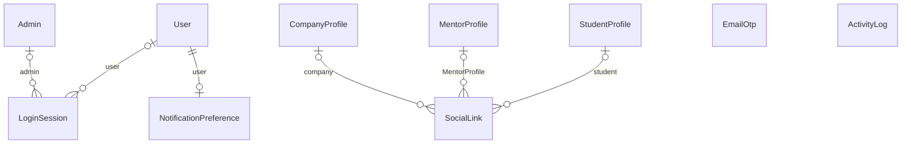

# Identity & accounts

Users, admins, login sessions, OTPs and per-user preferences.

:::info[Generated page]

This page is generated by `npm run sync` from `master` of **nextcybr-server**. Do not edit it by hand — changes are overwritten on the next sync.
:::

## User

| Field | Type | Attributes | Notes |
| --- | --- | --- | --- |
| `id` | `String` | @id @default(uuid()) |  |
| `role` | [UserRole](./enums#userrole) |  |  |
| `email` | `String` | @unique | Backed by partial unique index User_email_key WHERE "isDeleted" = false (migration 20260906184500) |
| `password` | `String?` |  |  |
| `firstName` | `String` |  |  |
| `lastName` | `String` |  |  |
| `isDeleted` | `Boolean` | @default(false) |  |
| `refreshToken` | `String?` |  |  |
| `createdAt` | `DateTime` | @default(now()) |  |
| `updatedAt` | `DateTime` | @updatedAt |  |
| `token` | `String?` |  |  |
| `tokenType` | [TokenType?](./enums#tokentype) |  |  |
| `tokenExpiry` | `DateTime?` |  |  |
| `tokenAttempts` | `Int` | @default(0) |  |
| `tokenLockUntil` | `DateTime?` |  |  |
| `loginAttempts` | `Int` | @default(0) |  |
| `lockUntil` | `DateTime?` |  |  |
| `onboardingComplete` | `Boolean` | @default(false) |  |
| `status` | [Status](./enums#status) | @default(ACTIVE) |  |
| `timezone` | `String` | @default("UTC") | IANA timezone (e.g. "America/New_York"), captured from the browser at account creation. Used for any per-user daily boundary — daily AI token reset (entitlementService.js resolvePeriod), not just display. |
| `lastSeen` | `DateTime?` |  |  |
| `deactivatedAt` | `DateTime?` |  |  |
| `approvedByAdmin` | `Boolean` | @default(false) |  |
| `coachActivities` | [CoachActivity[]](./ai#coachactivity) |  |  |
| `coachMilestones` | [CoachMilestone[]](./ai#coachmilestone) |  |  |
| `coachProgress` | [CoachProgress?](./ai#coachprogress) |  |  |
| `coachWeakAreas` | [CoachWeakArea[]](./ai#coachweakarea) |  |  |
| `companyProfile` | [CompanyProfile?](./profiles#companyprofile) |  |  |
| `conversations` | [ConversationParticipant[]](./messaging#conversationparticipant) |  |  |
| `invoices` | [Invoice[]](./billing#invoice) |  |  |
| `sessions` | [LoginSession[]](#loginsession) |  |  |
| `mentorProfile` | [MentorProfile?](./profiles#mentorprofile) |  |  |
| `mentorServices` | [MentorService[]](./mentorship#mentorservice) |  |  |
| `messages` | [Message[]](./messaging#message) |  |  |
| `notifications` | [Notification[]](./messaging#notification) |  |  |
| `notificationPreference` | [NotificationPreference?](#notificationpreference) |  |  |
| `studentProfile` | [StudentProfile?](./profiles#studentprofile) |  |  |
| `subscription` | [Subscription?](./billing#subscription) |  |  |
| `tickets` | [Ticket[]](./support#ticket) |  |  |
| `roadmaps` | [Roadmap[]](./ai#roadmap) |  |  |
| `coachSessions` | [CoachSession[]](./ai#coachsession) |  |  |
| `cvSuggestionHistory` | [CvSuggestionHistory[]](./ai#cvsuggestionhistory) |  |  |
| `cvDrafts` | [CvDraft[]](./ai#cvdraft) |  |  |
| `calendarIntegration` | [CalendarIntegration?](./mentorship#calendarintegration) |  |  |
| `badges` | [Badge[]](./mentorship#badge) |  |  |
| `discountCodes` | [DiscountCode[]](./mentorship#discountcode) |  |  |
| `serviceBundles` | [ServiceBundle[]](./mentorship#servicebundle) |  |  |
| `payoutMethod` | [MentorPayoutMethod?](./payouts#mentorpayoutmethod) |  |  |
| `payouts` | [MentorPayout[]](./payouts#mentorpayout) |  |  |
| `transactions` | [MentorTransaction[]](./payouts#mentortransaction) |  |  |
| `recruiterNotesAuthored` | [RecruiterNote[]](./hiring#recruiternote) |  |  |
| `devSeatAsEmployee` | [EmployeeDevelopmentSeat[]](./hiring#employeedevelopmentseat) |  |  |
| `subscriptionDiscountRedemptions` | [SubscriptionDiscountRedemption[]](./billing#subscriptiondiscountredemption) |  |  |

**Indexes & constraints:** `@@index([email])` · `@@index([role])` · `@@index([isDeleted])`

## Admin

| Field | Type | Attributes | Notes |
| --- | --- | --- | --- |
| `id` | `String` | @id @default(uuid()) |  |
| `role` | `String` | @default("ADMIN") |  |
| `email` | `String` | @unique |  |
| `password` | `String` |  |  |
| `active` | `Boolean` | @default(true) |  |
| `refreshToken` | `String?` |  |  |
| `createdAt` | `DateTime` | @default(now()) |  |
| `updatedAt` | `DateTime` | @updatedAt |  |
| `token` | `String?` |  |  |
| `tokenType` | [TokenType?](./enums#tokentype) |  |  |
| `tokenExpiry` | `DateTime?` |  |  |
| `tokenAttempts` | `Int` | @default(0) |  |
| `tokenLockUntil` | `DateTime?` |  |  |
| `loginAttempts` | `Int` | @default(0) |  |
| `lockUntil` | `DateTime?` |  |  |
| `firstName` | `String` |  |  |
| `lastName` | `String` |  |  |
| `profilePicture` | `String?` |  |  |
| `loginSessions` | [LoginSession[]](#loginsession) |  |  |
| `notifications` | [Notification[]](./messaging#notification) |  |  |
| `subscriptionDiscountsCreated` | [SubscriptionDiscount[]](./billing#subscriptiondiscount) | relation |  |

## LoginSession

| Field | Type | Attributes | Notes |
| --- | --- | --- | --- |
| `id` | `String` | @id @default(cuid()) |  |
| `userId` | `String?` |  |  |
| `refreshToken` | `String` | @unique |  |
| `device` | `String` |  |  |
| `browser` | `String` |  |  |
| `os` | `String` |  |  |
| `ip` | `String` |  |  |
| `userAgent` | `String` |  |  |
| `isRevoked` | `Boolean` | @default(false) |  |
| `lastActive` | `DateTime` | @default(now()) |  |
| `expiresAt` | `DateTime` |  |  |
| `createdAt` | `DateTime` | @default(now()) |  |
| `adminId` | `String?` |  |  |
| `admin` | [Admin?](#admin) | relation (FK) |  |
| `user` | [User?](#user) | relation (FK) |  |
| `previousRefreshToken` | `String?` | @unique | Short reuse grace window for the refresh token that was just rotated out. Concurrent requests (e.g. two browser tabs refreshing near the same access-token expiry) can legitimately present the just-replaced token a moment after rotation — without this, that second request looks identical to a stolen/replayed token and the session gets force-logged-out even though it's still valid. |
| `previousRefreshTokenExpiresAt` | `DateTime?` |  |  |

**Indexes & constraints:** `@@index([userId])` · `@@index([adminId])`

## EmailOtp

| Field | Type | Attributes | Notes |
| --- | --- | --- | --- |
| `id` | `String` | @id @default(cuid()) |  |
| `email` | `String` |  |  |
| `otp` | `String` |  |  |
| `expiresAt` | `DateTime` |  |  |
| `attempts` | `Int` | @default(0) |  |
| `lockedUntil` | `DateTime?` |  |  |
| `createdAt` | `DateTime` | @default(now()) |  |
| `verified` | `Boolean` | @default(false) | Set once verifyOtp succeeds; the row is kept (instead of deleted) for a short window so signUp can confirm the email was actually verified before creating the account, instead of trusting the client-side OTP step alone. |
| `verifiedAt` | `DateTime?` |  |  |

**Indexes & constraints:** `@@index([email])`

## NotificationPreference

| Field | Type | Attributes | Notes |
| --- | --- | --- | --- |
| `id` | `String` | @id @default(cuid()) |  |
| `userId` | `String` | @unique |  |
| `promotions` | `Boolean` | @default(true) |  |
| `productUpdates` | `Boolean` | @default(true) |  |
| `security` | `Boolean` | @default(true) |  |
| `activity` | `Boolean` | @default(true) |  |
| `newsletter` | `Boolean` | @default(true) |  |
| `jobAlerts` | `Boolean` | @default(true) |  |
| `createdAt` | `DateTime` | @default(now()) |  |
| `updatedAt` | `DateTime` | @updatedAt |  |
| `user` | [User](#user) | relation (FK) |  |

**Indexes & constraints:** `@@index([userId])`

## SocialLink

| Field | Type | Attributes | Notes |
| --- | --- | --- | --- |
| `id` | `String` | @id @default(uuid()) |  |
| `platform` | `String` |  |  |
| `url` | `String` |  |  |
| `companyId` | `String?` |  |  |
| `studentId` | `String?` |  |  |
| `createdAt` | `DateTime` | @default(now()) |  |
| `updatedAt` | `DateTime` | @updatedAt |  |
| `mentorProfileId` | `String?` |  |  |
| `company` | [CompanyProfile?](./profiles#companyprofile) | relation (FK) |  |
| `MentorProfile` | [MentorProfile?](./profiles#mentorprofile) | relation (FK) |  |
| `student` | [StudentProfile?](./profiles#studentprofile) | relation (FK) |  |

**Indexes & constraints:** `@@index([companyId])` · `@@index([studentId])` · `@@index([mentorProfileId])`

## ActivityLog

| Field | Type | Attributes | Notes |
| --- | --- | --- | --- |
| `id` | `String` | @id @default(uuid()) |  |
| `userId` | `String` |  |  |
| `action` | `String` |  |  |
| `createdAt` | `DateTime` | @default(now()) |  |
| `metadata` | `Json?` |  |  |
