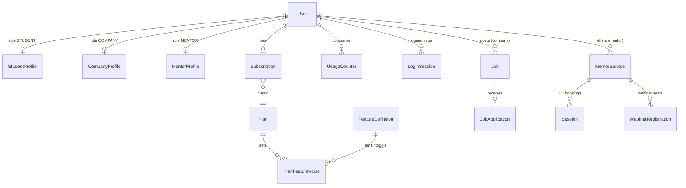

# Data model

:::info[Generated page]

This page is generated by `npm run sync` from `master` of **nextcybr-server**. Do not edit it by hand — changes are overwritten on the next sync.
:::

NextCybr stores everything in one PostgreSQL database accessed through **Prisma 7** (`@prisma/adapter-pg`). The schema lives in `prisma/schema.prisma` and currently defines **74 models** and **42 enums**. Migrations are in `prisma/migrations/` and are applied on deploy with `prisma migrate deploy`.

## Domains

| Domain | Models |
| --- | --- |
| [Identity & accounts](/reference/data-model/identity) | `User`, `Admin`, `LoginSession`, `EmailOtp`, `NotificationPreference`, `SocialLink`, `ActivityLog` |
| [Profiles](/reference/data-model/profiles) | `StudentProfile`, `CompanyProfile`, `MentorProfile`, `Education`, `WorkExperience`, `CompanyName` |
| [Jobs & hiring](/reference/data-model/hiring) | `Job`, `JobApplication`, `SavedJob`, `FavoriteCandidate`, `RecruiterNote`, `JobTemplate`, `SavedSearch`, `JobMatchRun`, `Interview`, `EmployeeDevelopmentSeat` |
| [Mentorship](/reference/data-model/mentorship) | `MentorService`, `OneToOneMentorService`, `WebinarMentorService`, `MentorAvailability`, `MentorAvailabilityException`, `Session`, `SessionReview`, `SessionWaitlist`, `WebinarRegistration`, `DiscountCode`, `ServiceBundle`, `ServiceBundleItem`, `Badge`, `CalendarIntegration` |
| [Mentor payouts](/reference/data-model/payouts) | `MentorPayoutMethod`, `MentorTransaction`, `MentorPayout` |
| [Billing & entitlements](/reference/data-model/billing) | `Plan`, `PlanCountryPrice`, `FeatureDefinition`, `PlanFeatureValue`, `UsageCounter`, `Feature`, `Subscription`, `SubscriptionDiscount`, `SubscriptionDiscountRedemption`, `Invoice` |
| [AI: coach, roadmaps & CV](/reference/data-model/ai) | `CoachSession`, `CoachMessage`, `CoachProgress`, `CoachActivity`, `CoachMilestone`, `CoachWeakArea`, `Roadmap`, `RoadmapStage`, `RoadmapMilestone`, `RoadmapActionItem`, `CvDraft`, `CvSuggestionHistory` |
| [Messaging & notifications](/reference/data-model/messaging) | `Conversation`, `ConversationParticipant`, `Message`, `Notification` |
| [Support](/reference/data-model/support) | `Category`, `Reason`, `Ticket`, `TicketMessage` |
| [Content & system](/reference/data-model/content) | `Blog`, `NotifyEmail`, `Dropdown`, `Options` |
| [Enums](/reference/data-model/enums) | All 42 enums |

## Core shape

## Conventions

- **IDs** are UUID strings (`@default(uuid())`).
- **Soft delete** — `User.isDeleted` and `User.status` (`ACTIVE`/`INACTIVE`) instead of hard deletes; sign-in rejects both.
- **Money** — stored as decimal amounts with an ISO currency on the row; payout math rounds through `roundMoney`.
- **Timestamps** — `createdAt` / `updatedAt` on most models; users carry an IANA `timezone` used for daily quota resets.
