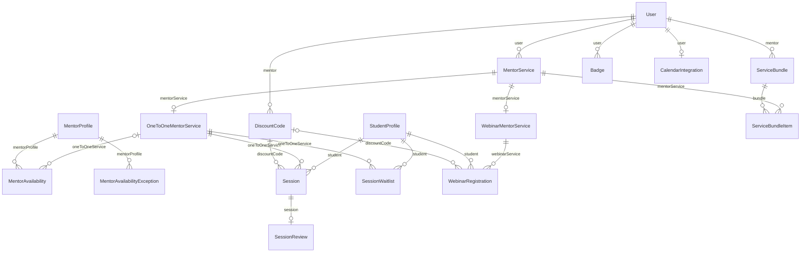

# Mentorship

Mentor services, availability, 1:1 sessions, webinars and promotions.

:::info[Generated page]

This page is generated by `npm run sync` from `master` of **nextcybr-server**. Do not edit it by hand — changes are overwritten on the next sync.
:::

## MentorService

| Field | Type | Attributes | Notes |
| --- | --- | --- | --- |
| `id` | `String` | @id @default(uuid()) |  |
| `type` | [MentorServiceType](./enums#mentorservicetype) |  |  |
| `title` | `String` |  |  |
| `description` | `String` |  |  |
| `price` | `Float` |  |  |
| `discountedPrice` | `Float?` |  |  |
| `coverImage` | `Json?` |  |  |
| `userId` | `String` |  |  |
| `isActive` | `Boolean` | @default(true) |  |
| `archivedAt` | `DateTime?` |  | Distinct from isActive/deactivated — a mentor can only deactivate a service today, with no separate archived state. Null = not archived; set = hidden from public listing but retained for history. Doesn't count against the active-services capacity limit either way once set. |
| `createdAt` | `DateTime` | @default(now()) |  |
| `updatedAt` | `DateTime` | @updatedAt |  |
| `user` | [User](./identity#user) | relation (FK) |  |
| `oneToOneDetails` | [OneToOneMentorService?](#onetoonementorservice) |  |  |
| `webinarDetails` | [WebinarMentorService?](#webinarmentorservice) |  |  |
| `bundleItems` | [ServiceBundleItem[]](#servicebundleitem) |  |  |

**Indexes & constraints:** `@@index([userId])`

## OneToOneMentorService

| Field | Type | Attributes | Notes |
| --- | --- | --- | --- |
| `id` | `String` | @id @default(uuid()) |  |
| `callDuration` | `Int` |  |  |
| `bufferTime` | `Int` | @default(5) |  |
| `skills` | `String[]` |  |  |
| `questions` | `String[]` |  |  |
| `mentorServiceId` | `String` | @unique |  |
| `createdAt` | `DateTime` | @default(now()) |  |
| `updatedAt` | `DateTime` | @updatedAt |  |
| `availability` | [MentorAvailability[]](#mentoravailability) |  |  |
| `mentorService` | [MentorService](#mentorservice) | relation (FK) |  |
| `sessions` | [Session[]](#session) |  |  |
| `waitlistEntries` | [SessionWaitlist[]](#sessionwaitlist) |  |  |

## WebinarMentorService

| Field | Type | Attributes | Notes |
| --- | --- | --- | --- |
| `id` | `String` | @id @default(uuid()) |  |
| `webinarDuration` | `Int` |  |  |
| `webinarDate` | `DateTime` |  |  |
| `webinarTimezone` | `String` | @default("UTC") |  |
| `capacity` | `Int` | @default(32) |  |
| `instructions` | `String` |  |  |
| `mentorServiceId` | `String` | @unique |  |
| `status` | [WebinarStatus](./enums#webinarstatus) | @default(UPCOMING) |  |
| `roomId` | `String?` |  |  |
| `recordingUrl` | `String?` |  |  |
| `reminderSentAt` | `DateTime?` |  |  |
| `createdAt` | `DateTime` | @default(now()) |  |
| `updatedAt` | `DateTime` | @updatedAt |  |
| `mentorService` | [MentorService](#mentorservice) | relation (FK) |  |
| `registrations` | [WebinarRegistration[]](#webinarregistration) |  |  |

**Indexes & constraints:** `@@index([status, webinarDate])`

## MentorAvailability

| Field | Type | Attributes | Notes |
| --- | --- | --- | --- |
| `id` | `String` | @id @default(uuid()) |  |
| `oneToOneServiceId` | `String?` |  |  |
| `dayOfWeek` | `Int` |  |  |
| `startTime` | `String` |  |  |
| `endTime` | `String` |  |  |
| `isActive` | `Boolean` | @default(true) |  |
| `createdAt` | `DateTime` | @default(now()) |  |
| `mentorProfileId` | `String` |  |  |
| `mentorProfile` | [MentorProfile](./profiles#mentorprofile) | relation (FK) |  |
| `oneToOneService` | [OneToOneMentorService?](#onetoonementorservice) | relation (FK) |  |

**Indexes & constraints:** `@@index([mentorProfileId, dayOfWeek])` · `@@index([oneToOneServiceId])`

## MentorAvailabilityException

Blackout dates — MentorAvailability only ever stored recurring weekly slots; this is the missing exception table so a specific date can be excluded from bookable slots regardless of the weekly pattern.

| Field | Type | Attributes | Notes |
| --- | --- | --- | --- |
| `id` | `String` | @id @default(uuid()) |  |
| `mentorProfileId` | `String` |  |  |
| `mentorProfile` | [MentorProfile](./profiles#mentorprofile) | relation (FK) |  |
| `date` | `DateTime` |  |  |
| `reason` | `String?` |  |  |
| `createdAt` | `DateTime` | @default(now()) |  |

**Indexes & constraints:** `@@unique([mentorProfileId, date])` · `@@index([mentorProfileId])`

## Session

Backed by partial unique index Session_active_slot_unique on (oneToOneServiceId, scheduledAt) WHERE status IN (PENDING, CONFIRMED, ONGOING) — migration 20260919120000. Prisma's DSL can't express a conditional unique constraint, so it's not declared as @@unique here; bookSession/rescheduleSession catch the resulting P2002 on conflict.

| Field | Type | Attributes | Notes |
| --- | --- | --- | --- |
| `id` | `String` | @id @default(uuid()) |  |
| `oneToOneServiceId` | `String` |  |  |
| `studentId` | `String` |  |  |
| `scheduledAt` | `DateTime` |  |  |
| `duration` | `Int` |  |  |
| `price` | `Float` |  |  |
| `discountCodeId` | `String?` |  | Mentor discount code applied at checkout, and how much it took off the service's list price (discountedPrice ?? price). `price` above is already net of it, so Stripe, payouts and refunds need nothing else. |
| `discountCode` | [DiscountCode?](#discountcode) | relation (FK) |  |
| `discountAmount` | `Float?` |  |  |
| `currency` | `String` | @default("USD") |  |
| `status` | [SessionStatus](./enums#sessionstatus) | @default(PENDING) |  |
| `roomId` | `String?` |  |  |
| `paymentId` | `String?` |  |  |
| `answers` | `Json?` |  |  |
| `cancelReason` | `String?` |  | Free-text reason the cancelling party gave, if any — surfaced to the other party in-app/email and shown on the booking detail view. |
| `cancelledByRole` | `String?` |  |  |
| `reminderSentAt` | `DateTime?` |  |  |
| `mentorJoinedAt` | `DateTime?` |  | First time each party joined the room — decides how an elapsed session settles (see settleElapsedSessions): a mentor who never joined means a refund, not a payout. |
| `studentJoinedAt` | `DateTime?` |  |  |
| `createdAt` | `DateTime` | @default(now()) |  |
| `updatedAt` | `DateTime` | @updatedAt |  |
| `oneToOneService` | [OneToOneMentorService](#onetoonementorservice) | relation (FK) |  |
| `student` | [StudentProfile](./profiles#studentprofile) | relation (FK) |  |
| `review` | [SessionReview?](#sessionreview) |  |  |

**Indexes & constraints:** `@@index([oneToOneServiceId, scheduledAt])` · `@@index([studentId, status])` · `@@index([status, scheduledAt])` · `@@index([paymentId])`

## SessionReview

| Field | Type | Attributes | Notes |
| --- | --- | --- | --- |
| `id` | `String` | @id @default(uuid()) |  |
| `sessionId` | `String` | @unique |  |
| `rating` | `Int` |  |  |
| `comment` | `String?` |  |  |
| `createdAt` | `DateTime` | @default(now()) |  |
| `session` | [Session](#session) | relation (FK) |  |

## SessionWaitlist

A student asking to be notified when a slot frees up on a date that's currently fully booked. No auto-booking on notify — payment still requires the student to go through the normal booking flow, so this only saves them from repeatedly checking back.

| Field | Type | Attributes | Notes |
| --- | --- | --- | --- |
| `id` | `String` | @id @default(uuid()) |  |
| `oneToOneServiceId` | `String` |  |  |
| `studentId` | `String` |  |  |
| `date` | `DateTime` |  |  |
| `notifiedAt` | `DateTime?` |  |  |
| `createdAt` | `DateTime` | @default(now()) |  |
| `oneToOneService` | [OneToOneMentorService](#onetoonementorservice) | relation (FK) |  |
| `student` | [StudentProfile](./profiles#studentprofile) | relation (FK) |  |

**Indexes & constraints:** `@@unique([oneToOneServiceId, studentId, date])` · `@@index([studentId])`

## WebinarRegistration

| Field | Type | Attributes | Notes |
| --- | --- | --- | --- |
| `id` | `String` | @id @default(uuid()) |  |
| `webinarServiceId` | `String` |  |  |
| `studentId` | `String` |  |  |
| `status` | [RegistrationStatus](./enums#registrationstatus) | @default(PENDING) |  |
| `price` | `Float` | @default(0) | Amount actually charged (discountedPrice ?? price at registration time), snapshotted so it survives later edits to the service's price. 0 for a free registration. |
| `discountCodeId` | `String?` |  | Mentor discount code applied at checkout (see Session.discountCodeId). |
| `discountCode` | [DiscountCode?](#discountcode) | relation (FK) |  |
| `discountAmount` | `Float?` |  |  |
| `paymentId` | `String?` |  |  |
| `answers` | `Json?` |  |  |
| `joinedAt` | `DateTime?` |  |  |
| `leftAt` | `DateTime?` |  |  |
| `cancelReason` | `String?` |  |  |
| `reminderSentAt` | `DateTime?` |  |  |
| `createdAt` | `DateTime` | @default(now()) |  |
| `student` | [StudentProfile](./profiles#studentprofile) | relation (FK) |  |
| `webinarService` | [WebinarMentorService](#webinarmentorservice) | relation (FK) |  |

**Indexes & constraints:** `@@unique([webinarServiceId, studentId])` · `@@index([studentId])` · `@@index([paymentId])` · `@@index([status, createdAt])`

## DiscountCode

| Field | Type | Attributes | Notes |
| --- | --- | --- | --- |
| `id` | `String` | @id @default(uuid()) |  |
| `mentorUserId` | `String` |  |  |
| `mentor` | [User](./identity#user) | relation (FK) |  |
| `code` | `String` |  |  |
| `discountType` | [DiscountType](./enums#discounttype) |  |  |
| `discountValue` | `Float` |  | percentage (0-100) or flat currency amount, per discountType |
| `maxRedemptions` | `Int?` |  |  |
| `redemptionCount` | `Int` | @default(0) |  |
| `expiresAt` | `DateTime?` |  |  |
| `isActive` | `Boolean` | @default(true) |  |
| `createdAt` | `DateTime` | @default(now()) |  |
| `sessions` | [Session[]](#session) |  |  |
| `registrations` | [WebinarRegistration[]](#webinarregistration) |  |  |

**Indexes & constraints:** `@@unique([mentorUserId, code])` · `@@index([mentorUserId])`

## ServiceBundle

| Field | Type | Attributes | Notes |
| --- | --- | --- | --- |
| `id` | `String` | @id @default(uuid()) |  |
| `mentorUserId` | `String` |  |  |
| `mentor` | [User](./identity#user) | relation (FK) |  |
| `title` | `String` |  |  |
| `description` | `String?` |  |  |
| `price` | `Float` |  |  |
| `isActive` | `Boolean` | @default(true) |  |
| `createdAt` | `DateTime` | @default(now()) |  |
| `items` | [ServiceBundleItem[]](#servicebundleitem) |  |  |

**Indexes & constraints:** `@@index([mentorUserId])`

## ServiceBundleItem

| Field | Type | Attributes | Notes |
| --- | --- | --- | --- |
| `id` | `String` | @id @default(uuid()) |  |
| `bundleId` | `String` |  |  |
| `bundle` | [ServiceBundle](#servicebundle) | relation (FK) |  |
| `mentorServiceId` | `String` |  |  |
| `mentorService` | [MentorService](#mentorservice) | relation (FK) |  |

**Indexes & constraints:** `@@unique([bundleId, mentorServiceId])` · `@@index([mentorServiceId])`

## Badge

| Field | Type | Attributes | Notes |
| --- | --- | --- | --- |
| `id` | `String` | @id @default(uuid()) |  |
| `userId` | `String` |  |  |
| `user` | [User](./identity#user) | relation (FK) |  |
| `type` | [BadgeType](./enums#badgetype) |  |  |
| `awardedAt` | `DateTime` | @default(now()) |  |
| `revokedAt` | `DateTime?` |  |  |

**Indexes & constraints:** `@@unique([userId, type])` · `@@index([userId])`

## CalendarIntegration

| Field | Type | Attributes | Notes |
| --- | --- | --- | --- |
| `id` | `String` | @id @default(uuid()) |  |
| `userId` | `String` | @unique |  |
| `user` | [User](./identity#user) | relation (FK) |  |
| `provider` | [CalendarProvider](./enums#calendarprovider) |  |  |
| `accessToken` | `String` |  |  |
| `refreshToken` | `String?` |  |  |
| `tokenExpiresAt` | `DateTime?` |  |  |
| `externalCalendarId` | `String?` |  |  |
| `isActive` | `Boolean` | @default(true) |  |
| `createdAt` | `DateTime` | @default(now()) |  |
| `updatedAt` | `DateTime` | @updatedAt |  |
