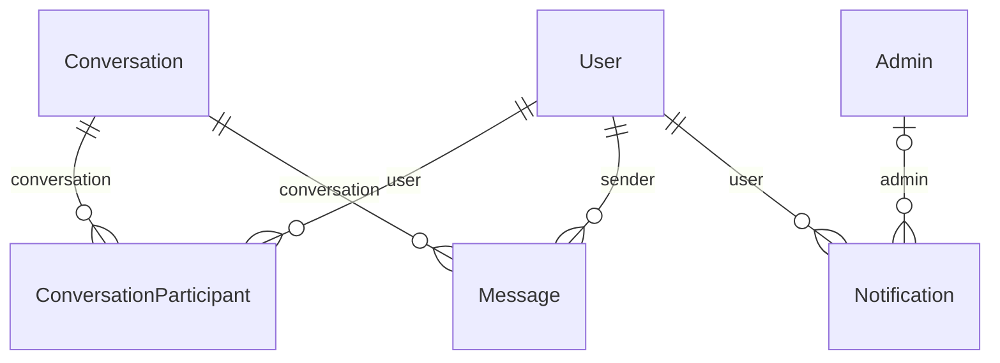

# Messaging & notifications

Conversations, messages and in-app notifications.

:::info[Generated page]

This page is generated by `npm run sync` from `master` of **nextcybr-server**. Do not edit it by hand — changes are overwritten on the next sync.
:::

## Conversation

| Field | Type | Attributes | Notes |
| --- | --- | --- | --- |
| `id` | `String` | @id @default(uuid()) |  |
| `initiatorId` | `String` |  |  |
| `createdAt` | `DateTime` | @default(now()) |  |
| `updatedAt` | `DateTime` | @updatedAt |  |
| `participants` | [ConversationParticipant[]](#conversationparticipant) |  |  |
| `messages` | [Message[]](#message) |  |  |

**Indexes & constraints:** `@@index([initiatorId])`

## ConversationParticipant

| Field | Type | Attributes | Notes |
| --- | --- | --- | --- |
| `id` | `String` | @id @default(uuid()) |  |
| `conversationId` | `String` |  |  |
| `userId` | `String` |  |  |
| `joinedAt` | `DateTime` | @default(now()) |  |
| `conversation` | [Conversation](#conversation) | relation (FK) |  |
| `user` | [User](./identity#user) | relation (FK) |  |

**Indexes & constraints:** `@@unique([conversationId, userId])` · `@@index([userId])`

## Message

| Field | Type | Attributes | Notes |
| --- | --- | --- | --- |
| `id` | `String` | @id @default(uuid()) |  |
| `conversationId` | `String` |  |  |
| `senderId` | `String` |  |  |
| `text` | `String` |  |  |
| `status` | [MessageStatus](./enums#messagestatus) | @default(SENT) |  |
| `readAt` | `DateTime?` |  |  |
| `createdAt` | `DateTime` | @default(now()) |  |
| `conversation` | [Conversation](#conversation) | relation (FK) |  |
| `sender` | [User](./identity#user) | relation (FK) |  |

**Indexes & constraints:** `@@index([conversationId])` · `@@index([senderId])` · `@@index([conversationId, createdAt(sort: Desc)])`

## Notification

| Field | Type | Attributes | Notes |
| --- | --- | --- | --- |
| `id` | `String` | @id @default(uuid()) |  |
| `type` | [NotificationType](./enums#notificationtype) | @default(SYSTEM) |  |
| `title` | `String` |  |  |
| `message` | `String` |  |  |
| `priority` | [NotificationPriority](./enums#notificationpriority) | @default(MEDIUM) |  |
| `isRead` | `Boolean` | @default(false) |  |
| `metadata` | `Json?` |  |  |
| `userId` | `String` |  |  |
| `adminId` | `String?` |  |  |
| `createdAt` | `DateTime` | @default(now()) |  |
| `updatedAt` | `DateTime` | @updatedAt |  |
| `admin` | [Admin?](./identity#admin) | relation (FK) |  |
| `user` | [User](./identity#user) | relation (FK) |  |

**Indexes & constraints:** `@@index([userId])` · `@@index([isRead])` · `@@index([priority])` · `@@index([userId, isRead])` · `@@index([userId, createdAt(sort: Desc)])` · `@@index([adminId])`
