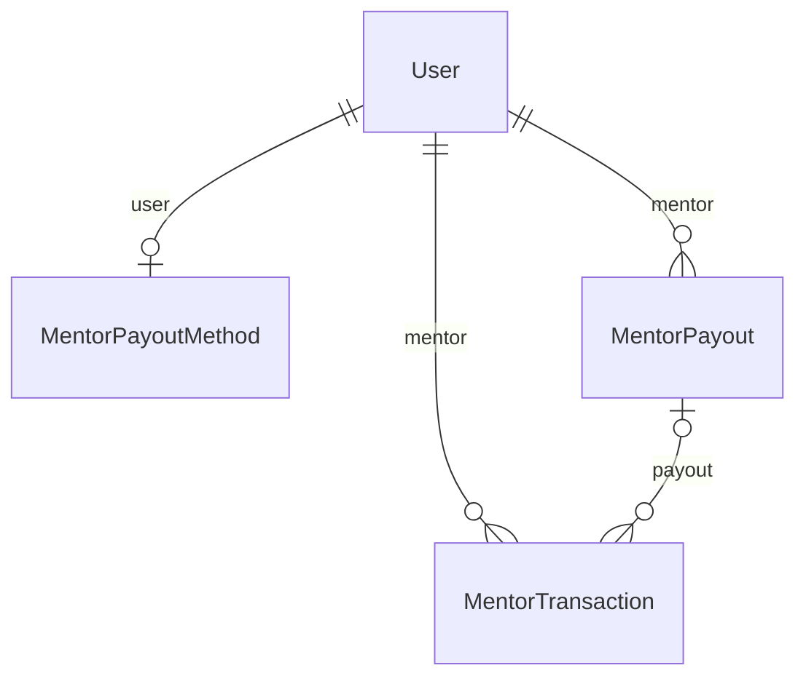

# Mentor payouts

Stripe Connect accounts, the earnings ledger and weekly payouts.

:::info[Generated page]

This page is generated by `npm run sync` from `master` of **nextcybr-server**. Do not edit it by hand — changes are overwritten on the next sync.
:::

## MentorPayoutMethod

| Field | Type | Attributes | Notes |
| --- | --- | --- | --- |
| `id` | `String` | @id @default(uuid()) |  |
| `userId` | `String` | @unique |  |
| `user` | [User](./identity#user) | relation (FK) |  |
| `provider` | `String` |  | e.g. "stripe_connect" |
| `externalAccountId` | `String?` |  |  |
| `status` | `String` | @default("pending") |  |
| `createdAt` | `DateTime` | @default(now()) |  |
| `updatedAt` | `DateTime` | @updatedAt |  |

## MentorTransaction

| Field | Type | Attributes | Notes |
| --- | --- | --- | --- |
| `id` | `String` | @id @default(uuid()) |  |
| `mentorUserId` | `String` |  |  |
| `mentor` | [User](./identity#user) | relation (FK) |  |
| `sourceType` | [TransactionSourceType](./enums#transactionsourcetype) |  |  |
| `sourceId` | `String` |  | Session.id or WebinarRegistration.id |
| `grossAmount` | `Float` |  |  |
| `platformFeeRate` | `Float` |  | e.g. 0.15 or 0.10, captured at transaction time |
| `platformFeeAmount` | `Float` |  |  |
| `processingFeeAmount` | `Float?` |  |  |
| `refundAmount` | `Float?` | @default(0) |  |
| `netAmount` | `Float` |  |  |
| `currency` | `String` | @default("USD") |  |
| `payoutId` | `String?` |  |  |
| `payout` | [MentorPayout?](#mentorpayout) | relation (FK) |  |
| `createdAt` | `DateTime` | @default(now()) |  |

**Indexes & constraints:** `@@unique([sourceType, sourceId])` · `@@index([mentorUserId])` · `@@index([payoutId])`

## MentorPayout

| Field | Type | Attributes | Notes |
| --- | --- | --- | --- |
| `id` | `String` | @id @default(uuid()) |  |
| `mentorUserId` | `String` |  |  |
| `mentor` | [User](./identity#user) | relation (FK) |  |
| `amount` | `Float` |  |  |
| `currency` | `String` | @default("USD") |  |
| `status` | [PayoutStatus](./enums#payoutstatus) | @default(PENDING) |  |
| `stripeTransferId` | `String?` |  | Set once stripe.transfers.create confirms — the handle for reconciling an ambiguous transfer failure by hand. |
| `initiatedAt` | `DateTime` | @default(now()) |  |
| `completedAt` | `DateTime?` |  |  |
| `transactions` | [MentorTransaction[]](#mentortransaction) |  |  |

**Indexes & constraints:** `@@index([mentorUserId])`
