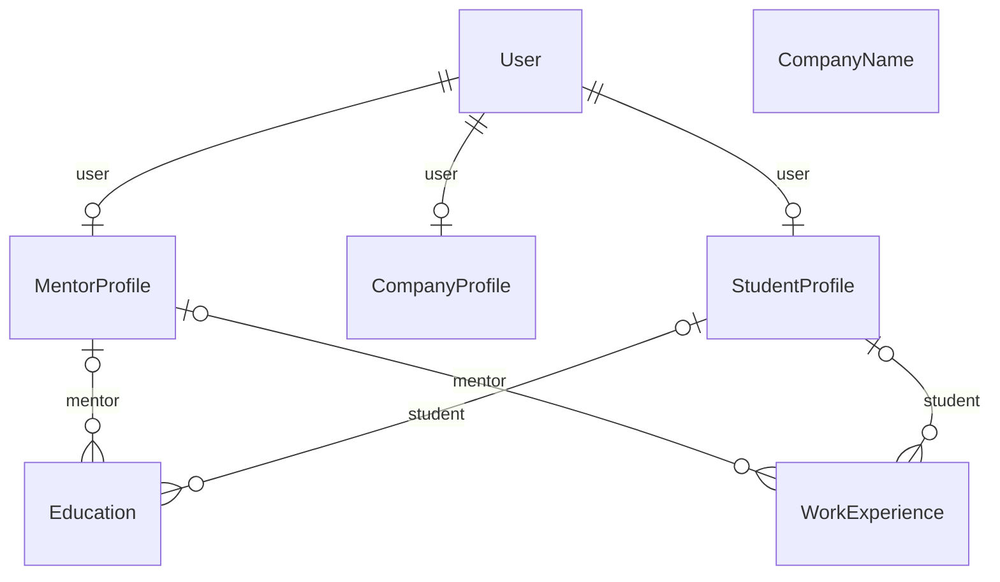

# Profiles

Role-specific profiles and the CV building blocks.

:::info[Generated page]

This page is generated by `npm run sync` from `master` of **nextcybr-server**. Do not edit it by hand — changes are overwritten on the next sync.
:::

## StudentProfile

| Field | Type | Attributes | Notes |
| --- | --- | --- | --- |
| `id` | `String` | @id @default(uuid()) |  |
| `hearAboutUs` | `String` |  |  |
| `gender` | [Gender](./enums#gender) |  |  |
| `nationalities` | `String[]` |  |  |
| `location` | `String` |  |  |
| `country` | `String?` |  | ISO 3166-1 alpha-2 (e.g. "US", "IN", "GB"). Distinct from `location` (free-text) and `nationalities` (citizenship) — used to match/price dynamic entitlement Plans by country. |
| `languages` | `String[]` |  |  |
| `currency` | `String` | @default("USD") |  |
| `remotePolicy` | [RemotePolicy](./enums#remotepolicy) |  |  |
| `certificates` | `String[]` |  |  |
| `skills` | `String[]` |  |  |
| `anonymous` | `Boolean` | @default(false) |  |
| `lookingForWork` | `Boolean` | @default(false) |  |
| `expectedSalary` | `Float?` |  |  |
| `hourlyRate` | `Float?` |  |  |
| `userId` | `String` | @unique |  |
| `createdAt` | `DateTime` | @default(now()) |  |
| `updatedAt` | `DateTime` | @updatedAt |  |
| `profilePicture` | `Json?` |  |  |
| `profileBanner` | `Json?` |  |  |
| `resume` | `Json?` |  |  |
| `profileTagline` | `String?` |  |  |
| `totalExperienceYears` | `Float` | @default(0) |  |
| `workExperienceInYears` | `Float` | @default(0) |  |
| `about` | `String?` |  |  |
| `alternateEmail` | `String?` |  |  |
| `alternatePhoneNumber` | `String?` |  |  |
| `countryCode` | `String?` |  |  |
| `phoneNumber` | `String?` |  |  |
| `profileVisibility` | [ProfileVisibility](./enums#profilevisibility) | @default(PUBLIC) |  |
| `contractType` | [ContractType[]](./enums#contracttype) |  |  |
| `education` | [Education[]](#education) | relation |  |
| `favoritedBy` | [FavoriteCandidate[]](./hiring#favoritecandidate) |  |  |
| `jobApplications` | [JobApplication[]](./hiring#jobapplication) |  |  |
| `oneToOnesessions` | [Session[]](./mentorship#session) |  |  |
| `waitlistEntries` | [SessionWaitlist[]](./mentorship#sessionwaitlist) |  |  |
| `socialLinks` | [SocialLink[]](./identity#sociallink) |  |  |
| `user` | [User](./identity#user) | relation (FK) |  |
| `webinarRegistrations` | [WebinarRegistration[]](./mentorship#webinarregistration) |  |  |
| `workExperience` | [WorkExperience[]](#workexperience) | relation |  |
| `savedJobs` | [SavedJob[]](./hiring#savedjob) |  |  |
| `recruiterNotes` | [RecruiterNote[]](./hiring#recruiternote) |  |  |

## CompanyProfile

| Field | Type | Attributes | Notes |
| --- | --- | --- | --- |
| `id` | `String` | @id @default(uuid()) |  |
| `gender` | [Gender](./enums#gender) |  |  |
| `companyName` | `String` |  |  |
| `companyEmail` | `String` |  |  |
| `companyWebsiteLink` | `String?` |  |  |
| `headquarter` | `String` |  |  |
| `founded` | `String?` | @default("2025") |  |
| `companySize` | `String?` |  |  |
| `industry` | `String?` |  |  |
| `companyTagline` | `String?` |  |  |
| `about` | `String?` |  |  |
| `country` | `String?` |  | ISO 3166-1 alpha-2 (e.g. "US", "IN", "GB"). Distinct from `headquarter` (free-text) — used to match/price dynamic entitlement Plans by country. |
| `userId` | `String` | @unique |  |
| `createdAt` | `DateTime` | @default(now()) |  |
| `updatedAt` | `DateTime` | @updatedAt |  |
| `hearAboutUs` | `String` |  |  |
| `profilePicture` | `Json?` |  |  |
| `profileBanner` | `Json?` |  |  |
| `roleWithCompany` | `String` | @default("Founder") |  |
| `profileTagline` | `String?` |  |  |
| `alternateEmail` | `String?` |  |  |
| `alternatePhoneNumber` | `String?` |  |  |
| `countryCode` | `String?` |  |  |
| `phoneNumber` | `String?` |  |  |
| `profileVisibility` | [ProfileVisibility](./enums#profilevisibility) | @default(PUBLIC) |  |
| `user` | [User](./identity#user) | relation (FK) |  |
| `favoriteCandidates` | [FavoriteCandidate[]](./hiring#favoritecandidate) |  |  |
| `jobs` | [Job[]](./hiring#job) |  |  |
| `socialLinks` | [SocialLink[]](./identity#sociallink) |  |  |
| `customPlans` | [Plan[]](./billing#plan) |  | ORG-scoped custom Plan rows created for this company (dynamic entitlement system). Assumes one active custom plan per company, matching the current 1:1 CompanyProfile.userId constraint — revisit if multi-seat workspaces ship. |
| `recruiterNotes` | [RecruiterNote[]](./hiring#recruiternote) |  |  |
| `jobTemplates` | [JobTemplate[]](./hiring#jobtemplate) |  |  |
| `savedSearches` | [SavedSearch[]](./hiring#savedsearch) |  |  |
| `jobMatchRuns` | [JobMatchRun[]](./hiring#jobmatchrun) |  |  |
| `devSeats` | [EmployeeDevelopmentSeat[]](./hiring#employeedevelopmentseat) |  |  |

## MentorProfile

| Field | Type | Attributes | Notes |
| --- | --- | --- | --- |
| `id` | `String` | @id @default(uuid()) |  |
| `hearAboutUs` | `String` |  |  |
| `gender` | [Gender](./enums#gender) |  |  |
| `nationalities` | `String[]` |  |  |
| `location` | `String` |  |  |
| `country` | `String?` |  | ISO 3166-1 alpha-2 (e.g. "US", "IN", "GB"). Distinct from `location` (free-text) and `nationalities` (citizenship) — used to match/price dynamic entitlement Plans by country. |
| `languages` | `String[]` |  |  |
| `currency` | `String` | @default("USD") |  |
| `certificates` | `String[]` |  |  |
| `skills` | `String[]` |  |  |
| `domain` | `String[]` |  |  |
| `userId` | `String` | @unique |  |
| `createdAt` | `DateTime` | @default(now()) |  |
| `updatedAt` | `DateTime` | @updatedAt |  |
| `profilePicture` | `Json?` |  |  |
| `profileBanner` | `Json?` |  |  |
| `yearsOfExperience` | `Int` | @default(1) |  |
| `timezone` | `String` | @default("UTC") |  |
| `profileTagline` | `String?` |  |  |
| `totalExperienceYears` | `Float` | @default(0) |  |
| `about` | `String?` |  |  |
| `alternateEmail` | `String?` |  |  |
| `alternatePhoneNumber` | `String?` |  |  |
| `countryCode` | `String?` |  |  |
| `phoneNumber` | `String?` |  |  |
| `profileVisibility` | [ProfileVisibility](./enums#profilevisibility) | @default(PUBLIC) |  |
| `education` | [Education[]](#education) | relation |  |
| `favoriteCandidates` | [FavoriteCandidate[]](./hiring#favoritecandidate) |  |  |
| `availability` | [MentorAvailability[]](./mentorship#mentoravailability) |  |  |
| `user` | [User](./identity#user) | relation (FK) |  |
| `socialLinks` | [SocialLink[]](./identity#sociallink) |  |  |
| `workExperience` | [WorkExperience[]](#workexperience) | relation |  |
| `availabilityExceptions` | [MentorAvailabilityException[]](./mentorship#mentoravailabilityexception) |  |  |

## Education

| Field | Type | Attributes | Notes |
| --- | --- | --- | --- |
| `id` | `String` | @id @default(uuid()) |  |
| `institute` | `String` |  |  |
| `level` | [EducationLevel](./enums#educationlevel) |  |  |
| `startDate` | `DateTime` |  |  |
| `endDate` | `DateTime?` |  |  |
| `studentId` | `String?` |  |  |
| `mentorId` | `String?` |  |  |
| `mentor` | [MentorProfile?](#mentorprofile) | relation (FK) |  |
| `student` | [StudentProfile?](#studentprofile) | relation (FK) |  |

**Indexes & constraints:** `@@index([studentId])` · `@@index([mentorId])`

## WorkExperience

| Field | Type | Attributes | Notes |
| --- | --- | --- | --- |
| `id` | `String` | @id @default(uuid()) |  |
| `companyName` | `String` |  |  |
| `jobTitle` | `String` |  |  |
| `description` | `String` |  |  |
| `startDate` | `DateTime` |  |  |
| `endDate` | `DateTime?` |  |  |
| `studentId` | `String?` |  |  |
| `mentorId` | `String?` |  |  |
| `mentor` | [MentorProfile?](#mentorprofile) | relation (FK) |  |
| `student` | [StudentProfile?](#studentprofile) | relation (FK) |  |

**Indexes & constraints:** `@@index([studentId])` · `@@index([mentorId])`

## CompanyName

Employer names offered in the "Company" picker (work experience). Seeded from open data (Wikidata, CC0) plus a curated list; users can add names that aren't listed — those are sanitised first and stored as USER rows.

| Field | Type | Attributes | Notes |
| --- | --- | --- | --- |
| `id` | `String` | @id @default(uuid()) |  |
| `name` | `String` |  |  |
| `nameKey` | `String` | @unique | lowercased, letters/digits only — unique so "AT&T", "at&t" and "AT & T" collapse |
| `rank` | `Int` | @default(1000000) | lower = shown first when nothing has been typed yet |
| `source` | [CompanyNameSource](./enums#companynamesource) | @default(SEED) |  |
| `createdAt` | `DateTime` | @default(now()) |  |

**Indexes & constraints:** `@@index([rank])`
