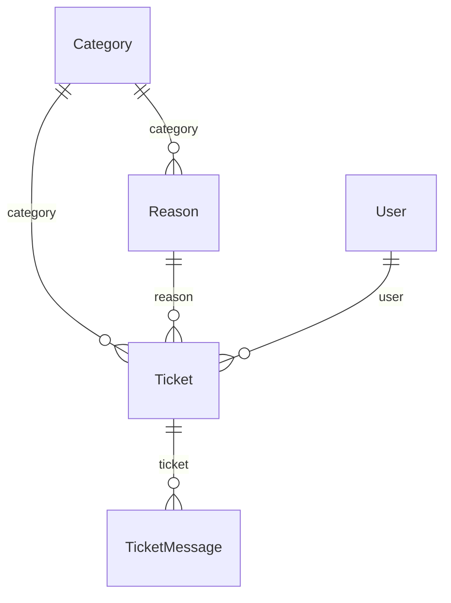

# Support

Help-desk tickets and their category/reason taxonomy.

:::info[Generated page]

This page is generated by `npm run sync` from `master` of **nextcybr-server**. Do not edit it by hand — changes are overwritten on the next sync.
:::

## Category

| Field | Type | Attributes | Notes |
| --- | --- | --- | --- |
| `id` | `String` | @id @default(cuid()) |  |
| `name` | `String` | @unique |  |
| `isActive` | `Boolean` | @default(true) |  |
| `createdAt` | `DateTime` | @default(now()) |  |
| `updatedAt` | `DateTime` | @updatedAt |  |
| `reasons` | [Reason[]](#reason) |  |  |
| `tickets` | [Ticket[]](#ticket) |  |  |

**Indexes & constraints:** `@@index([isActive])`

## Reason

| Field | Type | Attributes | Notes |
| --- | --- | --- | --- |
| `id` | `String` | @id @default(cuid()) |  |
| `categoryId` | `String` |  |  |
| `label` | `String` |  |  |
| `isCustom` | `Boolean` | @default(false) |  |
| `isActive` | `Boolean` | @default(true) |  |
| `createdAt` | `DateTime` | @default(now()) |  |
| `updatedAt` | `DateTime` | @updatedAt |  |
| `category` | [Category](#category) | relation (FK) |  |
| `tickets` | [Ticket[]](#ticket) |  |  |

**Indexes & constraints:** `@@index([categoryId])` · `@@index([isActive])`

## Ticket

| Field | Type | Attributes | Notes |
| --- | --- | --- | --- |
| `id` | `String` | @id @default(cuid()) |  |
| `userId` | `String` |  |  |
| `type` | [TicketType](./enums#tickettype) |  |  |
| `categoryId` | `String` |  |  |
| `reasonId` | `String` |  |  |
| `customReason` | `String?` |  |  |
| `description` | `String` |  |  |
| `screenshots` | `Json?` |  |  |
| `status` | [TicketStatus](./enums#ticketstatus) | @default(OPEN) |  |
| `priority` | [TicketPriority](./enums#ticketpriority) | @default(MEDIUM) |  |
| `supportLevel` | `Int` | @default(0) | The submitter's plan support tier when the ticket was opened (SUPPORT_PRIORITY_LEVEL*: 0 = Standard, 1 = Priority, 2 = Highest). Tie-breaker within a priority so paid plans are answered first. |
| `deletedAt` | `DateTime?` |  | Set when an admin deletes the ticket. Deleted tickets stay in the table but are left out of every user and admin read. |
| `createdAt` | `DateTime` | @default(now()) |  |
| `updatedAt` | `DateTime` | @updatedAt |  |
| `category` | [Category](#category) | relation (FK) |  |
| `reason` | [Reason](#reason) | relation (FK) |  |
| `user` | [User](./identity#user) | relation (FK) |  |
| `messages` | [TicketMessage[]](#ticketmessage) |  |  |

**Indexes & constraints:** `@@index([userId])` · `@@index([status])` · `@@index([priority])` · `@@index([createdAt])` · `@@index([categoryId])` · `@@index([reasonId])`

## TicketMessage

| Field | Type | Attributes | Notes |
| --- | --- | --- | --- |
| `id` | `String` | @id @default(cuid()) |  |
| `ticketId` | `String` |  |  |
| `senderId` | `String` |  |  |
| `senderType` | [TicketSenderType](./enums#ticketsendertype) |  |  |
| `message` | `String` |  |  |
| `createdAt` | `DateTime` | @default(now()) |  |
| `ticket` | [Ticket](#ticket) | relation (FK) |  |

**Indexes & constraints:** `@@index([ticketId])` · `@@index([senderId])`
